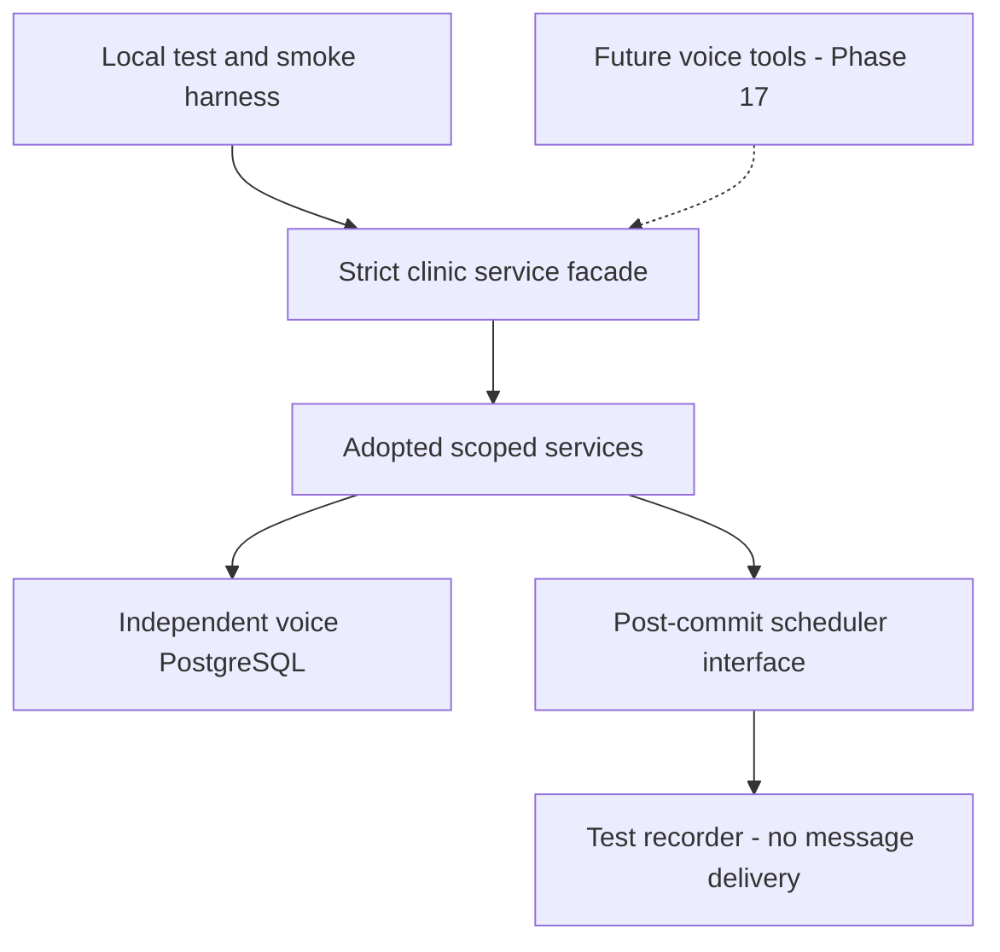

# Clinic Service Adoption — Phase 16

## Phase 17 bilingual reference-data follow-up (2026-10-16)

The local adopted doctor profile now carries reviewed English/Assamese names and aliases through additive migration `0003_chief_purple_man.sql`. The existing `listActiveDoctors` / `findDoctorsByName` services expose the additional metadata and the latter remains the only lookup query implementation. Names are normalized consistently in the organization-scoped catalog, with no fuzzy selection or guessed transliteration. Original contact names, doctor identities, source capacity/transaction/token rules and patient data remain intact. This is a deliberate local adaptation: the original WhatsApp implementation remains separate and unchanged, and its captured hashes continue to describe the source version rather than these local additions. Internal metadata import/readiness is operator-only; dates/times/weekdays already use canonical structured fields, so no duplicate English date columns were added. Full contracts, limitations and retesting instructions are in `CLINIC_VOICE_TOOLS.md`.

Source inspected: `D:/Projects/whatsapp-appointment-platform`. This reference path is provenance only; runtime and normal tests must not read it.

## Approved ownership

**Phase 17 follow-up:** The adopted services now have clinic voice-tool wrappers and a browser worker integration. See `CLINIC_VOICE_TOOLS.md` for current activation/contracts/verification. This document's Phase 16 inventory and original milestone limits remain historical provenance. No original WhatsApp file or runtime was changed.

The voice repository adopts the proven domain code and owns its own clinic data and database. The WhatsApp product stays separate; there is no shared database, synchronization or runtime import. Only internal services and scheduling contracts are in this milestone.

## Source findings

Concrete slots have capacity (default 30), tokens increase per doctor/day, and booking uses a transaction, doctor/day advisory lock, then slot row lock. Source clinic users are patient/staff contacts, not login accounts. Actual WhatsApp flow: language → action → doctor → date → slot → name → age → confirmation. Complaint remains optional. No rescheduling implementation exists. HOW_IT_WORKS describes older single-capacity/complaint behavior; actual source code is authoritative. The complete module/dependency/hash inventory is `backend/test/fixtures/clinic-source-inventory.json`.

## Adopted source and SHA-256 baseline

| Source path | Local clinic target | Original SHA-256 |
|---|---|---|
| `src/common/timezone.ts` | `timezone.ts` | `641c488d9185384c0a6997e391672d95c7989affd8dfeaf342f5653c4c6092c5` |
| `src/components/appointments/queue/schedule-reminder.ts` | `notifications/schedule-reminder.ts` | `1e4af4515dffcc14aed58babd1db4506e933076b4e6be4b28c402535b7a760f5` |
| `src/components/appointments/services/create-appointment.ts` | `services/create-appointment.ts` | `decd845f0df625c30d3fa147bd204dcb21a0029971dc53cf09e6bcafd34df958` |
| `src/components/appointments/services/list-upcoming-for-patient.ts` | `services/list-upcoming-for-patient.ts` | `b8bb8b1d1e5a9c0dcc57c23d8c82a616e20101dd6ac9e86cee2344b2fe5890c5` |
| `src/components/appointments/services/mark-appointment-status.ts` | `services/cancel-appointment.ts (cancellation only)` | `72caf425e74ff1b5ff45fbcfabc6d955b1c9bf82cfee04b775cc9e2e647a548f` |
| `src/components/booking/services/get-or-create-patient.ts` | `services/get-or-create-patient.ts` | `b18eaef2e4eba08fa099a32f4c74f719d3e304baaab3471daade3ff8063d6465` |
| `src/components/doctors/services/block-date.ts` | `services/block-date.ts` | `12860ab537471bfff08eb04aa5b367a9c5b002aa056710ba707b1853c591a247` |
| `src/components/doctors/services/find-doctor-by-name.ts` | `services/find-doctor-by-name.ts` | `2c76c33701fd95827a8b4de7386ef4535157733c17781de4954d7374258511b1` |
| `src/components/doctors/services/list-active-doctors.ts` | `services/list-active-doctors.ts` | `7d7cd5b979c3f3d55bebdebf125b388f4ea06080d76f053a5fb475311366ef96` |
| `src/components/notifications/queue/schedule-booking-alert.ts` | `notifications/schedule-booking-alert.ts` | `e519c6d972650c23590c1bffd4458f047065b23e1ece0328600bfa331a325ddc` |
| `src/components/slots/services/generate-slots.ts` | `services/generate-slots.ts` | `19d6fe787a8577ff8f7c5bd45f4fba4126c9f2a3b9f1b345013322e6cf7c20e0` |
| `src/components/slots/services/list-available-dates.ts` | `services/list-available-dates.ts` | `08e09393db1af82c72261b0e2b83eee3015766fcc51f25b6d8522ace437bda38` |
| `src/components/slots/services/list-available-slots.ts` | `services/list-available-slots.ts` | `0d12af7544d9de97060107847539b2b3c05d5df4a08c5b8cef37fd2ba82c46ae` |
| `src/lib/db/models/appointments.ts` | `models/appointments.ts` | `a7e6fab28361a0897fda21556b28251202f99eb433f017ef40f5398a4617368a` |
| `src/lib/db/models/blocked-dates.ts` | `models/blocked-dates.ts` | `b72d93dda6b90570a9e6e3b0cfcd04d7324877b6b275cf3f58e2f15b129e5d68` |
| `src/lib/db/models/doctors.ts` | `models/doctors.ts` | `9c2408a96a0e8826e8ff040eaf2b8de201a59904f85d3649c514b7d565eadb67` |
| `src/lib/db/models/enums.ts` | `models/enums.ts (clinic subset)` | `9d1efce8362a07dabf3ddb01afc02a546ea0b4cdb7dcd7bf3d19e9776e1bdcde` |
| `src/lib/db/models/slots.ts` | `models/slots.ts` | `40279fbc48191cbbfbd1fc1762a3eafad24796234cab3e620e0bf0f1b9b27a51` |
| `src/lib/db/models/tenants.ts` | `models/settings.ts + existing organizations` | `849edbc1c94148fa2a315b997fad5e7adac0aa37cd6feb75ccc24bec238b64c8` |
| `src/lib/db/models/users.ts` | `models/people.ts` | `34a53f9aeb281cac756673fdac05ee0301b974634cf098a03815e38af3f697a1` |

## Integration architecture and local layout



The selected boundary is local shared domain services inside this repository. No source folder, source backend or source database is needed at runtime or by normal tests. No live data is imported. One clinic domain here serves future channels through a source value; that value does not install a transport. The original WhatsApp system continues independently.

```text
backend/src/components/clinic/
├── index.ts                 validated, immutable server-bound facade
├── contracts/               inputs.ts, results.ts, errors.ts
├── models/                  adopted clinic tables and enum subset
├── services/                existing operation names, scoped to organization
│   └── runtime.ts           clinic/patient/doctor guards and shared day lock
├── notifications/           scheduling interface, timing rules, test recorder
└── timezone.ts              source Intl approach plus local-day/DST validation

backend/src/lib/db/
├── models/index.ts          exports existing and adopted models
├── db.ts                    existing application client and hook export
└── transaction-with-hooks.ts  existing hook pattern extracted for injection

backend/drizzle/migrations/0001_lucky_daredevil.sql
backend/test/clinic.test.ts
backend/test/clinic-db.test.ts
backend/test/clinic-test-db.ts
backend/test/clinic-smoke.ts
backend/test/fixtures/clinic-source-inventory.json
backend/test/fixtures/clinic-business-characterization.json
```

## Service mapping and deliberate adaptations

| Existing capability | Adopted behavior | Necessary adaptation |
|---|---|---|
| Active doctor listing/name lookup | Source joins clinic doctors to contacts; partial search returns all matches | Organization-scoped joins, literal wildcard escaping, ambiguity retained |
| Dates/slots | Concrete rows ordered by date/time; available capacity only | Check actual booked counts, blocked-date records, active doctor and clinic-local future time |
| Patient lookup/creation | Organization/phone uniqueness and conflict-safe insert/re-read | Do not accept an existing ORM row; reject a staff contact used as a patient |
| Booking | Capacity count, max-token-plus-one and transaction/advisory/slot locking | Verify relationships, active clinic/doctor and patient role; derive date/time from the locked slot |
| Upcoming appointments | Stored doctor/date/time/token summaries | Scope patient/joins; use clinic-local day and omit elapsed appointments |
| Cancellation | Cancel appointment and free remaining capacity | Bind verified patient context, derive slot, use day/slot locks, retain terminal slot states and make repeated cancellation safe |
| Slot generation | Expand weekdays/time windows into concrete dates, skip duplicates and partial intervals | Use civil dates in clinic timezone, validate limits, preserve blocked dates and use the shared day lock |
| Date block/unblock | Block slots and cancel booked appointments; reopen blocked timings | Make all mutations transactional and scoped; retain cancelled slots and recheck capacity on reopening |
| Reminders/doctor alerts | Reminder 24 hours before clinic-local appointment, alert immediately | Inject a scheduler; execute after commit; report disabled/skipped/unconfigured/failed outcomes |
| Timezone helper | Built-in Intl conversion, no added library | Validate actual wall-clock conversion; reject DST gaps/overlaps; avoid host/UTC day assumptions |

Source tables, enum names and constraints receive a clinic prefix. `tenantId` becomes `organizationId`; source `users` become `clinic_people` and doctor `userId` becomes `personId`. Name/status/timezone use existing organizations; the two source notification switches become clinic settings. Composite tenant foreign keys and value checks add enforcement at the database boundary. The voice project's existing common UUID/timestamp conventions are reused rather than copying source infrastructure or its migration journal. No extra patients, recurring schedules, login accounts or second booking service are created.

`source` and nullable UUID `call_id` are additive server-owned appointment metadata. Call correlation has no permanent call record or FK yet. Age is explicitly required and accepts 0–120, matching the actual source booking step; complaint is optional. The source IVR adapter's fabricated age/name/complaint defaults are excluded.

The original source services rely on transport callers for some tenant checks and accept a caller-supplied date/time or cancellation slot. Those trust assumptions are tightened only in the adopted copy. Original code is unchanged. Parameterized SQL for advisory locking and count/max aggregates preserves the source algorithm; operation values never become executable SQL. Test-only trigger DDL verifies rollback in a dedicated database.

## Server contracts and trust

Use `createClinicServices(identity, dependencies)` from the internal server, with an injected Drizzle database, the existing transaction-hook pattern, Winston logger, optional clock and optional scheduler. Detailed operation inputs/results are in `DATA_MODEL_AND_API_CONTRACT.md`.

Identity is an immutable copy of organization ID, source, optional call UUID and optional verified patient ID. It is not authentication: future adapters must first verify organization/staff access and patient ownership. An unbound patient ID represents a trusted operator/service caller. A bound patient identity cannot switch patients or run operator generation/blocking. Cancellation always requires a bound patient identity. Looking up a phone number does not prove ownership.

Each operation validates a strict input object before execution, reloads clinic status/type/timezone, scopes related IDs, validates JSON-only successful results and returns the existing success/error envelope. Names, phones, ages, complaints and raw exception/query/provider payloads are omitted from structured logs. Input errors and expected conflicts have stable safe codes; unexpected exceptions return `CLINIC_OPERATION_FAILED`.

Successful booking is distinct from notification configuration:

```json
{
  "success": true,
  "data": {
    "status": "booked",
    "notifications": {
      "reminder": "unconfigured",
      "doctorAlert": "unconfigured"
    }
  }
}
```

This shortened example omits appointment IDs, token/date/time/timezone fields for readability. Scheduling outcomes are `scheduled`, `disabled`, `skipped_window`, `unconfigured` or `failed`. The recorder is only a test adapter. No delivery worker, durable queue, reminder-sent update or message send is implemented. A future scheduler must persist accepted jobs and a delivery worker must recheck status/current settings. Scheduling is post-commit rather than an outbox: crash recovery and durable notification guarantees are deferred. A scheduler failure leaves the committed appointment successful and never reruns booking.

## How to test

Start this project's local PostgreSQL/Redis through its existing Docker Compose setup. From the repository root:

```powershell
npm --prefix backend run test:clinic
npm --prefix backend run test:clinic:db
npm --prefix backend run smoke:clinic
npm --prefix backend run typecheck:clinic-tests
```

The first command is offline and needs no database, credentials, .env or source repository. Database/smoke scripts use this repository's .env for local connection settings and target `voice_agent_clinic_test`, never the configured application database. An optional `CLINIC_TEST_DATABASE_URL` must be loopback and have that exact name or an underscore suffix. The harness checks the name/host before creation or migration, preserves existing test data and removes only its generated synthetic organizations. It never drops a database or migrates the original WhatsApp database.

The additive migration is checked into this repository and applied by the test harness. It was not applied to the main voice application database during this milestone. When these services are deployed later, the existing `db:migrate` command applies it against that deployment's chosen voice database.

Smoke flow: doctors → available dates → slots → patient → booking → upcoming appointment → cancellation → capacity reopened. Its final JSON reports the test database, checks, token, scheduling outcomes, recorded jobs and `deliveredMessages: 0`. No LLM/STT/TTS or paid service is called. The frontend is not connected to these services yet; talking to the current voice demo cannot verify real booking.

## Verification and limits

- Offline clinic contract/timezone/scheduling/boundary tests: **12/12**.
- PostgreSQL service/concurrency/rollback/tenant/characterization tests: **24/24**.
- Smoke booking/lookup/cancellation: **passes**, recording two jobs and delivering zero messages.
- Existing authentication regressions: **6/6**, using login fixtures in the isolated test database and local Redis.
- Tools **27/27**, engine **37/37**, agent **5/5**, LLM **8 offline passes / 1 live-cloud skip**, voice loop **8/8**, barge-in **20/20**, listening/dictation **24/24**.
- Strict clinic-test and engine/tool-test typechecks, backend typecheck/build and frontend typecheck: **pass**.
- Original WhatsApp project typecheck: **passes**. SHA-256 comparison of all **174 inventoried files** reports **zero changes**.

The source-derived fixture exercises the same capacity/token/cancellation outcomes for WhatsApp, voice and manual source metadata through the same local services. It characterizes shared business behavior; it does not execute the original WhatsApp conversation transport or prove a live Meta/Exotel end-to-end session. The original application and flow were not edited.

There is no automatic booking retry or durable request idempotency. Repeated distinct booking requests can create distinct appointments up to capacity, as in the original service. Future voice confirmation/replay handling must resolve that before enabling real actions. Staff HTTP authorization, patient-ownership verification, real notification delivery, rescheduling, clinic HTTP endpoints and live voice acceptance remain outside this milestone. No HTTP endpoint changed; Bruno changes were unnecessary. No dependencies were added/upgraded and no Git commands were run.

Service adoption is complete after these checks. **Overall Phase 16 remains IN PROGRESS** for API/database and rescheduling acceptance; **Phase 17 is NOT STARTED**.

## Complete source module classification

“Reused” means the equivalent infrastructure already exists here; source infrastructure is not copied. All other listed source modules are either adapted or excluded. Imports and exported operations for each entry are recorded in the JSON inventory.

| Source module | Decision | Reason |
|---|---|---|
| `src/app.ts` | excluded | Existing voice runtime/utilities are retained; this source module is not needed by the selected domain subset. |
| `src/common/day-of-week.ts` | excluded | Existing voice runtime/utilities are retained; this source module is not needed by the selected domain subset. |
| `src/common/format.ts` | excluded | Existing voice runtime/utilities are retained; this source module is not needed by the selected domain subset. |
| `src/common/timezone.ts` | adapted | Adopt domain behavior; bind organization scope, existing infrastructure and channel-neutral contracts. |
| `src/common/wa-link.ts` | excluded | Existing voice runtime/utilities are retained; this source module is not needed by the selected domain subset. |
| `src/components/admin/index.ts` | excluded | Retain existing voice authentication/membership; do not import source admin sessions or routes. |
| `src/components/admin/login-rate-limit.ts` | excluded | Retain existing voice authentication/membership; do not import source admin sessions or routes. |
| `src/components/admin/middleware.ts` | excluded | Retain existing voice authentication/membership; do not import source admin sessions or routes. |
| `src/components/admin/routes.ts` | excluded | Retain existing voice authentication/membership; do not import source admin sessions or routes. |
| `src/components/admin/schemas/index.ts` | excluded | Retain existing voice authentication/membership; do not import source admin sessions or routes. |
| `src/components/admin/schemas/login.schema.ts` | excluded | Retain existing voice authentication/membership; do not import source admin sessions or routes. |
| `src/components/admin/schemas/tenant.schema.ts` | excluded | Retain existing voice authentication/membership; do not import source admin sessions or routes. |
| `src/components/admin/services/get-admin-by-id.ts` | excluded | Retain existing voice authentication/membership; do not import source admin sessions or routes. |
| `src/components/admin/services/login.ts` | excluded | Retain existing voice authentication/membership; do not import source admin sessions or routes. |
| `src/components/admin/session-store.ts` | excluded | Retain existing voice authentication/membership; do not import source admin sessions or routes. |
| `src/components/admin/session-types.d.ts` | excluded | Retain existing voice authentication/membership; do not import source admin sessions or routes. |
| `src/components/appointments/index.ts` | excluded | Dashboard/read models, routes and additional CRUD/status operations are outside the selected service subset. |
| `src/components/appointments/queue/index.ts` | excluded | Real queue/delivery workers and morning summaries are deferred; only reminder/booking-alert scheduling ports are adopted. |
| `src/components/appointments/queue/reminder-worker.ts` | excluded | Real queue/delivery workers and morning summaries are deferred; only reminder/booking-alert scheduling ports are adopted. |
| `src/components/appointments/queue/schedule-reminder.ts` | adapted | Adopt domain behavior; bind organization scope, existing infrastructure and channel-neutral contracts. |
| `src/components/appointments/routes.ts` | excluded | Dashboard/read models, routes and additional CRUD/status operations are outside the selected service subset. |
| `src/components/appointments/schemas/appointment.schema.ts` | excluded | Dashboard/read models, routes and additional CRUD/status operations are outside the selected service subset. |
| `src/components/appointments/schemas/index.ts` | excluded | Dashboard/read models, routes and additional CRUD/status operations are outside the selected service subset. |
| `src/components/appointments/schemas/search.schema.ts` | excluded | Dashboard/read models, routes and additional CRUD/status operations are outside the selected service subset. |
| `src/components/appointments/services/create-appointment.ts` | adapted | Adopt domain behavior; bind organization scope, existing infrastructure and channel-neutral contracts. |
| `src/components/appointments/services/find-todays-appointment-by-token.ts` | excluded | Dashboard/read models, routes and additional CRUD/status operations are outside the selected service subset. |
| `src/components/appointments/services/get-clinic-dashboard.ts` | excluded | Dashboard/read models, routes and additional CRUD/status operations are outside the selected service subset. |
| `src/components/appointments/services/index.ts` | excluded | Dashboard/read models, routes and additional CRUD/status operations are outside the selected service subset. |
| `src/components/appointments/services/list-todays-appointments.ts` | excluded | Dashboard/read models, routes and additional CRUD/status operations are outside the selected service subset. |
| `src/components/appointments/services/list-upcoming-for-patient.ts` | adapted | Adopt domain behavior; bind organization scope, existing infrastructure and channel-neutral contracts. |
| `src/components/appointments/services/mark-appointment-status.ts` | adapted | Adopt domain behavior; bind organization scope, existing infrastructure and channel-neutral contracts. |
| `src/components/appointments/services/search-appointments.ts` | excluded | Dashboard/read models, routes and additional CRUD/status operations are outside the selected service subset. |
| `src/components/booking/handle-booking-message.ts` | excluded | WhatsApp conversation ladder and wording remain in the source product; domain call sequence is characterized in tests. |
| `src/components/booking/index.ts` | excluded | WhatsApp conversation ladder and wording remain in the source product; domain call sequence is characterized in tests. |
| `src/components/booking/messages.ts` | excluded | WhatsApp conversation ladder and wording remain in the source product; domain call sequence is characterized in tests. |
| `src/components/booking/services/conversation-state.ts` | excluded | WhatsApp conversation ladder and wording remain in the source product; domain call sequence is characterized in tests. |
| `src/components/booking/services/get-or-create-patient.ts` | adapted | Adopt domain behavior; bind organization scope, existing infrastructure and channel-neutral contracts. |
| `src/components/booking/services/index.ts` | excluded | WhatsApp conversation ladder and wording remain in the source product; domain call sequence is characterized in tests. |
| `src/components/booking/services/session-manager.ts` | excluded | WhatsApp conversation ladder and wording remain in the source product; domain call sequence is characterized in tests. |
| `src/components/booking/steps/back.ts` | excluded | WhatsApp conversation ladder and wording remain in the source product; domain call sequence is characterized in tests. |
| `src/components/booking/steps/confirm-booking.ts` | excluded | WhatsApp conversation ladder and wording remain in the source product; domain call sequence is characterized in tests. |
| `src/components/booking/steps/enter-age.ts` | excluded | WhatsApp conversation ladder and wording remain in the source product; domain call sequence is characterized in tests. |
| `src/components/booking/steps/enter-complaint.ts` | excluded | WhatsApp conversation ladder and wording remain in the source product; domain call sequence is characterized in tests. |
| `src/components/booking/steps/enter-name.ts` | excluded | WhatsApp conversation ladder and wording remain in the source product; domain call sequence is characterized in tests. |
| `src/components/booking/steps/idle.ts` | excluded | WhatsApp conversation ladder and wording remain in the source product; domain call sequence is characterized in tests. |
| `src/components/booking/steps/index.ts` | excluded | WhatsApp conversation ladder and wording remain in the source product; domain call sequence is characterized in tests. |
| `src/components/booking/steps/select-action.ts` | excluded | WhatsApp conversation ladder and wording remain in the source product; domain call sequence is characterized in tests. |
| `src/components/booking/steps/select-date.ts` | excluded | WhatsApp conversation ladder and wording remain in the source product; domain call sequence is characterized in tests. |
| `src/components/booking/steps/select-doctor.ts` | excluded | WhatsApp conversation ladder and wording remain in the source product; domain call sequence is characterized in tests. |
| `src/components/booking/steps/select-language.ts` | excluded | WhatsApp conversation ladder and wording remain in the source product; domain call sequence is characterized in tests. |
| `src/components/booking/steps/select-slot.ts` | excluded | WhatsApp conversation ladder and wording remain in the source product; domain call sequence is characterized in tests. |
| `src/components/booking/steps/shared.ts` | excluded | WhatsApp conversation ladder and wording remain in the source product; domain call sequence is characterized in tests. |
| `src/components/booking/types.ts` | excluded | WhatsApp conversation ladder and wording remain in the source product; domain call sequence is characterized in tests. |
| `src/components/doctors/index.ts` | excluded | Dashboard/read models, routes and additional CRUD/status operations are outside the selected service subset. |
| `src/components/doctors/routes.ts` | excluded | Dashboard/read models, routes and additional CRUD/status operations are outside the selected service subset. |
| `src/components/doctors/services/block-date.ts` | adapted | Adopt domain behavior; bind organization scope, existing infrastructure and channel-neutral contracts. |
| `src/components/doctors/services/copy-doctor-slots.ts` | excluded | Dashboard/read models, routes and additional CRUD/status operations are outside the selected service subset. |
| `src/components/doctors/services/create-doctor-slot.ts` | excluded | Dashboard/read models, routes and additional CRUD/status operations are outside the selected service subset. |
| `src/components/doctors/services/delete-doctor-slot.ts` | excluded | Dashboard/read models, routes and additional CRUD/status operations are outside the selected service subset. |
| `src/components/doctors/services/find-doctor-by-name.ts` | adapted | Adopt domain behavior; bind organization scope, existing infrastructure and channel-neutral contracts. |
| `src/components/doctors/services/get-doctor-by-user-id.ts` | excluded | Dashboard/read models, routes and additional CRUD/status operations are outside the selected service subset. |
| `src/components/doctors/services/get-doctor-schedule.ts` | excluded | Dashboard/read models, routes and additional CRUD/status operations are outside the selected service subset. |
| `src/components/doctors/services/index.ts` | excluded | Dashboard/read models, routes and additional CRUD/status operations are outside the selected service subset. |
| `src/components/doctors/services/list-active-doctors.ts` | adapted | Adopt domain behavior; bind organization scope, existing infrastructure and channel-neutral contracts. |
| `src/components/doctors/services/list-clinic-doctors.ts` | excluded | Dashboard/read models, routes and additional CRUD/status operations are outside the selected service subset. |
| `src/components/doctors/services/list-doctor-date-slots.ts` | excluded | Dashboard/read models, routes and additional CRUD/status operations are outside the selected service subset. |
| `src/components/doctors/services/update-doctor-slot.ts` | excluded | Dashboard/read models, routes and additional CRUD/status operations are outside the selected service subset. |
| `src/components/doctors/services/upsert-doctor-schedule.ts` | excluded | Dashboard/read models, routes and additional CRUD/status operations are outside the selected service subset. |
| `src/components/ivr/controllers/ivr.controller.ts` | excluded | Exotel transport, DTMF state and SMS are excluded; shared booking dependencies were traced. |
| `src/components/ivr/index.ts` | excluded | Exotel transport, DTMF state and SMS are excluded; shared booking dependencies were traced. |
| `src/components/ivr/middlewares/ip-allowlist.middleware.ts` | excluded | Exotel transport, DTMF state and SMS are excluded; shared booking dependencies were traced. |
| `src/components/ivr/routes/ivr.routes.ts` | excluded | Exotel transport, DTMF state and SMS are excluded; shared booking dependencies were traced. |
| `src/components/ivr/schemas/ivr.schema.ts` | excluded | Exotel transport, DTMF state and SMS are excluded; shared booking dependencies were traced. |
| `src/components/ivr/services/booking.service.ts` | excluded | Exotel transport, DTMF state and SMS are excluded; shared booking dependencies were traced. |
| `src/components/ivr/services/ivr-flow.service.ts` | excluded | Exotel transport, DTMF state and SMS are excluded; shared booking dependencies were traced. |
| `src/components/ivr/services/prompts.service.ts` | excluded | Exotel transport, DTMF state and SMS are excluded; shared booking dependencies were traced. |
| `src/components/ivr/services/resolve-tenant.service.ts` | excluded | Exotel transport, DTMF state and SMS are excluded; shared booking dependencies were traced. |
| `src/components/ivr/services/session.service.ts` | excluded | Exotel transport, DTMF state and SMS are excluded; shared booking dependencies were traced. |
| `src/components/ivr/services/sms.service.ts` | excluded | Exotel transport, DTMF state and SMS are excluded; shared booking dependencies were traced. |
| `src/components/ivr/services/xml.service.ts` | excluded | Exotel transport, DTMF state and SMS are excluded; shared booking dependencies were traced. |
| `src/components/notifications/queue/index.ts` | excluded | Real queue/delivery workers and morning summaries are deferred; only reminder/booking-alert scheduling ports are adopted. |
| `src/components/notifications/queue/notification-worker.ts` | excluded | Real queue/delivery workers and morning summaries are deferred; only reminder/booking-alert scheduling ports are adopted. |
| `src/components/notifications/queue/schedule-booking-alert.ts` | adapted | Adopt domain behavior; bind organization scope, existing infrastructure and channel-neutral contracts. |
| `src/components/notifications/queue/sync-morning-summary-schedulers.ts` | excluded | Real queue/delivery workers and morning summaries are deferred; only reminder/booking-alert scheduling ports are adopted. |
| `src/components/qr/index.ts` | excluded | Report delivery and QR presentation are unrelated to this adoption. |
| `src/components/qr/routes.ts` | excluded | Report delivery and QR presentation are unrelated to this adoption. |
| `src/components/qr/services/generate-qr.ts` | excluded | Report delivery and QR presentation are unrelated to this adoption. |
| `src/components/qr/services/get-clinic-qr.ts` | excluded | Report delivery and QR presentation are unrelated to this adoption. |
| `src/components/qr/templates/poster-template.ts` | excluded | Report delivery and QR presentation are unrelated to this adoption. |
| `src/components/qr/types.ts` | excluded | Report delivery and QR presentation are unrelated to this adoption. |
| `src/components/reports/queue/enqueue-report-delivery.ts` | excluded | Report delivery and QR presentation are unrelated to this adoption. |
| `src/components/reports/queue/index.ts` | excluded | Report delivery and QR presentation are unrelated to this adoption. |
| `src/components/reports/queue/report-worker.ts` | excluded | Report delivery and QR presentation are unrelated to this adoption. |
| `src/components/slots/services/generate-slots.ts` | adapted | Adopt domain behavior; bind organization scope, existing infrastructure and channel-neutral contracts. |
| `src/components/slots/services/index.ts` | excluded | Existing voice runtime/utilities are retained; this source module is not needed by the selected domain subset. |
| `src/components/slots/services/list-available-dates.ts` | adapted | Adopt domain behavior; bind organization scope, existing infrastructure and channel-neutral contracts. |
| `src/components/slots/services/list-available-slots.ts` | adapted | Adopt domain behavior; bind organization scope, existing infrastructure and channel-neutral contracts. |
| `src/components/staff/commands/block.ts` | excluded | WhatsApp command routing remains separate; underlying clinic domain is adopted where needed. |
| `src/components/staff/commands/cancel.ts` | excluded | WhatsApp command routing remains separate; underlying clinic domain is adopted where needed. |
| `src/components/staff/commands/done.ts` | excluded | WhatsApp command routing remains separate; underlying clinic domain is adopted where needed. |
| `src/components/staff/commands/index.ts` | excluded | WhatsApp command routing remains separate; underlying clinic domain is adopted where needed. |
| `src/components/staff/commands/noshow.ts` | excluded | WhatsApp command routing remains separate; underlying clinic domain is adopted where needed. |
| `src/components/staff/commands/report.ts` | excluded | WhatsApp command routing remains separate; underlying clinic domain is adopted where needed. |
| `src/components/staff/commands/slot.ts` | excluded | WhatsApp command routing remains separate; underlying clinic domain is adopted where needed. |
| `src/components/staff/commands/today.ts` | excluded | WhatsApp command routing remains separate; underlying clinic domain is adopted where needed. |
| `src/components/staff/handle-staff-message.ts` | excluded | WhatsApp command routing remains separate; underlying clinic domain is adopted where needed. |
| `src/components/staff/index.ts` | excluded | WhatsApp command routing remains separate; underlying clinic domain is adopted where needed. |
| `src/components/staff/resolve-doctor-scope.ts` | excluded | WhatsApp command routing remains separate; underlying clinic domain is adopted where needed. |
| `src/components/whatsapp/controller.ts` | excluded | Meta webhook, role routing, payload logging and delivery transport are outside local service adoption. |
| `src/components/whatsapp/routes.ts` | excluded | Meta webhook, role routing, payload logging and delivery transport are outside local service adoption. |
| `src/components/whatsapp/schema.ts` | excluded | Meta webhook, role routing, payload logging and delivery transport are outside local service adoption. |
| `src/components/whatsapp/services/apply-status-update.ts` | excluded | Meta webhook, role routing, payload logging and delivery transport are outside local service adoption. |
| `src/components/whatsapp/services/handle-inbound-message.ts` | excluded | Meta webhook, role routing, payload logging and delivery transport are outside local service adoption. |
| `src/components/whatsapp/services/index.ts` | excluded | Meta webhook, role routing, payload logging and delivery transport are outside local service adoption. |
| `src/components/whatsapp/services/log-message.ts` | excluded | Meta webhook, role routing, payload logging and delivery transport are outside local service adoption. |
| `src/components/whatsapp/services/message-router.ts` | excluded | Meta webhook, role routing, payload logging and delivery transport are outside local service adoption. |
| `src/components/whatsapp/services/parse-inbound.ts` | excluded | Meta webhook, role routing, payload logging and delivery transport are outside local service adoption. |
| `src/components/whatsapp/services/resolve-role.ts` | excluded | Meta webhook, role routing, payload logging and delivery transport are outside local service adoption. |
| `src/components/whatsapp/services/resolve-tenant.ts` | excluded | Meta webhook, role routing, payload logging and delivery transport are outside local service adoption. |
| `src/components/whatsapp/services/send-message.ts` | excluded | Meta webhook, role routing, payload logging and delivery transport are outside local service adoption. |
| `src/components/whatsapp/templates.ts` | excluded | Meta webhook, role routing, payload logging and delivery transport are outside local service adoption. |
| `src/components/whatsapp/verify-signature.ts` | excluded | Meta webhook, role routing, payload logging and delivery transport are outside local service adoption. |
| `src/index.ts` | excluded | Existing voice runtime/utilities are retained; this source module is not needed by the selected domain subset. |
| `src/lib/async-handler.ts` | excluded | Existing voice runtime/utilities are retained; this source module is not needed by the selected domain subset. |
| `src/lib/bull/index.ts` | excluded | Real queue/delivery workers and morning summaries are deferred; only reminder/booking-alert scheduling ports are adopted. |
| `src/lib/bull/queues.ts` | excluded | Real queue/delivery workers and morning summaries are deferred; only reminder/booking-alert scheduling ports are adopted. |
| `src/lib/db/db.ts` | reused | Reuse equivalent infrastructure already in the voice repository; do not duplicate source infrastructure. |
| `src/lib/db/index.ts` | excluded | Existing voice runtime/utilities are retained; this source module is not needed by the selected domain subset. |
| `src/lib/db/migrations/0000_colossal_patriot.sql` | excluded | Historical source schema evidence; generate an additive voice migration, not a second migration journal. |
| `src/lib/db/migrations/0001_acoustic_senator_kelly.sql` | excluded | Historical source schema evidence; generate an additive voice migration, not a second migration journal. |
| `src/lib/db/migrations/0002_useful_cassandra_nova.sql` | excluded | Historical source schema evidence; generate an additive voice migration, not a second migration journal. |
| `src/lib/db/migrations/0003_superb_tyrannus.sql` | excluded | Historical source schema evidence; generate an additive voice migration, not a second migration journal. |
| `src/lib/db/migrations/0005_closed_silver_surfer.sql` | excluded | Historical source schema evidence; generate an additive voice migration, not a second migration journal. |
| `src/lib/db/migrations/meta/_journal.json` | excluded | Historical source schema evidence; generate an additive voice migration, not a second migration journal. |
| `src/lib/db/migrations/meta/0000_snapshot.json` | excluded | Historical source schema evidence; generate an additive voice migration, not a second migration journal. |
| `src/lib/db/migrations/meta/0001_snapshot.json` | excluded | Historical source schema evidence; generate an additive voice migration, not a second migration journal. |
| `src/lib/db/migrations/meta/0002_snapshot.json` | excluded | Historical source schema evidence; generate an additive voice migration, not a second migration journal. |
| `src/lib/db/migrations/meta/0003_snapshot.json` | excluded | Historical source schema evidence; generate an additive voice migration, not a second migration journal. |
| `src/lib/db/migrations/meta/0005_snapshot.json` | excluded | Historical source schema evidence; generate an additive voice migration, not a second migration journal. |
| `src/lib/db/models/admin-users.ts` | excluded | Existing voice runtime/utilities are retained; this source module is not needed by the selected domain subset. |
| `src/lib/db/models/appointments.ts` | adapted | Adopt domain behavior; bind organization scope, existing infrastructure and channel-neutral contracts. |
| `src/lib/db/models/blocked-dates.ts` | adapted | Adopt domain behavior; bind organization scope, existing infrastructure and channel-neutral contracts. |
| `src/lib/db/models/common.ts` | reused | Reuse equivalent infrastructure already in the voice repository; do not duplicate source infrastructure. |
| `src/lib/db/models/conversation-state.ts` | excluded | Existing voice runtime/utilities are retained; this source module is not needed by the selected domain subset. |
| `src/lib/db/models/doctors.ts` | adapted | Adopt domain behavior; bind organization scope, existing infrastructure and channel-neutral contracts. |
| `src/lib/db/models/enums.ts` | adapted | Adopt domain behavior; bind organization scope, existing infrastructure and channel-neutral contracts. |
| `src/lib/db/models/index.ts` | excluded | Existing voice runtime/utilities are retained; this source module is not needed by the selected domain subset. |
| `src/lib/db/models/messages.ts` | excluded | Existing voice runtime/utilities are retained; this source module is not needed by the selected domain subset. |
| `src/lib/db/models/reports.ts` | excluded | Existing voice runtime/utilities are retained; this source module is not needed by the selected domain subset. |
| `src/lib/db/models/slots.ts` | adapted | Adopt domain behavior; bind organization scope, existing infrastructure and channel-neutral contracts. |
| `src/lib/db/models/tenants.ts` | adapted | Adopt domain behavior; bind organization scope, existing infrastructure and channel-neutral contracts. |
| `src/lib/db/models/users.ts` | adapted | Adopt domain behavior; bind organization scope, existing infrastructure and channel-neutral contracts. |
| `src/lib/db/seed.ts` | excluded | Operational scripts/audio/seed values are not copied; local synthetic test fixtures exercise adopted services. |
| `src/lib/env.ts` | excluded | Existing voice runtime/utilities are retained; this source module is not needed by the selected domain subset. |
| `src/lib/errors.ts` | reused | Reuse equivalent infrastructure already in the voice repository; do not duplicate source infrastructure. |
| `src/lib/index.ts` | excluded | Existing voice runtime/utilities are retained; this source module is not needed by the selected domain subset. |
| `src/lib/jwt.ts` | excluded | Existing voice runtime/utilities are retained; this source module is not needed by the selected domain subset. |
| `src/lib/logger.ts` | reused | Reuse equivalent infrastructure already in the voice repository; do not duplicate source infrastructure. |
| `src/lib/mutex.ts` | excluded | Existing voice runtime/utilities are retained; this source module is not needed by the selected domain subset. |
| `src/lib/retry.ts` | excluded | Existing voice runtime/utilities are retained; this source module is not needed by the selected domain subset. |
| `src/middlewares/auth.ts` | excluded | Retain existing voice authentication/membership; do not import source admin sessions or routes. |
| `src/middlewares/index.ts` | excluded | Retain existing voice authentication/membership; do not import source admin sessions or routes. |
| `src/scripts/generate-audio.ts` | excluded | Operational scripts/audio/seed values are not copied; local synthetic test fixtures exercise adopted services. |
| `src/scripts/refresh-slots.ts` | excluded | Operational scripts/audio/seed values are not copied; local synthetic test fixtures exercise adopted services. |
| `src/scripts/register-templates.ts` | excluded | Operational scripts/audio/seed values are not copied; local synthetic test fixtures exercise adopted services. |
| `src/scripts/reset-slots.ts` | excluded | Operational scripts/audio/seed values are not copied; local synthetic test fixtures exercise adopted services. |
| `src/scripts/seed-admin-users.ts` | excluded | Operational scripts/audio/seed values are not copied; local synthetic test fixtures exercise adopted services. |
| `src/scripts/test-dynamic-prompt.ts` | excluded | Operational scripts/audio/seed values are not copied; local synthetic test fixtures exercise adopted services. |
| `src/scripts/test-exotel-api-reassign.ts` | excluded | Operational scripts/audio/seed values are not copied; local synthetic test fixtures exercise adopted services. |
| `src/scripts/test-ivr-load.ts` | excluded | Operational scripts/audio/seed values are not copied; local synthetic test fixtures exercise adopted services. |
| `HOW_IT_WORKS.md` | excluded | Reference documentation/build configuration inspected; no runtime dependency. |
| `package.json` | excluded | Reference documentation/build configuration inspected; no runtime dependency. |
| `tsconfig.json` | excluded | Reference documentation/build configuration inspected; no runtime dependency. |
| `drizzle.config.ts` | excluded | Reference documentation/build configuration inspected; no runtime dependency. |
