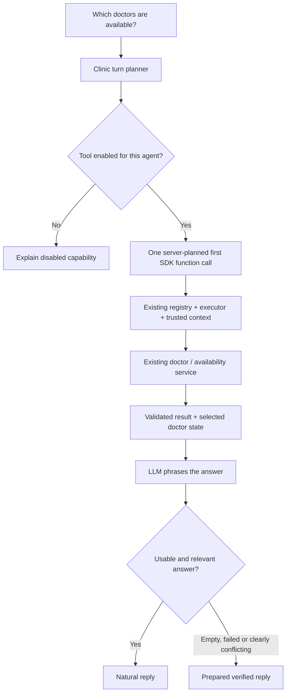
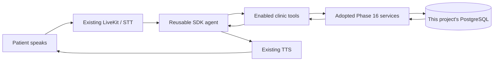
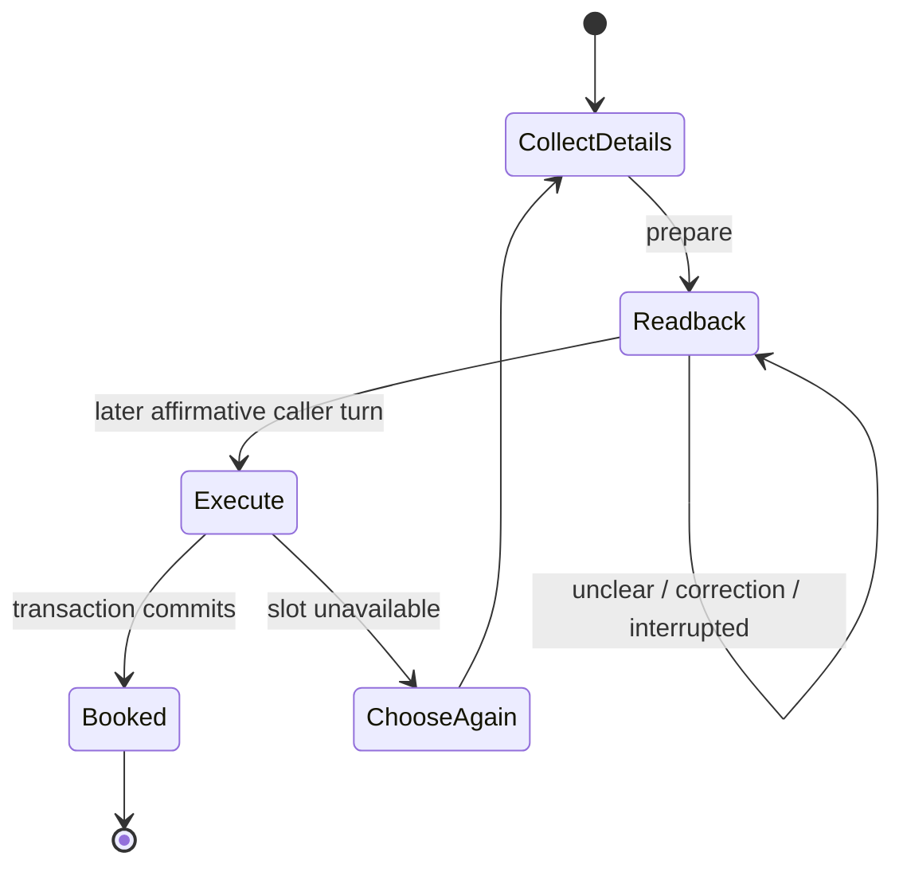

# Phase 17 — Talk to the clinic services 🎙️

## Current checkpoint — booking works; Phase 18 discussion next

On 22 October, the supplied real Assamese call completed booking and announced a token; a scoped database read verified the appointment is booked. Phase 18 is the user's next discussion, with implementation not started. Phase 17 remains IN PROGRESS for broader acceptance: live lookup/cancellation, the latest goodbye retest, intermittent recognition failures, the available-date question routed to doctor listing, a repeated name prompt, genuine speech-quality evaluation and audible latency measurements. Prompt/model/provider tuning remains tracked work. See PROGRESS.md for the current checklist; the earlier pending-live notes below describe their individual implementation milestones.

## After a successful booking — 22 October

The model receives the actual completed outcome/token, no pending action and no required intake field. It may naturally answer “এতিয়া মই ৰাখি দিও নেকি ফোনটো?” with “হয়, আপোনাৰ এপইণ্টমেণ্ট বুক হৈছে। আপুনি ফোনটো ৰাখিব পাৰে।” Correct model wording is kept. Contradictory status, renewed confirmation or wrong numeric receipt details use the verified result instead. A separate cancellation still needs its own readback and later confirmation; saying goodbye never changes or recreates a booking and does not disconnect the call automatically. Start a fresh call after reload to test the corrected conversation lifecycle.

## Age-evidence follow-up — 22 October

The 00:52 age failure was an intake evidence rejection after a completed model response, not a recognition or rate-limit error. The supplied sentence “মোৰ বয়স ২৮ বছৰ।” now passes an SDK regression even if the model quotes `28` and repeats the unchanged retained patient name. Only numeral-script differences are recovered back to the actual source; names and missing speech are not reconstructed. Safe validation logs now identify the evidence field, and VAD timing ranges support the separate recognition investigation. Start a fresh call after the worker reload. Missing/unclear recognition remains a separate live acceptance issue, not a claimed fix.

## Doctor request loop fixed — 22 October

Start a fresh call and say “মই ডঃ বৰুৱাক দেখাব বিচাৰিছোঁ।” The planner now looks up the doctor name alone, and reviewed-name matching accepts `বৰুৱাক`. A successful match selects that actual doctor and asks for a date. An unsuccessful lookup cannot announce a listed alternative as selected or proceed to patient intake. “মোৰ নাম উদয়চিছ বৰা।” remains patient intake even while the system still needs a doctor; it does not trigger another doctor search. Supplied spelling is retained. These scenarios pass SDK/database checks; real microphone acceptance remains separate. Unreviewed or corrupted names are not guessed.

## Current local test setup — 22 October

Open `http://localhost:3000/agents/default/testing`, log in with the existing staff account, select Brahmaputra Health Clinic and start a fresh call with headphones. Book using synthetic details, hear the token, check the appointment and separately confirm cancellation.

The existing local database was verified to contain migration 0004. Both labelled synthetic doctors now have future availability through 4 November; no appointments were created by setup. The worker and frontend were started locally, and the API health/test page returned HTTP 200. Local recognition was restored from the earlier `multi` experiment to `as`; English digit collection and trusted-language confirmations remain. The existing Groq model and TTS adapters were retained. The Raya catalog successfully resolved an Assamese voice; this is connectivity evidence, not voice-quality approval or a synthesis benchmark.

Provider error categories now survive the worker-to-frontend diagnostic message. Transcript/interruption updates are accepted only from agent participants. The former “Total” metric is labelled “Generation” because it excludes the listening pause and playback. Real microphone/provider quality and audible response timings still need acceptance; Phase 17 remains IN PROGRESS. The experiment notes below are historical.

## Retest the 20:17 phone-confirmation regression

The supplied logs show **confirm** for “Right number” at turn 6, followed by a rejected resolver call (`INVALID_TOOL_INPUT`) and a reply stopped by the 384-token completion limit. No-transcript recoveries occurred after returning to `multi`; a missing transcript never reaches the LLM. The precise rejected arguments were not logged, so a particular malformed argument cannot be established from these logs. They also contain short event-loop stalls, which are a separate latency observation rather than a proven explanation for all missing speech.

The resolver now takes **only `{}`**. After a completed phone readback and a later validated confirmation, the server plans that enabled resolver with its retained number, then reuses the resulting patient binding. Fresh facts are supplied before every SDK model call, and approved replies cannot request an already confirmed number again. Partial phone-like speech cannot replace it. Explicit complete corrections still require a new readback and confirmation. Ordinary valid next questions remain model-written.

GPT-OSS now gets at least **1,536 completion tokens** for reasoning plus its short final answer; context fitting reserves the same budget. Low reasoning effort, the short spoken-reply policy and existing timeouts remain. Nonempty `finish_reason: length` replies and length-limited structured decisions are rejected as `incomplete_output`, without replaying executed tools. An entirely empty text result retains the existing single pre-tool recovery allowance.

Restart the worker, start a fresh call, dictate the full phone and let its readback finish. Reply in Assamese that it is correct. The recognition log should now show **conversation/as** during pending confirmation even though normal recognition remains **multi**. After confirmation, expect one successful `resolve_clinic_and_caller` call and a question for the next missing detail, not another phone request. Normal recognition then returns to **multi**. Also test rejecting/replacing the number and interrupting its readback; neither unclear speech nor interruption authorizes an action. Repeat the whole flow with an actual booking/token and cancellation. Microphone/model acceptance is still pending; `multi` remains unsuitable as a claimed Assamese-wide solution.

## Local GPT-OSS-120B + multilingual recognition experiment (17 October)

The requested comparison is enabled in this machine's `backend/.env`: `LLM_PROVIDER=groq`, `GROQ_MODEL=openai/gpt-oss-120b`, `DEEPGRAM_MODEL=nova-3`, `DEEPGRAM_LANGUAGE=multi`. This is a local experiment, not a new benchmark result or production default. Deepgram's documented `multi` language set includes English and Hindi but does not include Assamese. Assamese reply instructions and the current TTS remain in place. Phone dictation uses `en-IN`; pending phone/action confirmations use the trusted session reply language (`as` by default), then restore the configured `multi` baseline after completion.

1. Stop the worker with Ctrl+C, then run `npm run agent:dev` from `backend/`. Start a **fresh** frontend call; an existing worker/session retains its old configuration.
2. Check startup logs for `LLM provider initialized` with `Groq Cloud (openai/gpt-oss-120b)`. Recognition mode changes should show `conversation: multi` and `english-digits: en-IN`.
3. Ask for doctors and choose a returned doctor/date. Try “nine AM”, “ন বজাত ৰাতিপুৱা” and “सुबह नौ बजे” in separate calls. Compare the actual “You (STT)” text, selected-slot badge and reply; do not judge recognition solely from the reply.
4. Give your name/age, explicitly correct the age, dictate a complete phone and confirm its readback. Check that replies stay Assamese and details agree with the badges. Booking still requires its separate action readback and later confirmation.
5. Record provider errors/finish reason if generation fails. GPT-OSS uses low reasoning effort with reasoning excluded from replies and a minimum 1,536-token reasoning/final-output budget; deadlines and short spoken replies remain. Neither reasoning settings nor mocked tests establish live quality.

To revert, set `GROQ_MODEL=qwen/qwen3.8-27b` and `DEEPGRAM_LANGUAGE=as` in `backend/.env`, restart the worker and start another fresh call. The previously identified date-selection, correction-routing and stale post-tool context issues are outside this configuration experiment and may still appear.

## Retest multilingual ages and times (18:45 call follow-up)

Restart the worker and begin a fresh configured clinic call. Keep the reply language Assamese. Ask for doctors, select a returned doctor and a genuinely available date. Then try:

| Input after the relevant question | Expected |
|---|---|
| Time: `nine thirty`, `नौ तीस`, `ন ত্ৰিশ` or `নাইন থাৰ্টি` | Select the returned 09:30 slot if it is the unique matching time. If both AM/PM match, ask which one. Do not select an unavailable slot. |
| Time: `ন বজা`, `ন বজা ন বজা` or `nine nine` | Interpret an unambiguous repeated nine as one hour choice, not 09:09. Only an actual returned matching slot can be selected. |
| Time: `9am` / `9pm` | Respect the period and actual availability. |
| Time: “nine am or ten am” / “not nine am” | Clarify; do not silently select the first time or book anything. |
| After your name, age: `twenty-eight`, `টুৱেণ্টি8`, `बीस eight`, `अट्ठाईस` or `আঠাইশ` | Retain 28 as an unconfirmed age candidate, keep the name/doctor/slot and ask for the next missing detail. English input must not by itself switch the reply language. |
| Correct the age with an explicit complete replacement. | Update the candidate, invalidate any old pending booking draft and require a revised full action readback. |
| Finish phone and booking confirmation. | Hear the actual selected date/time, supplied name, age and phone in the action readback; only a later valid confirmation can create a booking and real token. |

Inspect “You (STT)” first. English spoken words can appear in Assamese script; known phonetic and mixed forms are supported without changing response language. Completely garbled speech still requires clarification. The supplied `টুৱেণ্টি8` failure was an `age_mismatch` validation bug, while earlier short time replies were classified as help. These fixes do not constitute a new live benchmark for unrestricted multilingual STT. Check new provider/microphone results separately from offline SDK and database tests.

## Retest the name loop (18:27 call follow-up)

Restart the worker and begin a **fresh frontend call**. Choose a real doctor and offered future date/time. When asked for the patient's name:

| Say / observe | Expected |
|---|---|
| Give the name alone, as in `উদয়চিছ বড়া` or `দেৱাশিছ বৰা`. | The model selects an exact excerpt; the server retains that spelling and asks for the next missing detail. No requirement to say “my name is.” |
| The STT line ends with `?`. | That punctuation alone must not turn a name answer into a request for help. Terminal speech punctuation can be removed from the selected name; spelling stays unchanged. |
| Ask “What should I say?” instead. | Guidance for the missing field; the request itself is not saved as a patient name. |
| Give name and age together, or give age next. | Both become evidence-linked candidates. Doctor/date/time changes must not erase them. |
| Capture still fails twice. | Focused slow-speech/spelling guidance, rather than endlessly repeating the identical full-name request. No fabricated patient name. |
| Finish phone confirmation and booking readback, then confirm. | Only the existing service's confirmed booking supplies the real token. Check and separately confirm cancellation as before. |

The old turn-10 `name_mismatch` path required the model to write the name twice, as a value and evidence. The model now selects one exact source quote, and the server constructs the stored candidate. Invented excerpts or source turns remain invalid. Deterministic/mock-provider tests prove this boundary; they do not guarantee that a hosted model will always choose the right excerpt or recognize speech perfectly.

An STT score above 80% already qualifies for normal acceptance **when timing and detected speech also qualify**. It is a recognition score, not approval to guess a name or confirm booking. If the STT spelling is wrong, correct it before confirming the booking readback. Useful safe events remain `interpretation_completed`, `Clinic understanding completed`, field-presence flags, outcome and nonProgress; do not log patient text or raw provider output.

## Retest Assamese replies and short confirmation (18:16 call follow-up)

Restart the worker and start a fresh call so old Bengali replies are not part of the recent conversation. Wait for the listening indicator. Say hello, request booking, ask for doctors and choose an actual doctor/date/time. Ordinary replies should use Assamese grammar (for example, `আপুনি`/`আপোনাৰ`) and ask you to **say** details, not type them. English names and common English terms are allowed; Bengali sentences are not the intended reply language. Explicit English/Hindi requests should still switch the conversation language.

When asked for your name, give the name alone. STT punctuation such as a trailing question mark must not by itself disqualify a personal-name answer; the name must remain exactly as captured, not silently respelled. Then give your age. Inspect the patient badge and `Clinic understanding completed` field-presence diagnostics. Earlier failures still require their own intake events to diagnose; the supplied logs begin only once both fields were retained.

After dictating the phone, let its **full readback finish**. An unclear answer should now get a short “Is that number correct, or should it change?” question, without repeating every digit. It remains unconfirmed until a clear later affirmative answer. Interrupting the short question must not erase the completed readback of the unchanged number. Separately test interrupting the original number readback: it must still require the full readback before confirmation. Changing/rejecting/restoring the candidate requires a fresh readback. Booking still needs its own full action readback and confirmation.

In the supplied call, the recognizer did restore `as` after English digits, and the confirmation model returned `unclear` despite some high-confidence STT. Acoustic confidence does not establish semantic agreement. These later logs show no 413/429/provider rejection and do not explain the earlier name loop. The language and name prompt checks use deterministic providers; only a new hosted microphone test establishes live improvement.

## Retest first hello and shorter replies (17 October follow-up)

1. Restart the worker (`npm --prefix backend run agent:dev`) and refresh the frontend. Start a **fresh** configured clinic test session with headphones.
2. Wait for **“Agent listening. You can speak now.”** Room connection alone is not readiness. Say hello once. Expect one recognized greeting and a brief answer. If a final transcript is delayed, the collector now requests finalization and waits one additional bounded 1.5 seconds. A genuine missing transcript can still produce clarification.
3. Ask for doctors, choose Baruah and ask for actual available dates/times. Expect a short answer with one next question; the assistant should not repeatedly reconfirm the selected doctor. “বৰুৱাৰ” can match the approved “বৰুৱা” alias. “আছা” is not automatically substituted for stored “আশা”; choose an offered doctor or import a reviewed alias.
4. Provide name/age before or after selection, then confirm the phone readback. Repeating a booking request after all details are present should prepare the **full action readback**, not loop on “ready to review.” No appointment exists until that readback finishes and you confirm on a later turn. Critical readbacks remain longer so important details are audible.
5. Correct an age without a complete replacement: it must clarify rather than invent missing digits. A complete replacement must survive subsequent doctor/time selections. Use an actually offered date/time; no invented May dates.
6. Complete booking, hear the actual token, then check and separately confirm cancellation. Notification delivery remains unconfigured unless a scheduler is supplied.

If patient capture fails again, collect `interpretation_completed` lines with `stage: intake`, category, finish reason, HTTP status and completion-token count. Do not paste patient values or provider output. The newer supplied 17:49 log showed accepted STT but only `invalid_or_failed`; it does **not** reveal whether evidence/schema validation or another processing step rejected the answer. The earlier 17:27 log explicitly showed 429; they must not be conflated. Initial-hello events were absent from both excerpts, so microphone/hosted-provider acceptance remains necessary.

## Retest early details and age corrections (17 October follow-up)

Restart the worker with `npm --prefix backend run agent:dev` from the repository root and start a **fresh frontend call**. If using `agent:start`, build the backend first. Keep the existing local API, frontend, PostgreSQL, Redis and LiveKit running. Use the configured Brahmaputra clinic test profile and headphones. This follow-up does not change the database or seed new appointments.

Ordinary replies should come from the configured model; exact wording can vary. Verified phone/action readbacks and exceptional recovery remain deliberately controlled.

| Try this | Expected behavior |
|---|---|
| Say hello and request a booking. Give the test phone in English; wait for its full readback, then confirm in Assamese. | The number is retained and confirmed without authorizing booking. |
| **Before selecting a doctor/time**, say “মোৰ নাম উদয়চিছ বৰা, বয়স twenty.” | The name is retained exactly as STT supplied it, and 20 becomes a candidate. It must not be silently rewritten to another spelling. |
| Say “No, not twenty; my age is twenty-seven.” | If STT contains the complete replacement, the age becomes 27. The name and confirmed phone remain. |
| Deliberately say only “No, not twenty.” | The previous age is disputed, not accepted again. The assistant asks for the correct age rather than inventing 27. |
| Give the age as “two seven” or “২ ৭”. | A recognized, explicit individual-digit age can become 27; the final booking readback must still include the correct age. |
| Ask which doctors are available, then select “ডঃ বৰুৱা”. Ask for dates and choose an actually offered Tuesday using “মঙলবাৰ”. | Tools supply real doctors/dates. The selected date is saved before acknowledgement and times come from the existing availability tool. If Tuesday is not offered or is ambiguous, it must clarify. |
| Choose an offered 09:30 with “নাইন ঠার্তি”. | Contextual interpretation may resolve it to the returned 09:30 slot. An unknown/unavailable or ambiguous time must not silently become 09:00. |
| Say “নামটো কৈছিলেই দেখোন” or “What should I say now?” | It uses retained candidates and guides you to the actual next step. It must not repeatedly collect an already retained name/age. |
| During the booking readback, correct the age again. | The old draft becomes unusable. A revised readback is required before a later affirmative reply can book. |
| Interrupt a readback, then say yes. | Interrupted playback grants no authorization; a complete readback and later confirmation remain necessary. |
| Finish confirmation, hear the actual token, check the appointment and confirm cancellation. | Exactly one booking, a database-issued token and a separately confirmed cancellation through existing tools. Notification delivery remains unconfigured unless a scheduler is supplied. |

Continue for 15–20 turns in the same call. Doctor/date/time changes should retain patient candidates; changing the caller phone deliberately clears those candidates and earlier access grants. A provider failure must preserve useful information and explain the service problem.

**Recognition matters:** inspect the “You (STT)” line. If it says only twenty, the model has no evidence for twenty-seven. A successful test requires useful clarification in that case, not a lucky guess. Keep microphone/hosted-model results separate from the deterministic automated tests.

Safe worker event `Clinic understanding completed` reports capture/clarification/no-progress/selection, field presence/dispute booleans and the next goal. It never prints names, ages, source evidence or transcripts. Repeated no-progress should lead to a more focused question. `provider_failed`, `context_prepared` and `LLM request measured` still diagnose provider/context issues separately.

## Retest the day/date failure — 17 October 2026

Restart the worker, wait for `job runner initialized`, and start a **fresh** call from `/agents/default/testing` with Brahmaputra Health Clinic. Follow the current offered dates; the examples below match the supplied 17 October call.

| Say | Expected experience |
|---|---|
| “কোন কোন ডক্টৰ আছে?” then “ডঃ বৰুৱা।” | Stored doctors, then one matched doctor and its persistent badge. |
| “কিমান ডে'ত কোনটো ডে'ত এভেইলেবল আছে?” | Dates for the selected doctor, without asking for the doctor again. Speech offers at most three dates. |
| Select an offered option, e.g. “হয় দেওবাৰ ওঠৰ অক্টোবৰ।” / “Sunday eighteenth October.” | `get_available_times` uses the selected doctor and concrete offered date. A supplied conflicting model ID is rejected safely; it cannot select a different doctor. |
| “আৰু তাৰিখ আছে?” | The next date page is fetched through the existing service. The caller can also request a specific date and hear actual availability. |
| Choose a returned time, give test name/age and phone, then confirm each completed readback. | The agent keeps selections and asks one missing detail; a separate booking confirmation produces the actual token. |
| If a lookup fails, ask “কিয় তথ্য আনিব পৰা নাই?” | Explain the failed step and retain the doctor. No new-booking/cancellation menu reset. |
| Ask whether a booking was made. | Distinguish a confirmed current-caller outcome from an uncompleted selection or unknown older appointment. Older appointment access still requires confirmed phone and token/date. |

Ordinary replies remain model-written. Phone/action readbacks, actual tokens and exceptional recovery use verified rendering. Date/clock relevance checks accept short localized labels and spoken times, but cannot prove every sentence's meaning. If several offered dates fit a weekday, the agent must clarify. An unknown spoken form may still need model clarification; the deterministic resolver is deliberately bounded.

The tool list is smaller for the current step, and requests reserve room for tool results. This reduces request size and provider token pressure. The generic engine still has no clinic vocabulary or database access. Redundant summaries of public read events are skipped; low observed provider quota pauses optional background work. **A free provider's rate limit can still be reached**, especially across concurrent sessions; honest recovery must retain the task instead of treating accepted speech as unclear.

Repeated rejected/missing transcripts produce one spoken clarification until an accepted caller turn resets recovery admission. The microphone remains active and safe statuses still update. The no-input reminder budget is separate. No model call, booking or cancellation is triggered by that clarification.

Detailed implementation/verification plan: [PHASE17_CONVERSATION_RELIABILITY.md](PHASE17_CONVERSATION_RELIABILITY.md). Automated tests exercise synthetic records and deterministic SDK providers. A real 15–20-turn frontend booking/token/lookup/cancellation call is still required before Phase 17 is complete.

## Live test for compact context and model-led conversation (17 October 2026)

This is a **manual microphone and hosted-provider acceptance test**, not an automated-test result. The local `voice_agent` database already has the labelled Brahmaputra Health Clinic test doctors and future slots described below. Start from a **new call** so its context policy and provider session are fresh.

**If the frontend cannot connect and the worker says `runner initialization timed out`:** stop that worker with Ctrl+C and start `npm --prefix backend run agent:dev` again. The 17 October startup fix raises LiveKit's child initialization window from its 10-second default to 60 seconds and prewarms one dev child before calls. Wait for `job runner initialized` in the agent terminal, then make a new frontend call. The SDK's `dev mode is deprecated` and Node `DEP0190` warnings are separate warnings, not this failure. If startup still fails, capture `job runner initialized` or the first failure event and its timestamp; do not infer an STT/LLM problem from a startup timeout.

1. From the repository root, start or restart the API with `npm --prefix backend run dev` and the worker with `npm --prefix backend run agent:dev`. If you use `agent:start`, run `npm --prefix backend run build` first, then restart it. Start the frontend with `npm --prefix frontend run dev` if it is not running. Keep the existing PostgreSQL, Redis and LiveKit local services running.
2. Refresh `http://localhost:3000/agents/default/testing`, sign in with the existing staff account, choose **Brahmaputra Health Clinic**, permit the microphone and start a fresh conversation. Use headphones. The patient needs no login.
3. Follow the script below. Exact wording can vary: ordinary answers are model-written. The doctor, available slot, readback, booking result and token must agree with the clinic tools/database.

| Say this (or a natural equivalent) | What should happen |
|---|---|
| “হেল্ল'। কোন কোন ডাক্তৰ আছে?” | The agent answers in Assamese with actual doctors. The feed shows `list_doctors` with a listed count. |
| “ডঃ বৰুৱা।” | `find_doctor · matched · 1 result` appears; the selected-doctor badge shows **ডাঃ বৰুৱা (Voice Test)** / **Dr. Baruah (Voice Test)**. It asks for a date without asking for the doctor again. |
| “কাইলৈ কি সময় খালী আছে?” | It gives an actual clinic-local date and offered times from `get_available_dates` / `get_available_times`. If it asks you to choose a date first, choose one it just offered. Never accept an invented time. |
| “ৰাতিপুৱা দহ বজাত।” | The selected date/time becomes a concrete slot. The agent asks for the next missing patient detail. The date may be spoken with Assamese digits/words; it need not use ASCII numerals. |
| “মোৰ নাম উদয় আশীষ বৰা, বয়স ২৮ বছৰ।” | The agent retains both the **name candidate** and **age candidate**, then asks only for a missing detail such as phone. It should not keep asking for name/age or say your clear speech was unintelligible. The patient name remains as supplied. |
| “কি ক'ব লাগে?” | If any detail is still missing, it tells you which one. If name and age are already captured, it should guide you to the next needed step instead of repeating a generic apology. |
| Speak a ten-digit **test** number in English, e.g. `7 double 0 2 0 5 9 5 double 4`. | The phone is read back digit by digit. Wait until playback ends, then say “হয়, শুদ্ধ।” The phone confirmation authorizes only that phone, not a booking. |
| Follow the booking readback and say “হয়, বুক কৰক।” **after** it finishes. | `book_appointment · confirmation_required` comes before `book_appointment · booked`. The spoken token is the database-issued token. No booking success may be claimed before the tool reports `booked`. |
| Ask “মোৰ এপয়েণ্টমেণ্টটো চাব পাৰিমনে?” then ask to cancel it. | A booking made in this session can be checked. Cancellation needs its own readback and later affirmative reply; `cancelled` must come from the tool. In a new session, give confirmed phone plus the actual token/date to pass the basic knowledge check. |

**Test the original failure:** continue naturally for **15–20 caller turns**. Ask a follow-up about the selected doctor/date, correct a detail, and ask “কি ক'ব লাগে?” Do not start a new call between those turns. The agent should remember validated selections and captured patient candidates while replying to the current utterance. The frontend should not enter a repeated “please say it again” loop when its STT line clearly contains your words. Natural phrasing may vary; verified phone/action readbacks and booked token details are intentionally exact.

**When a provider fails:** `Response processing failed` or a more specific request/rate/configuration category is honest. “I could not understand your speech” is **not** the expected reply when STT accepted it and the model request failed. The worker's privacy-safe events `context_prepared`, `model_usage`, `provider_failed` and `turn_completed` help diagnose this without logging the words or number. `LLM request measured` reports actual serialized request bytes. A 413 may cause one smaller retry of that failed model request; it must not run a booking twice. If a confirmed booking already committed, check the appointment/token before trying another booking.

The default context target is **8 KiB**, the hard outgoing request limit **12 KiB**, and the input token estimate **3,500**; output/safety headroom is separate. If a provider's own limit is smaller, the trusted server profile can lower the values through `contextLimits`. The byte limit is enforced on the serialized body; multilingual token counts are estimates. After enough completed turns, a short background summary may preserve older *conversational notes*; confirmed identities, selections, action drafts and tool records stay in validated session state. Summaries cannot authorize actions and are discarded when the active caller changes. An HTTP 413 means the provider refused the request size, while 429 means rate limiting; neither proves the caller's speech was unclear.

For this follow-up, the offline twelve-slot reconstruction peaked at **9,799 bytes**, down from its former **20,928-byte** reconstruction (about **53% smaller**). These are reconstructed payloads, not measurements from your earlier rejected live request or proof of this provider's exact limit. The 200-turn offline session remained bounded. Live Assamese microphone quality and hosted-provider acceptance remain to be recorded from this call.

### Code map for this follow-up

```text
backend/src/components/agent/
  providers/llm/context-budget.ts  bounded model view, size estimates, one 413 recovery
  providers/llm/chat-protocol.ts   exact wire-size check, safe HTTP errors and cooldown
  providers/llm/cooldown.ts        shared provider cooldown via injected Redis
  engine/context.ts                last four caller groups, complete tool pairs
  engine/memory.ts                 optional tool-free background summary
  engine/session.ts                session ownership, cancellation and model view
  tools/{types,registry,executor,sdk}.ts  validated compact model result projections
backend/src/components/clinic/voice/
  intake.ts                        model interpretation of name/age/help turns
  model-results.ts                 paged, compact doctor/date/time results
  runtime.ts                       validated clinic candidates and next missing field
frontend/src/lib/voice-diagnostics.ts  safe provider/status badges
```

Complete validated tool results still live in the active session snapshot. The SDK receives the projected result; historical replay uses the same recorded projection. The reusable engine contains no clinic rules or database queries. No database migration, endpoint, Bruno request or dependency was added for this follow-up.

## Phone and action confirmations: what changed (2026-10-16)

**Before:** seeing a negative word could erase the number, even in a sentence such as “No, keep the previous number—it was correct.” Rejected transcripts could vanish without a response. Text preparation did not prove a readback had finished playing.

**Now:** the model proposes the meaning; the server checks its exact target and evidence. Unclear speech keeps the number unconfirmed. The last five candidates remain available within the session. Restoring one reads it back again. Booking and cancellation have their own separate confirmation; saying a number is correct never authorizes either action. Corrections to a pending action invalidate that draft. Partial digit edits request the full corrected number instead of guessing.

| Caller reply | Expected behavior |
|---|---|
| “হয়, শুদ্ধ।” after a completed phone readback | Interpret agreement and confirm that phone only |
| “No, keep the previous number—it was correct.” | Restore the referenced candidate and read it back for fresh confirmation |
| “The last digit is five.” | Keep the old candidate unconfirmed and request the complete corrected number |
| Unclear or contradictory words | Retain data and ask a focused clarification |
| “No, keep my appointment.” during cancellation confirmation | Discard the cancellation draft; leave the booking intact |
| Speech detected but recognition fails | At most one language recovery pass during digit mode, then contextual clarification |

The interpretation run has no business tools, uses the same configured provider and SDK adapter, and is bounded to one model turn and three seconds. It adds latency on pending confirmation/correction turns. English digit recognition remains; an unclear qualified utterance can be replayed once in the conversation language. This adds a provider request only on eligible recovery attempts. No background parallel recognition runs. Model interpretation and a second recognition pass cannot guarantee recovery of misheard audio.

### Try it from the frontend

1. Restart the API/worker processes as appropriate, refresh the frontend and start a **fresh configured clinic session**. No migration or new seed is needed for this follow-up.
2. Dictate a synthetic number in English. Let the readback finish, then confirm in Assamese. Check the confirmation/listening badges.
3. On another attempt reject the number, then say “the previous number was correct.” Expect a fresh readback, not an erased number or a booking.
4. Give a complete replacement number. Confirm its readback. Try a partial correction and verify the agent asks for the full corrected number.
5. Interrupt a phone or action readback, then say yes. The interrupted readback must not authorize execution; let the new readback finish first.
6. Prepare a booking, correct a detail and confirm the revised draft. Verify the actual returned token, then prepare cancellation. Reject cancellation once and verify the appointment remains, then prepare/confirm cancellation explicitly.
7. Stay quiet after a question: expect at most two reminders (eight seconds, then fifteen seconds after the first reminder completes). The session continues listening afterward. Qualified unclear speech should trigger contextual recovery rather than disappear.
8. If recognition or audio fails, inspect the safe status and Winston category/turn IDs. Do not treat a failed playback as speech the caller heard.

These are **pending live acceptance steps**. Automated fixtures exercise SDK contracts, local recognition sockets and database outcomes; they do not prove live Assamese recognition quality. The exact cause of the earlier silence was not captured and is not retrospectively claimed as established.

### Code map for this follow-up

- `components/clinic/voice/interpreter.ts`: short SDK-only semantic interpretation, strict output/evidence checks and timeout.
- `components/clinic/voice/runtime.ts` and `session.ts`: retain candidates, apply permitted transitions, revoke stale grants/drafts and inject the configured interpreter.
- `components/agent/engine/`: neutral asynchronous preparation, prepared replies, assistant-only recovery and playback-result hooks.
- `agent/turn-collector.ts`: distinguish accepted, rejected and missing recognition outcomes.
- `agent/stt.ts` and `recognition-recovery.ts`: bounded ephemeral PCM and one temporary conversation-language recognizer.
- `agent/voice-recovery.ts` and `agent/index.ts`: reminder budget, native playback drain, interruption ownership and worker integration.
- Frontend voice diagnostics/hook/sandbox: safe optional statuses and no fabricated caller rows.

Run `npm run test:confirmation`, `npm run test:voice-turns`, `npm run test:stt-language`, `npm run test:clinic:voice:db` and the existing regressions. Database suites must use the guarded dedicated local test database and run sequentially. All default checks are offline/local; do not enable paid live tests for routine verification.


The clinic voice tools and worker integration are implemented. Automated local checks pass. **Real microphone / hosted-model acceptance is still pending**, so Phase 17 remains IN PROGRESS.

Patients do not create accounts. They speak their details, hear a readback, confirm it, and receive the booking service's token. Staff still log into the existing testing dashboard.

## Bilingual doctor conversation follow-up — 16 October 2026

English reference data and Assamese conversation now have separate responsibilities:

| Information | Stored / used by tools | Spoken to caller |
|---|---|---|
| Doctor | Existing ID, legacy name, reviewed `nameEn`, `nameAs`, `searchAliases` | Assamese name when supplied; English name otherwise |
| Date | `2026-10-17` | Localized day/month/date |
| Weekday | `saturday`, derived English calendar label | Localized weekday |
| Time | `10:00:00`, clinic timezone | Localized morning/afternoon time |
| Patient name | Exactly supplied and confirmed | Same name; no English translation requested |

`ডঃ বৰুৱা`, `Dr. Baruah` and reviewed alias `Dr. Boruah` now find the **same existing synthetic doctor ID**. The original contact name and appointment records remain intact. The default local setup supplies reviewed names for both synthetic doctors; legacy real records remain nullable until an operator supplies approved spellings. No call-time transliteration or fuzzy selection is performed.



This fixes the earlier loop where a successful `find_doctor` could still be followed by “say it again.” Doctor selection is visible immediately. UI badges distinguish `matched`, `not found`, `ambiguous` and `inactive`, show result counts, and identify a **Verified reply** separately from generic **Recovery**. Active doctor listing does not assert a bookable time: dates/times still come from the existing availability services.

The first call is injected into the existing SDK Model adapter once, with server-generated invocation identity. The SDK Runner invokes the existing executor; the generic engine contains no clinic routing keywords or database imports. A planned read turn narrows advertised/executable tools to its required read operation. Other conversational/action turns retain the agent's enabled tools. Four attempts, five SDK turns, cancellation, booking confirmations, source locks/tokens and idempotency remain in force.

### Retest the reported doctor conversation

Restart the worker (rebuild first for `agent:start`) and reload the frontend, then start a new call:

1. Say “কোন ডক্টৰ এভেইলেবল আছে?” Expect a doctor list and `list_doctors · listed` with a count.
2. Say “গেছৰ'ল'জি”. The synthetic data contains general medicine, so expect an honest no-specialist-match answer and the actual alternatives.
3. Say “ডঃ পাণ্ডে”. Expect no match, with actual alternatives, not a request to repeat the same name.
4. Say “ডঃ বৰুৱা”, then try “Dr. Boruah” in a fresh call. Both should select the same doctor, show the English secondary name and ask for a date in Assamese.
5. Ask for available dates, then say “কাইলৈ ৰাতিপুৱা দহ বজাত”. Expect actual slots and a concrete date. If both AM/PM slots fit an unqualified time, clarify which period; do not guess.
6. Complete phone, patient details and the booking readback; confirm and verify the database-issued token. Check and separately confirm cancellation.

These changes do not prove hosted-model or microphone quality. Relative-date handling supports explicit ISO dates and tested today/tomorrow/day-after-tomorrow expressions; it is not a general date recognizer. Natural reply checks are bounded relevance checks, not universal semantic verification. Long doctor/date/time results speak the first five entries; full structured results remain available to the model.

### Reviewed metadata import and readiness

Use a JSON manifest with existing organization and doctor UUIDs:

```json
{
  "organizationId": "<existing organization UUID>",
  "doctors": [{
    "doctorId": "<existing doctor UUID>",
    "nameEn": "Dr. Baruah",
    "nameAs": "ডাঃ বৰুৱা",
    "searchAliases": ["Baruah", "Boruah", "বৰুৱা"]
  }]
}
```

From `backend`, after applying the additive migration:

```powershell
npm run clinic:doctor-metadata -- manifest.json          # dry-run by default
npm run clinic:doctor-metadata -- manifest.json --apply  # explicit local update
```

The operator command permits only local development voice databases, validates the complete manifest, scopes relationships to the organization, and commits all changes transactionally. Normalized duplicate aliases within one doctor are rejected; shared aliases across doctors preserve ambiguity. Its readiness report lists existing doctor IDs missing English names. No dashboard, HTTP endpoint or LLM metadata-editing tool was added.

### Separate phone-confirmation issue still open

The later supplied feed showed a correctly captured ten-digit number followed by STT text containing `নহয়`. Existing confirmation handling treats that as rejection, clears the candidate and re-enters English-digit collection. There is no retained previous-number candidate for a later “the previous number was correct” request. That state transition was reproduced without provider/database calls. The feed ends at the repeat-number prompt, so the subsequent complete silence is not conclusively diagnosed: active Redis sessions had already closed and host-worker stdout was unavailable. English-digit recognition or transcript admission may reject an Assamese explanation, but that remains unverified for this call. This follow-up did not alter phone rejection or speech-admission behavior; record that live issue separately rather than claiming it is fixed by bilingual doctor data.

### Checks for this follow-up

```powershell
npm run test:clinic:dialogue
npm run test:clinic:dialogue:db
npm run test:clinic:voice:db
npm run test:tools
npm run typecheck:engine-tests
```

Run database suites sequentially when a new migration is pending, since each harness opens/migrates the same dedicated database. Frontend badge tests: `npm --prefix frontend run test:voice-diagnostics` from the repository root. They use the existing backend `tsx` test runtime, with no added dependency. No test calls a paid provider or sends real messages.

## Current frontend test data — ready (2026-10-16)

Following the request to insert data for frontend booking, the **configured local `voice_agent` database** now has two labelled test doctors in the existing **Brahmaputra Health Clinic**:

| Doctor | Bookable dates verified at setup | Times / capacity |
|---|---|---|
| ডাঃ বৰুৱা (Voice Test) | 17–29 October 2026 | 09:00–12:00 Asia/Kolkata, 15-minute slots, capacity 5 |
| Dr. Asha Basu (Voice Test) | 17–29 October 2026 | Same |

The existing pending additive request-key migration was applied to this local application database. `backend/.env` now selects `backend/config/voice-agents.local.json`; the database URL and existing staff accounts were retained. That profile enables the eight clinic tools for `default` and the existing `agent-clinic-opd-01` frontend page.

**For this prepared setup:** restart the API and worker, open http://localhost:3000/agents/default/testing, select Brahmaputra Health Clinic if needed, and start speaking. You do **not** need to switch to the separate test database described later in this guide.

Try: “মোক ডাঃ বৰুৱাৰ লগত কাইলৈ ৰাতিপুৱা ১০ বজাত এপইণ্টমেণ্ট লাগে।” Then provide test patient name, age and phone, and confirm the readbacks. No appointment was pre-booked and no messages were sent by setup.

### Check unwanted speech-recognition turns first

After the 16 October recognition fix, restart the worker and start a **new** browser session. If using `agent:start`, rebuild the backend first; `agent:dev` uses source files.

1. Keep your headphones on. Say only “হেল্ল'”, then stay silent for 10 seconds. Expect one caller turn and its reply, with no extra “You (STT)” turns during silence.
2. Speak a real follow-up. The agent must still listen, and “ৰব” during playback must still interrupt it.
3. When asked for your phone, check the worker event `stt_input_mode_changed`: it should show `english-digits` / `en-IN`, even when the model asked the question without invoking the resolver first.
4. Dictate all ten test digits: `7 double 0 2 0 5 9 5 double 4`. After readback, recognition should return to `conversation` / `as`; reply “হয়, শুদ্ধ।”. For a partial number, the agent should retain recognized digits and ask for the rest.

“You (STT)” is Deepgram's transcription of the microphone track, not text invented by the LLM or inserted test data. Previously, long low-confidence transcripts could pass the noise filter, and final transcripts did not require matching Silero speech activity. The worker now rejects both low-confidence recognition and transcripts without matching speech timing before model input. Rejected-only turns trigger no fallback speech. Operational rejection logs contain confidence/timing/reason, not your words or number.

This does not guarantee perfect Assamese recognition: background speech can also pass VAD, and words spoken during real speech may still be misrecognized. The reported session's microphone audio and host-worker stdout were not available for retrospective analysis, so its exact acoustic cause is unproven. Docker's LiveKit logs show microphone transport and disconnects; the STT/LLM worker runs on the host, outside Docker. Record live acceptance separately from the offline checks.

To refresh/add future test slots later, from the repository root:

```powershell
npm --prefix backend run setup:clinic:voice:dev
```

This explicit development command requires a loopback `voice_agent` database and development mode. It reuses labelled test contacts/doctors, uses the existing repeatable slot-generation service, rejects contact/profile conflicts instead of overwriting them, and leaves booked slots intact. The second run during verification created zero extra slots. Existing custom profile paths are not replaced. The separate `setup:clinic:voice` command below remains an alternative for an isolated database on a fresh checkout.

## What changed?



The tools are wrappers over existing services. They do not contain SQL, capacity rules, or token allocation. The reusable engine and providers still have no database access. The original WhatsApp application stays independent and unchanged; there is no shared database or synchronization.

## The eight tools

| Tool | Input | Existing capability / result |
|---|---|---|
| `resolve_clinic_and_caller` | Empty object `{}` | Existing clinic guard provides name/timezone/local clock; the server-retained confirmed phone goes to `getOrCreatePatient`. Returns clinic details and caller-resolution flags, not a model-selectable patient ID. |
| `list_doctors` | `{}` | `listActiveDoctors`: actual active doctors. |
| `find_doctor` | `name` | `findDoctorsByName`: all partial matches, including active flags. Normalize titles/whitespace; clarify ambiguity or list doctors on a spelling/script mismatch. |
| `get_available_dates` | Optional `doctorId`, optional `offset` | `listAvailableDates`: actual dates/timezone/local date. Defaults to the selected doctor; conflicting supplied IDs are rejected. Model pages contain three dates. |
| `get_available_times` | `date`, optional `doctorId` / `offset` | `listAvailableSlots`: concrete slot IDs, times and remaining capacity. Defaults to the selected doctor; no model ID can override that selection. |
| `book_appointment` | `mode: prepare`, doctor/slot/name/age, optional complaint; later `mode: confirm`, `draftId` | `createAppointmentFromBooking`, including its post-commit reminder/alert scheduling. |
| `check_my_appointments` | Optional token/date/doctor | `listUpcomingAppointmentsForPatient`, filtered by server-owned access grants before returning anything to the model. |
| `cancel_appointment` | `mode: prepare`, authorized appointment ID and reason; later `mode: confirm`, `draftId` | Existing patient-scoped `cancelAppointment`. |

All model inputs are strict Zod objects. Caller, organization, source, request key, call and conversation identity are bound by the server. Unexpected fields fail validation. Normal results keep `{ success, data }` / `{ success, error }` envelopes.

The current voice flow collects a ten-digit local mobile number; the underlying service retains its existing 10–15-digit contract. Neither layer invents a country code or missing digits.

Booking data has one explicit `outcome`: `confirmation_required`, `booked`, or `unavailable`. A successfully handled tool request is **not automatically a successful booking**. Only `booked` contains a confirmed appointment/token. Cancellation similarly distinguishes a draft from `cancelled`.

## Try this conversation 👇

> **Caller:** Which doctors can I see?
>
> **Agent:** Uses `list_doctors` and reads actual names.
>
> **Caller:** I want Dr. Basu.
>
> **Agent:** Uses `find_doctor`, dates and times; clarifies which doctor if needed.
>
> **Caller:** Gives a selected time, test phone, patient name and age.
>
> **Agent:** Reads the phone digits back. After confirmation, resolves the patient through the existing service.
>
> **Agent:** Reads the doctor, exact date/time/timezone, patient name, age and phone. “Shall I book?”
>
> **Caller:** Yes.
>
> **Agent:** Confirms the draft through the service, then reads the **returned token**.



`confirmed: true` supplied by a model cannot authorize an action. Interrupted readbacks, failed TTS and zero delivered audio frames invalidate confirmation eligibility. The tool-backed profile uses the contextual interpreter described above for phone and action confirmations. Readback eligibility requires completed nonempty local playback; corrections invalidate action authorization.

<details>
<summary>What if the caller interrupts just after the database books it?</summary>

Stopping speech does not undo a database commit. The server keeps the draft/request identity and reconciles that request. The same request returns the same appointment/token. It does not create another booking or schedule another pair of jobs. The same protection covers a tool timeout after commit and a newer conversation turn superseding the old reply.

Active sessions are not crash-resumable. Durable request-key protection applies when the **same request identity** is reused; a new call/new confirmed request is a separate intent.
</details>

## Which organization gets which tools?

`VOICE_AGENT_PROFILES_PATH` points to a strict server-owned JSON array. See `backend/config/voice-agents.example.json`.

Effective permissions = selected business module ∩ organization appointment capability ∩ enabled agent tools.

- Missing default profile: a generic conversation with **zero tools**.
- An explicitly requested, unconfigured agent: `AGENT_NOT_AVAILABLE` / HTTP 403.
- A clinic profile cannot be selected for a hotel organization.
- `appointmentsEnabled: false` removes the clinic tool list.
- Only enabled schemas reach the model; the executor also rejects disabled or unknown calls.
- `clinic-demo` is an explicit development profile with no real business actions.
- Profiles are copied into a server-issued session binding. Changing the file affects newly issued sessions, not an already running call.

Saved agent/dashboard configuration is still Phase 18. Adding a hotel requires a hotel module, tools/services and composition/configuration registration. The engine, SDK executor and speech providers stay reusable.

## “My appointments” without patient login

A phone number identifies a contact; it does not prove ownership. This milestone uses the selected basic knowledge check:

1. Collect and confirm the phone number.
2. For an older appointment, ask for its token and exact date.
3. Filter the existing service's results internally; never send unverified appointments to the model.
4. Require a doctor selection if token/date are ambiguous. Failed checks return the same safe response and stop after three failures per session.
5. Cancel only a granted appointment, after a separate cancellation readback and confirmation.

With no proof arguments, lookup returns only appointments already authorized in this session; it never dumps the patient's whole appointment history. Correcting the phone clears grants and drafts. Newly booked appointments are known to the current session. This knowledge check is not strong authentication and has no cross-session brute-force protection yet.

## Booking integrity and notifications

The existing appointment table gains nullable `request_key` / `request_fingerprint` and a unique organization/request constraint through migration `0002_classy_madame_web.sql`.

Request locking happens before the existing doctor/day advisory lock and slot row lock. Matching retries reuse the appointment; conflicting reuse fails. Calls without a request key preserve the original service behavior. No second appointment table exists.

The transaction checks that the selected slot still matches the server's spoken date/time/timezone expectation. A slot changed after readback requires a fresh choice. Capacity and doctor/day token allocation remain in the existing booking service.

On `SLOT_UNAVAILABLE`, the wrapper calls existing date/slot services for fresh alternatives and returns `outcome: unavailable`. It never books an alternative automatically. Two patients can both succeed in a capacity-two slot; a capacity-one slot admits only one.

Reminder timing remains 24 hours before the clinic-local appointment; doctor alerts remain immediate post-commit requests. Missing schedulers return `unconfigured`, failures remain separate from booking success, and database idempotent replays return `not_repeated` notification outcomes. That means no new scheduling attempt, not proof of the original delivery status. The live composition has no delivery adapter configured. No real messages or durable delivery queue were added.

## Test from your frontend ✅

### Prepare local data

This workspace's guarded `voice_agent_clinic_test` database and `backend/config/voice-agents.sandbox.json` were prepared during implementation. On a fresh checkout, run once from the repository root:

```powershell
npm --prefix backend run setup:clinic:voice
```

The setup uses only a loopback database named `voice_agent_clinic_test` (or a permitted underscore suffix), applies this repository's migrations, creates a new clearly named synthetic clinic, attaches the existing development staff user, and creates two test doctors and future slots through `generateSlots`. Test slots have capacity one for race testing. Existing clinic records are not replaced. An existing sandbox profile is not overwritten; reuse it rather than rerunning setup.

### Start the configured session

1. In `backend/.env`, keep your local PostgreSQL connection credentials/port and change **only the database name** to `voice_agent_clinic_test`. Both API and worker must use that database.
2. Set `VOICE_AGENT_PROFILES_PATH=D:/Projects/voice-agent/backend/config/voice-agents.sandbox.json`.
3. Use the existing configured Groq/Hugging Face provider with tool-calling support and your existing speech configuration. The ordinary offline mock cannot execute tools; automated tests use a separate deterministic tool-capable provider.
4. Start the existing Docker infrastructure, API, worker and frontend:

```powershell
npm --prefix backend run dev
```

```powershell
npm --prefix backend run agent:dev
```

```powershell
npm --prefix frontend run dev
```

5. Log out/back into the staff dashboard using the existing development account from `backend/src/lib/db/seed.ts`. Open **http://localhost:3000/agents/default/testing**.
6. Select the **Voice Sandbox Synthetic …** organization in the sandbox's organization selector, before starting the call. It uses the existing membership list; backend membership checks remain authoritative.
7. Use headphones. Start the session and permit the microphone.

### Speak and check

- [ ] Ask which doctors are available. Expect `list_doctors` activity and stored names.
- [ ] Ask for Dr. Basu or ডাঃ বৰুৱা; choose from the returned names/dates/times.
- [ ] Dictate a synthetic phone such as `7000000001` in English digits. Confirm the readback in Assamese if desired.
- [ ] Give a synthetic patient name and actual test age; confirm the complete booking readback.
- [ ] Expect `book_appointment · confirmation_required` first, then `book_appointment · booked` and the returned token.
- [ ] Start another session. Supply the phone plus that token/date to check the appointment.
- [ ] Ask to cancel; confirm the cancellation readback. Expect `cancelled` only after service success.
- [ ] In two tabs, prepare the same capacity-one slot using different test phones; confirm both. One caller gets a booking, the other gets fresh alternatives. Tabs use separate rooms and cannot hear one another.
- [ ] Interrupt a readback. An immediate unclear reply must not book anything.

Tool badges show only name, execution status, error code and domain outcome. A check mark on a prepare operation does not mean an appointment exists. Existing transcript/latency/audio diagnostics remain available.

**Not yet verified:** real microphone recognition, hosted-provider tool choice, natural Assamese dialogue quality, TTS pronunciation, and a full live browser booking/cancellation. This checklist is manual acceptance work, not a claim those checks passed.

## Repeatable local verification

```powershell
npm --prefix backend run test:clinic:voice
npm --prefix backend run test:clinic:voice:db
npm --prefix backend run test:clinic:live-session
npm --prefix backend run test:clinic
npm --prefix backend run test:clinic:db
npm --prefix backend run smoke:clinic
npm --prefix backend run test:auth:local
npm --prefix backend run test:livekit:local
```

Offline tool contracts need no credentials. Database / Redis integration tests use local infrastructure and synthetic fixtures; normal tests do not require the WhatsApp repository. The live-session test exercises the real token issuer → Redis binding → worker factory → SDK → clinic service → cleanup with a deterministic provider, not microphone audio.

Original WhatsApp regression evidence: source-derived business scenarios remain green, all 174 inventoried source hashes match, and its TypeScript check passes. This is not a live Meta/WhatsApp end-to-end test. No real messages were sent.

## Important code map

```text
backend/src/components/
  agent/
    profiles.ts                 strict organization/agent capability selection
    runtime-binding.ts          one-use server-owned Redis session binding
    engine/                     reusable SDK engine + optional business lifecycle hooks
    tools/                      existing registry/executor; no clinic SQL here
    normalizers/                reused deterministic phone digits; legacy demo confirmation
  clinic/
    voice/
      names.ts                  the eight clinic tool keys
      confirmation.ts           legacy conservative helper + shared name normalization
      interpreter.ts            live contextual phone/action interpretation
      runtime.ts                typed tools, drafts, patient grants, service calls
      session.ts                clinic AgentConfig and worker-compatible session adapter
    services/create-appointment.ts  existing transaction + request replay/readback guard
    models/appointments.ts      same appointment table, additive request fields

backend/src/agent/create-session.ts   selects clinic/demo/generic; injects dependencies
backend/src/agent/index.ts            existing audio lifecycle + bound sessions/tool summaries
backend/src/components/livekit/       existing token endpoint, changed binding/room semantics
backend/config/voice-agents.example.json
backend/test/clinic-voice*.ts          contracts, SDK/database tests, guarded setup
backend/test/clinic-live-session.test.ts
frontend/src/components/voice/        test organization selector + outcome badges
```

The engine gained optional generic lifecycle hooks and an opt-in repeated-response policy so a verified readback/result can be repeated without generic recovery replacing it. All clinic-specific decisions stay in the clinic adapter. Provider selection, framework and dependencies are unchanged.

No rescheduling or human-transfer tools were added. Phase 16 HTTP/rescheduling acceptance and Phase 18 saved configuration remain outstanding. Stop at this milestone after documenting checks.
