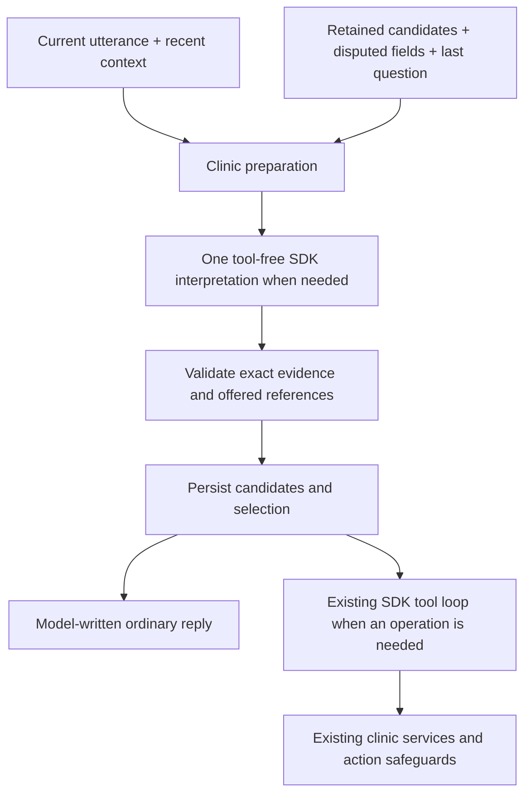
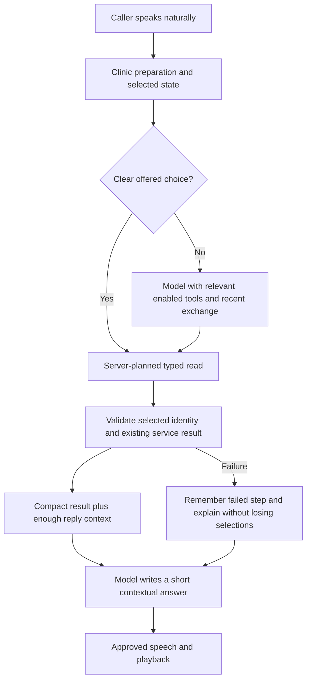

# Phase 17 — Continue the conversation reliably

## Follow-up: remember patient details before slot selection (17 October)

The next live call exposed a gap in the earlier implementation: the assistant could ask for name/age before selecting a slot, while structured capture only ran at the later patient stage. The model's acknowledgement did not save those fields. Two further valid intake outputs captured nothing and repeated the same question. The displayed transcript also omitted the intended “seven” from twenty-seven, so reconstructing 27 would have been a guess.

| Before | Implemented behavior |
|---|---|
| Early name/age stayed only in recent chat | Explicit details and answers to the last intake question enter validated candidate state before doctor/date/time selection |
| Null could conceal a rejected value | Null keeps a value; evidence-linked `disputedFields` marks a rejected name/age unusable until a current explicit correction |
| A valid empty extraction looked successful | Operational outcomes separate capture, clarification and no progress; unresolved evidence stays bounded and repeated non-progress gets a focused exceptional clarification |
| Choosing a time always triggered the fixed name question | Verified availability fallbacks consult retained intake; ordinary model replies receive the same next-goal context |
| Model speech could acknowledge an unsaved date/time | Contextual selection proposals are checked against returned options and committed before acknowledgement |



The existing `intake.ts` interpreter now handles early intake, contextual help/corrections and short unresolved offered-option answers. It returns name/age proposals, explicit disputes, optional date/slot references, a next field and a model-written reply. `runtime.ts` validates even injected interpreters, applies field transitions, guards revision/turn ownership, derives the next goal and records approved question context. One structured call handles ordinary capture plus the follow-up; actual tools still use the existing Runner. Clear public reads retain their existing fast route. Legacy/free-form questions are observed as context only, never as user facts or action authorization.

Candidates preserve STT spelling and exact evidence. Old pending evidence cannot restore a rejected value; a new current-utterance correction is required. Changing the caller clears intake through the existing caller boundary. Doctor/date/time changes retain patient candidates while invalidating incompatible selections/drafts. An interrupted assistant reply retains captured user facts but grants no action permission. A pending action correction clears the old draft and can capture the supplied replacement before preparing a new readback.

The interpretation view drops optional whole recent messages and then oldest unresolved evidence entries above its 3,200-byte / 1,250-estimated-token soft input target. It preserves current text and candidate values; the existing provider budget enforces full-request limits. Active snapshots still retain their bounded pending evidence (two utterances), revisions, last question and candidate/dispute state with the existing TTL and close cleanup. No summary authorizes an action, and no whole-call replay is added.

`ClinicDialogue.choose` accepts only returned dates and current-doctor/date slot references. A contextual date choice retrieves times through the existing enabled tool; a slot choice changes state before speech. The deterministic calendar parser remains a fast path; unfamiliar spoken forms use contextual interpretation or clarify. This is not an expansion into fuzzy doctor matching or invented availability.

**Verification:** fourteen focused intake tests and a database-backed early-phone → name/age → correction → doctor → weekday → spoken time → corrected draft → confirmed booking scenario pass. Existing service and voice regressions cover locks, capacity, tokens, cancellation, interrupted/late work and idempotency. The twelve-slot request reconstruction peaks at 8,523 bytes, still below half the original 20,928-byte reconstruction. These are offline measurements, not measured hosted-provider request limits. Exact suite results are recorded in `PROGRESS.md`.

**Limits:** model interpretation and bounded reply checks cannot prove every sentence correct. Missing audio/STT content is not reconstructed; a rejected “twenty” without a recognizable replacement requires clarification. Live Assamese/provider acceptance remains pending, and Phase 17 remains IN PROGRESS. No new endpoint, schema, dependency, booking engine or phase was added.

## The problem we are fixing

The 17 October call found the right doctor but then asked for the doctor again. A spoken date missed the calendar route, the model supplied a doctor reference that the clinic service rejected, and the response after that tool exceeded our own context estimate. Later, the hosted provider returned HTTP 429. These are separate failures; repeating the patient's words cannot fix them.

## Implementation plan

| Change | Caller experience | Server responsibility |
|---|---|---|
| Resolve offered choices | “Sunday, eighteenth October” selects an offered date; an ambiguous weekday gets one clarification | Match only actual returned dates, using clinic-local labels and explicit number normalization; never invent availability |
| Bind selected doctor | The caller does not repeat a successfully selected doctor | Allow omitted doctor IDs for availability, bind the selected server record, reject conflicting supplied IDs before services |
| Smaller tools per step | More context and provider allowance are available for useful replies | Intersect stage-relevant tools with the existing agent allowlist; keep all prerequisite/action checks in handlers |
| Tool-result headroom | A read operation can return its result and the model can still answer | Reserve estimated space before generation and preserve complete current tool pairs; retain the previous exchange where budgets permit |
| Contextual recovery | Explain the failed step and continue it instead of restarting the menu | Persist the failed operation/code and known completed outcomes as verified session facts |
| Short spoken choices | Offer a few dates/times, then let the caller select or request more | Keep canonical results internally; speech and model pages use bounded options with explicit continuation |
| Useful background work | Spend provider quota on the caller before optional notes | Skip summaries of read-event notes already represented in validated state; suppress background requests when observed provider quota is low |
| Recognition recovery admission | One unclear-speech prompt instead of repeated identical interruptions | Suppress repeated unusable-speech recovery until an accepted caller turn; keep listening and retain interruption ownership |



## Safety and scope

The existing SDK Runner/executor, tenant guard, booking transactions, capacity, tokens, request idempotency and separate phone/action confirmations remain authoritative. A model-provided UUID is never proof of a selected doctor. No failed or timed-out action is automatically repeated to obtain speech. Changing a doctor clears incompatible dates/slots/drafts. No database schema, endpoint, dependency, provider replacement or new booking engine is needed.

## Verification

Use the exact reported utterances, the real SDK with deterministic providers, mocked HTTP quota responses, and the guarded local PostgreSQL tests. Cover ambiguous dates, wrong/cross-tenant IDs, disabled tools, post-tool context headroom, interrupted/superseded turns, duplicate booking protection, concise replies and repeated recognition recovery. Run backend and strict test typechecks/build, affected clinic/engine/provider/voice regressions and frontend diagnostics/typecheck. Record actual microphone and hosted-provider acceptance separately; Phase 17 stays in progress until it passes.

## Live retest

Restart the worker and start a fresh frontend session. Ask for doctors, choose Baruah, ask which days are available, choose one by weekday and spoken date, then select a time. Ask why if an operation fails: the answer should refer to that operation and retain the doctor. Finish patient intake, phone/action readbacks, booking/token, lookup and cancellation. Keep the same call for 15–20 turns. Ordinary replies may vary, while selected records and action outcomes must stay factual.

## Implemented result

The changes above are implemented. Date pages contain three actual returned options. A supplied doctor ID cannot override an existing selection. Relevant tool subsets reduce schemas while the existing executor still checks every call. Ordinary explanations remain model-written; exact critical readbacks and exceptional recovery remain verified. Caller switching excludes previous-caller outcomes from model context while retaining internal request reconciliation.

The generic engine preserves the previous exchange when hard limits permit and reserves 512 estimated tokens before an anticipated tool result. Clinic output is bounded to 384 tokens. Redundant read-event summaries are skipped, and observed low quota pauses optional background work. These measures reduce requests; they do not promise unlimited calls under an 8,000-token/minute account limit.

| Verification | Result |
|---|---|
| Engine, tools, provider protocol, confirmation, clinic dialogue and context | 129 passed |
| Listening, voice loop, barge-in, agent, LLM and VAD | 78 passed; one paid-cloud test intentionally skipped |
| Clinic service / voice / dialogue PostgreSQL suites | 24 / 14 / 15 passed |
| Redis / token-to-worker / recognition WebSocket | 2 / 1 / 11 passed |
| Frontend diagnostics | 5 passed |
| Backend, strict test and frontend typechecks; backend build | Passed |

The twelve-slot reconstruction's largest request is **8,171 bytes**, about **61% below** its original **20,928-byte** reconstruction. The previous implementation measured **9,799 bytes**. Actual hosted request limits, live microphone recognition and spoken durations must still be checked in a fresh frontend call.

## Important code and folder map

```text
backend/src/
  components/clinic/voice/
    calendar.ts       normalized date references against actual options; cached labels
    dialogue.ts       selected doctor/date, three-option page and concise read fallback
    runtime.ts        stage tools, doctor binding, failure context and caller privacy
    model-results.ts  compact validated model pages; complete results stay internal
    session.ts        concise model instructions and 384-token reply allowance
    confirmation.ts   bounded completion-claim speech safeguard
  components/agent/
    providers/llm/context-budget.ts  previous exchange plus prospective result reserve
    providers/llm/chat-protocol.ts   actual wire checks and safe quota feedback
    providers/llm/cooldown.ts        injected shared cooldown, integer Redis TTL
    engine/session.ts              generic memory cancellation and empty-source skip
  agent/
    voice-recovery.ts  one unusable-speech prompt until accepted input
    index.ts           participant-local recovery admission at the transport boundary
```

Clinic-specific interpretation stays in the clinic module. The generic engine owns SDK lifecycle, cancellation and bounded model input. The existing clinic services own all database and booking rules. No new persistence tables or HTTP surfaces are part of this follow-up. Phase 17 remains **in progress** until the real microphone/provider acceptance passes.
