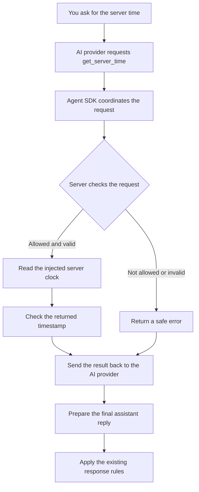
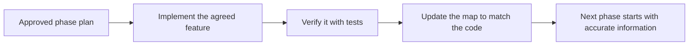
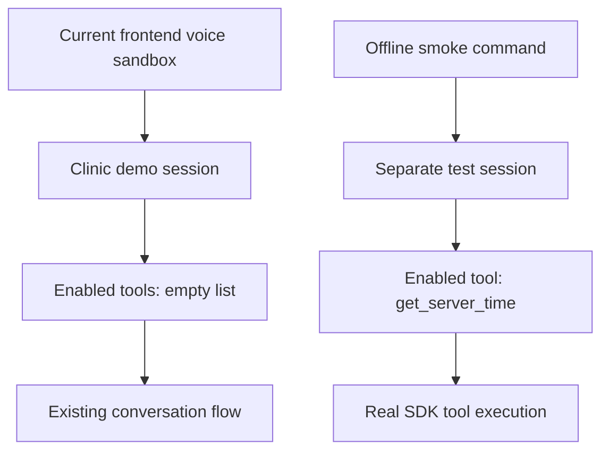
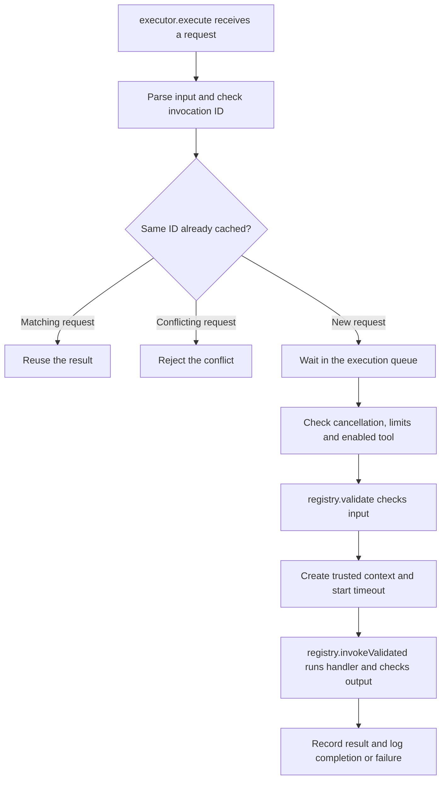

# Phase 15: Giving the AI a safe toolbox 🧰

**What we built:** a checked path from “the AI asks for a tool” to “the server runs it and returns a result.”

**Try this first:** the offline demo below. **Frontend status:** the clinic voice demo has no tools enabled yet.

> Reading tip: follow the diagrams, open the “Try guessing” boxes, and tick the checklists in an editor. Expandable boxes and Mermaid diagrams depend on your Markdown viewer. This file does not run commands when you click them.

## 1. Your first test — about one minute ▶️

Open PowerShell in the project folder. With the project's Node dependencies already installed, run:

```powershell
Set-Location D:\Projects\voice-agent
npm --prefix backend run smoke:tools
```

You do **not** need the frontend, microphone, Docker services, an `.env` file or an AI API key for this test. It makes no paid or cloud calls.

Look for these three things:

```text
tool_started       → the server began the clock tool
tool_completed     → the tool returned a checked result
The server time is 2026-10-13T10:06:50.066Z (UTC).
```

The timestamp above is an example. Your output should show the server's current time. `Z` means UTC.

- [ ] I saw `tool_started`.
- [ ] I saw `tool_completed` with `code: "OK"`.
- [ ] I saw a final sentence containing the timestamp and `UTC`.
- [ ] The command ended successfully.

**What did you just prove?** The real agent SDK requested a tool, our server checked and ran it, and the SDK continued to a final reply. The AI provider in this demo is scripted, so the test is repeatable and free. It does not prove that a cloud model or microphone will behave correctly.

Want the failure tests too?

```powershell
npm --prefix backend run test:tools
```

Expected result: **27 tests pass, 0 fail.** They include invalid requests, wrong organization context, timeouts, interrupted work and duplicate requests.

<details>
<summary>Something failed? Open this small troubleshooting card</summary>

| What you see | What to check |
|---|---|
| `npm` is not recognized | Use the Node/npm installation normally used for this project. |
| Missing package or `tsx` | Install the backend's existing dependencies using the project's normal setup. |
| Cannot find `backend/package.json` | Run the commands from `D:\Projects\voice-agent`. |
| The demo returns a recovery reply or an error | Save the terminal output. This is not the expected successful tool test. |

Do not add API credentials to fix the offline demo. It does not need them.

</details>

## 2. What was missing before? 🧩

Before Phase 15, the agent could listen, remember a conversation and reply. Phase 14 deliberately rejected tool calls because the checked execution path had not been built yet.

For example, imagine a future caller asking:

> “Is Dr. Baruah available tomorrow?”

A language model cannot establish real availability just by writing a convincing sentence. It needs an approved server function that checks the real business system.

**The missing piece was the bridge between conversation and checked server actions.** This does not mean the AI previously had direct database access; it did not.

| Before Phase 15 | After Phase 15 |
|---|---|
| Tool code was only a placeholder. | Tools have checked definitions and a registry. |
| The engine rejected tool requests. | Explicitly enabled tools can run through the SDK. |
| Providers did not complete the function-call/result path. | Calls and matching results travel between provider and SDK. |
| No reusable execution checks existed for future actions. | Input, permission to use the tool, context, output and timing are checked. |
| No working tool example demonstrated the path. | The harmless clock tool demonstrates it offline. |

**Availability and booking are still future work.** We built the toolbox; Phase 15 supplied only a clock tool.

## 3. Watch one request travel through the system 🗺️



<details>
<summary>Diagram not rendering? Open the plain version</summary>

```text
Question → AI tool request → SDK → server checks → clock
                                                    ↓
Final reply ← AI receives result ← checked timestamp
```

</details>

Here is the same trip as a small conversation. These are **illustrative messages from the offline path**, not a transcript from the frontend:

| Who | What happens |
|---|---|
| You | “What is the current server time?” |
| AI provider | Requests `get_server_time` with `{}`. |
| Server | Checks that this tool is enabled and the input is valid. |
| Clock tool | Returns the time. |
| Server | Checks the output and sends the result back. |
| AI provider | Uses that result to form the final sentence. |

The checked successful result looks like this:

```json
{
  "success": true,
  "data": {
    "timestamp": "2026-10-13T10:06:50.066Z",
    "timezone": "UTC"
  }
}
```

`success: true` means this tool completed. For this tool, that means **the clock was read**, not that an appointment was booked.

## 4. Meet the toolbox team 👋

| Part | Simple meaning | Why it matters |
|---|---|---|
| Tool definition | A card saying what the tool accepts, returns and does. | Each tool has a clear agreement. |
| Tool registry | A fixed catalogue of approved tools. | Duplicate names and invalid definitions are rejected. |
| `enabledTools` | The tools this particular agent may use. | Being in the catalogue does not automatically enable a tool. |
| Zod validation | A form checker for incoming and outgoing values. | Wrong values and extra root fields do not reach the handler. |
| Trusted `ToolContext` | A server-created identity badge for the request. | The AI cannot choose which organization it belongs to. |
| Executor | The server gate that checks and runs a tool. | Tool requests must pass the same execution checks. |
| Tool result | A clear success or error message. | The AI receives a result it can interpret. |
| SDK Runner | The coordinator between AI requests and tool results. | We use the existing SDK, rather than building another agent framework. |
| Winston logs | A record of starts, completions and failures. | We can investigate execution without logging private payloads. |

The existing voice providers remain in place. This phase adds tool support to the model adapters; it does not replace speech recognition or speech generation.

## 5. Try guessing: should the server allow this? 🎯

### Card A — The normal request

```text
Tool: get_server_time
Arguments: {}
Tool is enabled for this agent.
```

<details>
<summary>Show the answer</summary>

**Allow it**, assuming the trusted context is valid. Empty input is exactly what the clock tool expects.

</details>

### Card B — An extra organization field

```json
{ "organizationId": "another-business" }
```

<details>
<summary>Show the answer</summary>

**Reject it.** The clock tool accepts only `{}`. Also, organization identity comes from the server, never from AI arguments.

The safe result is:

```json
{
  "success": false,
  "error": {
    "code": "INVALID_TOOL_INPUT",
    "message": "The tool arguments are invalid."
  }
}
```

The handler does not run.

</details>

### Card C — The same request arrives twice

```text
First request:  invocation ID clock_1, arguments {}
Second request: invocation ID clock_1, arguments {}
Both are in the same SDK run.
```

<details>
<summary>Show the answer</summary>

**Reuse the first result.** Do not execute the handler twice. If the same ID is reused with different arguments or a different tool, reject the conflicting request.

This protection lasts within one run. It does not guarantee that future bookings cannot be repeated across different calls or after a crash. Business services will need their own durable duplicate protection.

</details>

### Card D — The AI requests a database tool

```text
Tool: query_postgres
```

<details>
<summary>Show the answer</summary>

**Reject it.** No such tool is registered. The AI has no PostgreSQL client or SQL execution path.

Future business tools must call trusted server services. Those services must check organization access and use transactions where needed.

</details>

## 6. What happens when things go wrong? 🚦

| Situation | What the system does |
|---|---|
| Arguments are malformed or invalid | Returns a safe validation error; no handler execution. |
| A registered tool is disabled for this agent | Rejects it. |
| A handler throws an exception | Returns a safe error without its private exception message or stack. |
| A handler returns bad output | Rejects the output instead of treating it as success. |
| A tool takes longer than the default five seconds | Signals cancellation, returns a timeout and stops further handlers in that run. |
| Tools are requested together | Runs handlers one at a time. |
| More than four new tool attempts are requested in one turn | Rejects attempts beyond the default limit. |
| The AI keeps asking for another model round | The SDK run is limited to five model turns. |
| A new user turn replaces an unfinished turn | Cancels the old run and prevents its late result from being committed. |
| Playback is interrupted | Marks that turn's tool history interrupted and excludes it from later model context. |
| A tool ran but the final AI reply is empty | Uses recovery speech; does not restart the executed tool sequence. |

> A cancellation signal is a stop request. It cannot undo an action already completed or forcibly stop a handler that ignores it. This matters when we later add real business actions.

Valid tool call/result pairs are remembered in active session snapshots. They are not permanent audit records. Tool logs contain operational IDs, tool names, timing and error codes—not arguments, transcripts or result payloads.

## 7. Why did the architecture Markdown files change? 📘

**They changed to describe the implementation you approved. Editing them is part of keeping the code and its design documents in agreement. It is not evidence that the whole original architecture was wrong.**

Your Phase 15 plan explicitly asked for updates to architecture and tool-contract documentation. Root `AGENTS.md` also says to update the relevant architecture document when architecture changes, update progress, and record why. It also says: “Do not silently change architecture.”

Think of the documents as a map:



Leaving a map saying “no tools exist” after building tools would mislead the next developer.

| Source document | What was updated | Why |
|---|---|---|
| `BACKEND_ARCHITECTURE.md` | Actual tool folder, injected runtime, checks and limits. | Shows where the implementation lives and who owns execution. |
| `VOICE_AI_ARCHITECTURE.md` | Optional tools, SDK loop, result replay and safe recovery after a tool attempt. | The old text described a text-only Phase 14 engine. |
| `DATA_MODEL_AND_API_CONTRACT.md` | Typed input/output agreement, trusted context and safe result errors. | The old tool outline did not fully describe the implemented contract. |
| `PHASES.md` | Phase 15 build details and concrete acceptance checks. | Makes “done” testable. Phase order and dependencies were not changed. |
| `PROGRESS.md` | Completed work, verification, limits and unresolved voice backlog. | Separates what works from what still needs work. |

**What was added to the design description?** Details of the approved feature: optional tool enablement, checked execution, cancellation, time limits, result memory and provider support.

**What stayed central to the design?** LiveKit owns voice transport. The existing agent SDK owns orchestration. Providers remain replaceable. The AI cannot directly query PostgreSQL. Future business services must enforce tenant access.

<details>
<summary>Was there any actual gap we had to fix?</summary>

Yes, there was an implementation edge case: the installed SDK parses malformed tool JSON before our tool handler runs. Its default path could return its own parsing message instead of our safe error envelope.

We added a small adapter step that routes malformed input to our validation rejection path. Tests check that it cannot execute the handler or expose the original malformed payload.

That explains one code change. It does not justify unrelated changes to the architecture. Documentation updates must describe approved work; changing a document is not a way to approve extra features or make failing code count as complete.

</details>

For this explanation follow-up, we added this guide and a progress note. The architecture changes described above were made during the Phase 15 implementation.

## 8. Can you test this from the frontend? 🎙️

**You can check that the existing voice demo still works. You cannot currently verify the clock tool through it.**

Here is why:



The accepted plan selected an isolated demonstration and kept the clinic demo outside this phase. Its session was not given a tool registry/runtime, and its enabled-tool list is empty by default.

### What you can do in the frontend now

With your existing local services and configuration ready, start the usual processes if they are not already running. Use a separate terminal for each:

```powershell
# Terminal 1 — backend API
npm --prefix backend run dev
```

```powershell
# Terminal 2 — voice worker
npm --prefix backend run agent:dev
```

```powershell
# Terminal 3 — frontend
npm --prefix frontend run dev
```

Use the frontend address printed by Next.js. Sign in, open your agent's **Testing** page (or its voice sandbox), and click **Start Voice Session**. Headphones help reduce speaker echo.

| Try saying | What to observe | What this checks |
|---|---|---|
| “Hello.” | Your STT text and an audible agent reply appear. | Existing speech/conversation flow. |
| A short follow-up | Another conversation turn appears. | Existing session continuity. |
| Speak while the agent is talking | Playback stops when interruption is detected. | Existing interruption behavior. |
| Disconnect, then reconnect | A new session connects normally. | Existing session cleanup. |

These are checks to perform, not a claim that a new microphone test was run for Phase 15. The reported phone-confirmation, date/time and Assamese wording issues remain unresolved.

**A `Safe Guard` badge or a convincing answer is not proof of a tool call.** Asking the current clinic demo “What is the server time?” cannot validate this tool because it is not enabled there.

### What would be needed for a future frontend tool test?

The server would need to create a test session with the clock tool registered, enable it in that agent's configuration, and inject trusted context and the runtime. We would then verify cloud-model behavior and inspect correlated tool logs while speaking through the frontend.

That integration has **not** been implemented in this phase. Adding only `enabledTools` or changing a prompt is insufficient; the server runtime must also be provided.

When that test exists, the evidence should be:

```text
Spoken question → tool_started → tool_completed with OK
               → returned timestamp → spoken answer using that result
```

For today, use the smoke command to verify Phase 15.

## 9. What is ready, and what comes later? 🏁

| Ready now | Still later |
|---|---|
| Reusable checked tool system | Clinic availability and booking tools |
| Harmless server-time tool | Clinic database/services in Phase 16 |
| Offline SDK demo and 27 tool tests | Live clinic voice workflow in Phase 17 |
| Provider protocol support tested with mocked HTTP | Live cloud tool-calling qualification |
| Active session tool history | Permanent tool-event records |
| Safe tool failures and execution limits | Resolution of the live voice backlog |

Phase 15 verification also passed the engine, LLM, voice-loop, interruption, agent and listening/dictation regressions, strict test/backend typechecks, backend build and frontend typecheck. The live-cloud LLM test was skipped; no live browser/audio qualification was claimed.

### Your finish checklist

- [ ] I understand that a tool is a server function the AI can request.
- [ ] I understand that the server checks the request before executing it.
- [ ] I ran the offline clock demo.
- [ ] I know why the architecture documents were updated.
- [ ] I know the frontend clinic session does not have tools enabled yet.
- [ ] I know Phase 15 did not fix the reported clinic voice issues or implement booking.

**Phase 15 is complete. Phase 16 remains not started.**

<details>
<summary>Want to inspect the actual files? Open the code map</summary>

| File | What to look for |
|---|---|
| [Tool types](D:/Projects/voice-agent/backend/src/components/agent/tools/types.ts) | Definition, trusted context and success/error agreement. |
| [Registry](D:/Projects/voice-agent/backend/src/components/agent/tools/registry.ts) | Definition validation and enabled-tool lookup. |
| [Executor](D:/Projects/voice-agent/backend/src/components/agent/tools/executor.ts) | Checks, execution queue, limits and duplicate protection. |
| [SDK adapter](D:/Projects/voice-agent/backend/src/components/agent/tools/sdk.ts) | Connection to SDK function tools. |
| [Clock tool](D:/Projects/voice-agent/backend/src/components/agent/tools/server-time.ts) | The harmless tool's input and output. |
| [Smoke script](D:/Projects/voice-agent/backend/test/tool-smoke.ts) | The complete offline demonstration. |
| [Progress](D:/Projects/voice-agent/docs/PROGRESS.md) | Checks, limits and the live voice backlog. |
| [Project rules](D:/Projects/voice-agent/AGENTS.md) | Documentation and architecture rules. |

</details>

## 10. Walk through the code — what each important file does 🧑‍💻

This section connects the flow you already know to the actual code. You do not need to understand every line to understand the design.

**Suggested reading route:** clock tool → registry → executor → SDK adapter → session → provider adapter.

### A. The folder structure

This is the relevant part of the project, not the entire repository. **NEW** means added in Phase 15; **UPDATED** means an existing file changed in Phase 15.

```text
backend/
├── src/components/agent/
│   ├── index.ts                         UPDATED: public exports
│   ├── tools/
│   │   ├── types.ts                     UPDATED: shared tool agreements
│   │   ├── registry.ts                  NEW: definitions and catalogue
│   │   ├── executor.ts                  NEW: checked execution
│   │   ├── sdk.ts                       NEW: SDK connection
│   │   ├── server-time.ts               NEW: harmless clock tool
│   │   ├── logger.ts                    NEW: safe tool events
│   │   └── index.ts                     NEW: tool exports
│   ├── engine/
│   │   ├── config.ts                    UPDATED: enabled tool settings
│   │   ├── state.ts                     UPDATED: tool history
│   │   ├── prompts.ts                   UPDATED: tool instructions
│   │   └── session.ts                   UPDATED: connect tools to a turn
│   └── providers/llm/
│       ├── types.ts                     UPDATED: call/result message shapes
│       ├── agents-model.ts              UPDATED: provider ↔ SDK translation
│       ├── chat-protocol.ts             NEW: shared provider message handling
│       ├── groq.ts                      UPDATED: use shared protocol
│       └── huggingface.ts               UPDATED: use shared protocol
├── test/
│   ├── helpers/scripted-provider.ts     NEW: predictable test AI
│   ├── tools.test.ts                    NEW: tool verification
│   └── tool-smoke.ts                    NEW: runnable clock demonstration
├── package.json                        UPDATED: test/demo commands
└── tsconfig.engine-tests.json           UPDATED: strict test typechecking

docs/
├── PHASE_15_EXPLAINED.md                NEW guide, extended in these follow-ups
├── BACKEND_ARCHITECTURE.md              UPDATED: backend implementation map
├── VOICE_AI_ARCHITECTURE.md             UPDATED: tool/conversation flow
├── DATA_MODEL_AND_API_CONTRACT.md       UPDATED: tool agreements
├── PHASES.md                            UPDATED: Phase 15 acceptance checks
└── PROGRESS.md                          UPDATED: work, checks and limits
```

**Why these folders?** `tools/` owns checked server actions. `engine/` owns the conversation. `providers/llm/` translates messages for AI vendors. `test/` demonstrates and verifies them. Keeping these jobs separate lets a future clinic or hotel tool use the same execution code.

### B. Start with the smallest file: `server-time.ts` 🕒

Open [server-time.ts](D:/Projects/voice-agent/backend/src/components/agent/tools/server-time.ts).

The important pieces of its definition are:

```ts
name: "get_server_time",
inputSchema: z.object({}).strict(),
outputSchema: z.object({
  timestamp: z.iso.datetime(),
  timezone: z.literal("UTC"),
}).strict(),
execute: async () => ({
  success: true as const,
  data: {
    timestamp: clock().toISOString(),
    timezone: "UTC" as const,
  },
}),
```

| Code | What it means |
|---|---|
| `name` | The name the AI uses to request this tool. |
| `z.object({}).strict()` | Accept an empty object. Reject extra fields. |
| `z.iso.datetime()` | Require a correctly formatted ISO timestamp. |
| `z.literal("UTC")` | Require exactly `UTC`, not an arbitrary timezone. |
| `execute` | The actual work: read the clock and format the time. |
| `as const` | Tell TypeScript these values are exactly `true` and `"UTC"`. It is not a runtime validation check. |

The surrounding `createServerTimeTool(clock)` function lets the server supply the clock. Normally it uses `new Date()`. Tests can supply a fixed clock, so they know the expected answer.

**Why it is here:** it proves the complete tool path with a small, harmless action. The tool does not know about doctors, bookings, speech or AI vendors.

### C. `types.ts`: the agreement, not the execution 📋

Open [tools/types.ts](D:/Projects/voice-agent/backend/src/components/agent/tools/types.ts).

| Type | What it carries | Why we need it |
|---|---|---|
| `ToolDefinition<I, O>` | Name, description, input/output schemas and handler. | Connects the handler to its expected input and output types. `I` means input; `O` means output. |
| `ToolResult<T>` | Either successful data or an error. | Callers can clearly tell success from failure. |
| `ToolContext` | Trusted IDs and a cancellation signal. | Identity stays separate from AI arguments. |
| `ToolRuntime` | Registry, call/conversation IDs, optional logger and limits. | The server supplies the resources needed to enable tools. |
| `ToolInvocation` | Tool name, invocation ID, arguments and result. | Gives history replay a matched request/result record. |
| `ToolLogger` / `ToolEvent` | The agreed logging interface and event names. | The executor can report events without choosing a logging vendor itself. |

The result agreement is small:

```ts
export type ToolResult<T = unknown> =
  | { success: true; data: T }
  | { success: false; error: { code: string; message: string } };
```

**Important difference:** TypeScript types help developers while writing and checking code. They do not make incoming AI data trustworthy. Zod performs the checks while the program is running.

### D. `registry.ts`: prepare the tools, then keep a catalogue 🗂️

Open [registry.ts](D:/Projects/voice-agent/backend/src/components/agent/tools/registry.ts).

There are two main jobs in this file:

| Important code | What it does | Why it matters |
|---|---|---|
| `defineTool(...)` | Checks the definition, makes the input object strict, rejects reserved context fields and builds the model-facing schema. | A poorly defined tool is rejected before use. |
| `validate(input)` | Parses incoming JSON data with the input schema. | The handler receives checked values, including any declared transformations. |
| `invokeValidated(input, context)` | Calls the typed handler, then checks its result and successful output. | Returning an object does not automatically make it a valid result. |
| `ToolRegistry` constructor | Stores approved definitions and rejects duplicate names. | Two tools cannot accidentally share the same request name. |
| `get(name)` | Looks up one registered tool. | Execution has a single catalogue to consult. |
| `enabled(names)` | Looks up the agent's explicitly selected tools. | Registered and enabled are separate decisions. |

For example, the registry in the smoke script is created with:

```ts
new ToolRegistry([createServerTimeTool()])
```

The catalogue and generated schemas are protected against mutation. Successful output must also be JSON-compatible: ordinary data that can be sent as a message, not a function or a circular object.

**Why output checking lives here:** every registered tool gets the same result rules, rather than each tool author having to recreate them.

`invokeValidated` is an internal execution step. Application code should use the executor instead of calling that step directly and skipping input checks.

<details>
<summary>What does the registry's `strict` flag mean?</summary>

There are two different checks here. Zod's strict object validation is our server rule. Provider strict schema mode is a setting sent to the AI vendor.

Some schemas with optional fields do not fit the provider's strict-mode requirements. The registry detects that and uses compatible provider metadata. The server still checks the input and rejects extra root fields.

</details>

### E. `executor.ts`: the gate every tool request must pass 🚦

Open [executor.ts](D:/Projects/voice-agent/backend/src/components/agent/tools/executor.ts).

The main entry point is:

```ts
execute(name: string, rawInput: unknown, invocationId: string)
```

`rawInput` is deliberately `unknown`: we have not trusted or validated it yet. `invocationId` identifies this particular request, such as `clock_1`.



Rejected input or failed checks exit the path before the handler runs.

| Important code | Simple meaning |
|---|---|
| `context` | The server identity this executor is bound to. |
| `enabled` | Which registered tools this agent is allowed to use. |
| `cache` | Saved results for matching invocation IDs within this run. |
| `canonical(...)` | Makes object key order consistent when comparing requests. `{a: 1, b: 2}` and `{b: 2, a: 1}` count as the same arguments. |
| `queue` | A chain that makes handlers run one at a time. |
| `attempts` / `limits` | Bounds tool attempts and execution time. |
| `AbortSignal.any(...)` | Combines turn cancellation and the tool's own timeout cancellation. |
| `Promise.race(...)` | Waits for whichever arrives first: handler result, timeout or cancellation. It does not forcibly terminate a handler. |
| `history` | Returns a copy of recorded invocation/result pairs. |
| `prepareCall(...)` | Routes malformed JSON through our safe rejection path before the SDK's default parser can expose its own error text. |

**Why it is here:** tool authors write the useful work; this shared executor handles the repeated execution checks. Future business handlers still need to enforce their service-level permissions, transactions and duplicate protection.

### F. `sdk.ts`: connect our gate to the existing SDK 🔌

Open [sdk.ts](D:/Projects/voice-agent/backend/src/components/agent/tools/sdk.ts).

The `sdkTools(...)` function adapts enabled registry entries using the SDK's `tool(...)` helper. When the SDK invokes a tool, the adapter checks the run context against the executor's trusted context and calls:

```ts
executor.execute(
  definition.name,
  input,
  details?.toolCall?.callId ?? "invalid",
)
```

The SDK's `callId` becomes our invocation ID. This keeps the request and result matched. A missing ID cannot become a valid execution.

**Why this file exists:** the SDK has its own function-tool format. This adapter connects that format to our registry and executor. It does not create another AI decision loop; the SDK Runner still owns that loop.

### G. The modified engine files: where tools join the conversation 🗣️

| File | Important Phase 15 change | Why it belongs here |
|---|---|---|
| [engine/config.ts](D:/Projects/voice-agent/backend/src/components/agent/engine/config.ts) | Adds `enabledTools`, defaulting to `[]`. | Configuration chooses the agent's available tools. |
| [engine/state.ts](D:/Projects/voice-agent/backend/src/components/agent/engine/state.ts) | Adds separate `toolHistory` with turn IDs and interruption flags. | Tool results become conversation context without changing ordinary user/assistant history. |
| [engine/prompts.ts](D:/Projects/voice-agent/backend/src/components/agent/engine/prompts.ts) | `buildPrompt(...)` names enabled tools and retains factuality rules. | The AI needs instructions about the capabilities it has. Prompts do not replace execution checks. |
| [engine/session.ts](D:/Projects/voice-agent/backend/src/components/agent/engine/session.ts) | Accepts optional tool runtime, creates a per-run executor, attaches SDK tools, replays history and commits current results. | The session owns the current turn and knows when it has been interrupted or replaced. |

The key location in `session.ts` is `processUserUtterance(...)`. Inside it, the engine:

1. Creates a `ToolExecutor` only when a runtime exists and tools are enabled.
2. Creates the SDK agent with `sdkTools(...)` and a `ProviderModel` adapter.
3. Rebuilds model input from conversation history and non-interrupted tool pairs.
4. Calls the existing SDK Runner with trusted context, cancellation and the model-turn limit.
5. Checks that the turn is still current before recording results and returning approved reply text.

This actual condition is especially important:

```ts
if (normalizeSpokenText(generated) || executor?.invocationCount) break;
```

It means: stop the empty-output retry loop if there is usable text **or any tool attempt occurred**. An empty spoken reply must not cause an already executed tool sequence to start again.

`notifyInterruption(...)`, `reset()` and `close()` also handle tool state/cancellation. The existing response policy and session store are reused; this phase did not create a second speech policy or storage system.

### H. The provider files: translate messages, never execute actions ↔️

| File | What was added or changed | Why |
|---|---|---|
| [providers/llm/types.ts](D:/Projects/voice-agent/backend/src/components/agent/providers/llm/types.ts) | Adds tool-call lists, strict schema metadata, tool choice and related options to the existing interfaces. | Providers need to carry calls and results, not just reply text. |
| [agents-model.ts](D:/Projects/voice-agent/backend/src/components/agent/providers/llm/agents-model.ts) | `ProviderModel` converts SDK function calls/results to provider messages and converts provider calls back to SDK output. | The SDK and vendors use different message shapes. |
| [chat-protocol.ts](D:/Projects/voice-agent/backend/src/components/agent/providers/llm/chat-protocol.ts) | `chatMessages(...)`, `streamChat(...)` and `completeChat(...)` share the wire handling. | Groq and Hugging Face should not duplicate the same protocol logic. |
| [groq.ts](D:/Projects/voice-agent/backend/src/components/agent/providers/llm/groq.ts) | Keeps Groq settings and delegates `generate(...)` / `chat(...)` to the shared protocol. | Vendor settings remain outside the engine. |
| [huggingface.ts](D:/Projects/voice-agent/backend/src/components/agent/providers/llm/huggingface.ts) | Keeps Hugging Face settings and uses that same protocol. | Switching providers does not change tool execution rules. |

`streamChat(...)` collects fragments before emitting a complete function call. For example, argument fragments `"{"` and `"}"` are assembled into `"{}"`. Separate call indexes keep multiple calls apart.

`ProviderModel.messages(...)` turns a result into a provider message with `role: "tool"` and the matching `toolCallId`. The model can then use that result in its next answer.

**The boundary matters:** providers send and receive messages. `ToolExecutor` runs approved handlers. Neither provider adapters nor the engine contain PostgreSQL queries.

### I. Follow the code for one complete clock request 🧭

```text
tool-smoke.ts
  creates a registry + enabled config + trusted runtime
       ↓
session.ts → processUserUtterance(...)
  creates executor, SDK agent and provider adapter
       ↓
SDK Runner → ProviderModel → ScriptedProvider
  receives a get_server_time request
       ↓
sdk.ts → executor.execute(...)
  checks context, arguments, allowlist, duplicate ID and limits
       ↓
registry.validate(...) → registry.invokeValidated(...)
  server-time.ts reads clock; registry checks returned data
       ↓
SDK Runner → ProviderModel → ScriptedProvider
  sends the matching result; receives the final sentence
       ↓
session.ts
  records current tool history and applies the reply policy
       ↓
tool-smoke.ts
  checks success and prints the sentence
```

In the offline demo, `ScriptedProvider` fills the AI-provider role. In a real vendor session, Groq or Hugging Face and `chat-protocol.ts` handle the provider connection. The execution gate stays the same.

### J. Supporting files: logs, exports and tests 🧪

| File | Purpose and important behavior |
|---|---|
| [tools/logger.ts](D:/Projects/voice-agent/backend/src/components/agent/tools/logger.ts) | Implements `ToolLogger` using existing Winston. Filters metadata to allowed operational fields so payloads are not logged. |
| [tools/index.ts](D:/Projects/voice-agent/backend/src/components/agent/tools/index.ts) | Exports the reusable tool APIs from one entry point. It contains no execution logic. |
| [agent/index.ts](D:/Projects/voice-agent/backend/src/components/agent/index.ts) | Updates the existing component exports to include those tool APIs. This is the component file, not the LiveKit worker entry file. |
| [helpers/scripted-provider.ts](D:/Projects/voice-agent/backend/test/helpers/scripted-provider.ts) | Supplies predictable AI messages and records requests for assertions. It replaces external inference in tests, not the actual SDK Runner. |
| [tools.test.ts](D:/Projects/voice-agent/backend/test/tools.test.ts) | Checks the execution boundary, real SDK loop and mocked vendor HTTP protocol. Failures should be caught before future business tools are connected. |
| [tool-smoke.ts](D:/Projects/voice-agent/backend/test/tool-smoke.ts) | Wires one complete session, executes the clock path, checks success and closes the session. |
| [package.json](D:/Projects/voice-agent/backend/package.json) | Adds the `test:tools` and `smoke:tools` commands. No dependency upgrade was required. |
| [tsconfig.engine-tests.json](D:/Projects/voice-agent/backend/tsconfig.engine-tests.json) | Includes the new tests/demo in strict TypeScript checks. Test code must also satisfy the type rules. |

The documentation file changes are explained in Section 7. The folders shown above are source code; `dist/` is generated by the existing build command and is not a separate implementation to maintain.

### K. Five things to remember when reading the code ✅

- [ ] **A type is not runtime validation.** `types.ts` describes agreements; Zod checks actual data.
- [ ] **A registered tool is not automatically enabled.** Both the catalogue and agent configuration matter.
- [ ] **Arguments are not identity.** The server provides context separately.
- [ ] **The SDK coordinates; the executor checks execution.** Their responsibilities are different.
- [ ] **A successful clock call is not a booking.** Future business tools need trusted services and their own transactional protections.

<details>
<summary>Quick code quiz: where should a future hotel's availability lookup go?</summary>

In a dedicated business tool handler that calls a trusted hotel service. Its definition can use this registry, executor and SDK adapter.

It should not be placed inside `ProviderModel`, the Groq/Hugging Face adapter or generic conversation code. That keeps the shared engine reusable and business access checks in the appropriate service.

This is an explanation of the boundary, not an implemented hotel tool.

</details>
