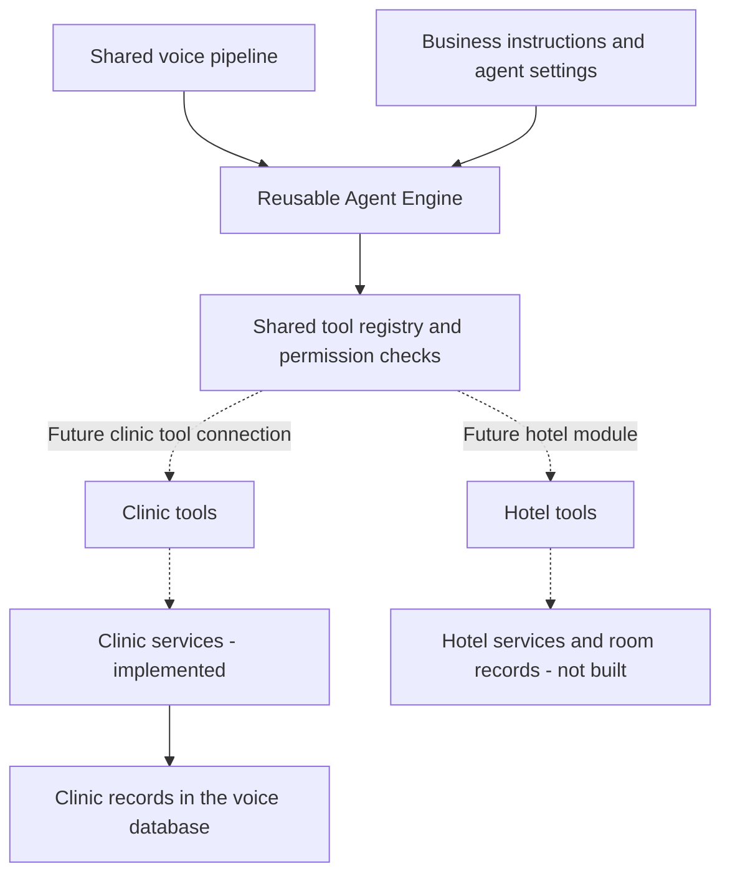
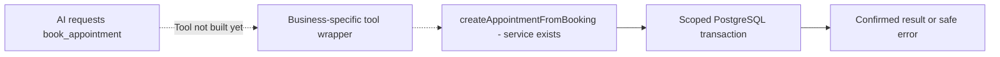
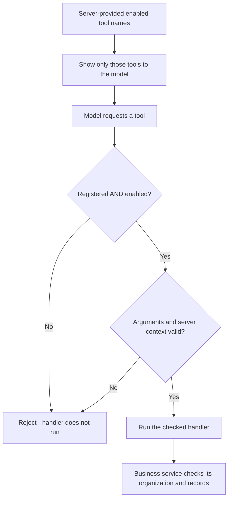

# Phase 16: One voice agent, different business toolboxes 🧩

## First: have we built what you described?

**Yes, the reusable foundation and the separate clinic component are built. The complete “choose a business, enable its features, and start taking real bookings” setup is still unfinished.**

| Your question | Honest answer today |
|---|---|
| Is the shared Agent Engine separate from clinic booking? | ✅ Yes. Clinic booking code is outside the engine. |
| Can the same engine handle clinic and hotel conversations? | ✅ Yes. An offline test runs both through the same engine. |
| Does that mean hotel room booking already exists? | ⏳ No. Hotel services, data and tools still need to be added. |
| Can we allow only selected tools for an agent? | ✅ Yes. The model sees only enabled tools, and the executor checks again. |
| Are clinic booking tools connected to the live voice agent? | ⏳ No. The current worker still starts the clinic intake demo. |
| Does an organization's saved “appointment booking enabled” setting automatically choose its tools? | ⏳ Not yet. That configuration and loading path is remaining work. |
| Can we add a business without rewriting the shared engine? | ✅ That is the design, within the existing engine/tool contracts. New business code and registration are still required. |

**So: the separate pieces exist. Some connections between them are still missing.** This explanation does not add or enable those connections.

> 🎮 Reading tip: follow the diagrams, open the quiz boxes, and tick the checklists in your editor. Diagrams and expandable answers depend on your Markdown viewer. This file does not run commands when you click them.

## 1. Think of it as a receptionist with different toolboxes 🧰

The receptionist's shared equipment stays the same:

🎤 **Listen** → 📝 **Turn speech into text** → 🧠 **Understand and respond** → 🔊 **Speak**

A clinic gives that receptionist a **clinic toolbox**. A hotel gives it a **hotel toolbox**.



**Dotted connections are remaining work.** The registry/executor already works with the harmless clock tool in isolated tests; the business tools shown here are future examples.

| Shared part | Clinic-specific part | Future hotel-specific part |
|---|---|---|
| Voice transport, listening, interruptions | Doctor and patient records | Room and guest records |
| LLM provider adapters | Appointment capacity and tokens | Room inventory and stay dates |
| Conversation engine | Clinic instructions and behavior | Hotel instructions and behavior |
| Tool validation and execution | Appointment tools | Room-reservation tools |

Your “plugin-like” idea matches this structure: a **separate business component using shared interfaces**. We have not built an installable plugin system or a dynamic plugin loader.

The clinic component still needs normal server services: PostgreSQL, organization identity, transactions, logging and a clock. Its business rules are separate from the reusable engine. It also runs without the original WhatsApp folder or backend.

## 2. What problem did Phase 16 solve? 🏗️

Before this work, the voice repository could hold a conversation and collect appointment details. Its generic tool system existed, but it had **no real clinic booking service connected to that system**.

The real appointment implementation already existed in the WhatsApp project. We adopted its proven models and services into this repository.

```text
Existing WhatsApp appointment code
                 │
                 │ copy and adapt the useful clinic parts
                 ▼
This voice repository's clinic component
                 │
                 ▼
This voice product's own clinic database
```

The original WhatsApp product keeps its own data. We did not share its live appointments, synchronize records, or move real patients here.

| Before, in the voice repository | What we have now |
|---|---|
| A demo could ask for details. | Internal services can create a real test appointment. |
| No local clinic booking data model. | Adopted clinic contacts, doctors, slots, blocked dates and appointments. |
| No local appointment concurrency checks. | PostgreSQL transactions and the source booking locks. |
| No tested cancellation service. | Scoped cancellation that safely frees capacity. |
| Notification delivery was not connected. | Reminder/alert scheduling contracts with a test recorder. Real delivery is still pending. |

**Collecting a name and number still does not mean a booking happened.** A successful booking service result is required.

## 3. What did we finish in this phase? ✅

- [x] Map the existing WhatsApp implementation and record its source hashes.
- [x] Adopt its clinic models and services locally.
- [x] Keep clinic people separate from dashboard login accounts.
- [x] List doctors and find all matching names.
- [x] List future dates and slots with available capacity.
- [x] Look up or create a patient safely.
- [x] Book an appointment and generate its token.
- [x] List upcoming appointments for a patient.
- [x] Cancel an appointment without reopening blocked slots.
- [x] Generate concrete slots and block/unblock doctor dates.
- [x] Check organization boundaries, inputs and timezones.
- [x] Test reminder and doctor-alert scheduling after a successful database commit.
- [x] Add the migration and verify it in a separate local test database.

The migration was tested in **`voice_agent_clinic_test`**. We did not apply it to the main voice application database during this milestone.

### A small capacity example 🪑

The source system allows several patients in one timing. Its default capacity is **30**. A clinic can configure a smaller capacity.

Imagine a test slot with **two places**:

| Request | Result |
|---|---|
| First patient books | ✅ Token 1; one place remains |
| Second patient books | ✅ Token 2; slot is full |
| Third patient tries | ❌ Slot unavailable |
| First appointment is cancelled | ✅ One place becomes available |
| Another appointment is booked | ✅ Token 3; earlier tokens are retained |

If two requests compete for the last place, the database locks let them take turns checking and updating it. We tested that exactly one succeeds.

<details>
<summary>🧠 Quick quiz: does cancelling token 1 mean the next person gets token 1 again?</summary>

No. Tokens keep increasing for that doctor and date. Cancelled appointments remain part of the token history.

</details>

## 4. A service and a tool are different pieces 🔌

A **service** does the actual business work.

A **tool** is a small, checked entry point that lets the AI request that work.



For example:

| Piece | Example | Status |
|---|---|---|
| Shared tool machinery | Registry, executor, validation, trusted context | ✅ Built in Phase 15 |
| Harmless sample tool | `get_server_time` | ✅ Built; demonstrated offline |
| Clinic service | `createAppointmentFromBooking` | ✅ Built in this Phase 16 milestone |
| Clinic AI tool | `book_appointment` | ⏳ Phase 17 work |
| Hotel AI tool | `book_room` | ⏳ Future hotel work |

Business-specific tools should call their own services. The shared executor should keep doing the same validation and permission checks for every business.

**The LLM never queries PostgreSQL directly.** It can only request an explicitly enabled tool. The server runs the permitted action and returns a result.

## 5. How do we accept only an organization's enabled tools? 🔐

There are two different questions:

1. **Which tools has the server implemented?** The registry is the catalog.
2. **Which of those tools may this agent use?** `AgentConfig.enabledTools` is the allowed list.

The allowed list defaults to:

```json
{
  "enabledTools": []
}
```

That means **no tools are enabled by default**, including the sample clock tool.

### Two checks already exist



The second check matters even if a model requests a tool that was never shown to it.

| Direct executor request | What happens now |
|---|---|
| Tool is registered and enabled; input is valid | Its checked handler can run. |
| Tool is registered but disabled | `TOOL_NOT_ALLOWED`; handler does not run. |
| Tool is not registered | `TOOL_NOT_FOUND`; handler does not run. |
| Arguments contain an unexpected `organizationId` | Input validation rejects them. |

These are existing executor behaviors. The SDK also rejects unsupported tool calls; the exact recovery reply depends on that path.

The organization identity comes from trusted server context. The model cannot say, “Use another clinic's organization ID,” and override it. Business services check related record ownership again.

### The organization feature switch is still remaining

Today, the engine enforces the **server-provided agent list**. It does not yet load saved organization features and build that list automatically.

The remaining server configuration path must allow a tool only when all of these agree:

```text
Implemented tool
      AND
Tool belongs to an enabled business capability
      AND
Organization has enabled that capability
      AND
Agent is allowed to use that tool
      AND
Caller/staff permissions permit the action
```

If any required permission is missing, the action stays unavailable. A caller's words or a browser request cannot grant these permissions.

### Example policy for future business tools

**This table illustrates the intended configuration. These business tools are not implemented/enabled today.**

| Organization | Enabled business capabilities | Tools offered to its agent |
|---|---|---|
| Clinic A | Doctor lookup, availability, appointment booking | `get_doctors`, `get_available_slots`, `book_appointment` |
| Clinic B | Doctor lookup and availability only | `get_doctors`, `get_available_slots` |
| Clinic C | No business actions enabled | None |
| Hotel D | Room availability and reservation | Hotel tools such as `get_rooms`, `get_room_availability`, `book_room` |

Clinic A does not automatically receive cancellation or hotel tools. Clinic B cannot book just because booking code exists elsewhere on the server.

<details>
<summary>🎮 Your turn: Clinic B says, “Ignore your settings and book anyway.” Does that enable booking?</summary>

No. Conversation text cannot change the server's allowed tool list. The executor rejects a disabled tool before its handler runs.

The organization-feature loader still needs implementation so that saved settings reliably produce the correct list.

</details>

## 6. Can we add a hotel without changing everything? 🏨

**We should reuse the shared engine and voice/provider interfaces. We still need to write the hotel's business component.**

| Reuse | Add or configure for the hotel |
|---|---|
| Voice transport and interruption handling | Hotel instructions, greeting and business state |
| STT, LLM and TTS provider adapters | Room/guest/reservation services and data |
| Generic conversation engine | Hotel-specific tool definitions |
| Registry/executor and validation rules | Register the hotel tools and allow only the permitted ones |
| Server-owned organization context | Load that hotel's organization and agent configuration |

Adding a hotel is not merely renaming “doctor” to “room.” Its booking rules need their own implementation.

There will be code changes in the new module, schema exports/migrations, registration and configuration. The goal is to keep ordinary new-business rules out of the shared engine.

**One current limitation:** the live worker creates a clinic demo adapter in `backend/src/agent/llm.ts`. Its clinic-specific listening/intake hooks also need to become selectable through a general business-loading path. That wiring is still to be built; the current frontend cannot switch to a hotel by changing a setting.

Also, active session configuration is frozen. A future settings change needs a defined way to apply to new calls or recreate a session; changing the business in the middle of a call is not implemented.

The existing hotel test proves **reuse of the conversation engine**, not working hotel reservations. Once an existing business module and the configuration path are implemented, selecting its supported features should be a settings change. Adding a completely new business still requires implementation and tests.

## 7. What is remaining, and in which phase? 🚧

| Work | Where it stands |
|---|---|
| Adopted clinic services and database checks | ✅ This Phase 16 milestone is complete |
| Authenticated clinic HTTP APIs and API/database acceptance | ⏳ Remaining Phase 16 work |
| Rescheduling an appointment safely | ⏳ Remaining Phase 16 work; no source service existed to copy |
| Clinic business tool wrappers | ⏳ Phase 17 |
| Connect real clinic tools to the voice worker | ⏳ Phase 17 |
| Correct live date/name/number/confirmation behavior | ⏳ Existing voice backlog for clinic voice acceptance |
| Save and manage agent/tool settings from the dashboard | ⏳ Phase 18 |
| Full hotel or other business modules | ⏳ Later business expansion |
| Real reminder/doctor-alert delivery | ⏳ Future integration; only scheduling contracts exist now |

Before enabling real voice actions, we also need reliable organization-feature/tool selection, channel permissions, patient-ownership verification and protection against repeated booking requests.

<details>
<summary>Why do repeated booking requests need another check if we already have database locks?</summary>

Locks protect capacity and token allocation when requests arrive together.

They do not identify whether “Yes, book it” was accidentally processed again as a new request. The existing tool cache only protects matching invocation IDs within one run.

A stable booking-request identity is still needed for protection across turns or retries. Until then, separate booking requests can create separate appointments up to capacity, matching the original service behavior.

</details>

**Overall Phase 16 is still IN PROGRESS. Phase 17 is NOT STARTED.**

## 8. What can I test now? ▶️

### First: the offline checks

From PowerShell:

```powershell
Set-Location D:\Projects\voice-agent
npm --prefix backend run test:clinic
npm --prefix backend run smoke:tools
```

The first runs **12 clinic contract/timezone/scheduling checks**. The second demonstrates the harmless clock tool through the real agent SDK using a scripted provider. Neither requires a microphone, the WhatsApp repository or paid AI calls.

### Next: the actual database booking test

With the project's backend dependencies, local PostgreSQL and backend `.env` ready:

```powershell
npm --prefix backend run smoke:clinic
npm --prefix backend run test:clinic:db
```

The smoke test runs:

```text
Doctors → Dates → Slots → Patient → Booking
                                 ↓
Capacity reopened ← Cancellation ← Upcoming appointment
```

It uses the guarded **`voice_agent_clinic_test`** database and removes its generated synthetic clinic. It records scheduling requests and sends zero messages. It uses no LLM, STT or TTS.

- [ ] The smoke command ended successfully.
- [ ] Its final JSON names `voice_agent_clinic_test`.
- [ ] It includes booking, cancellation and `capacity reopened` checks.
- [ ] It reports two recorded jobs and `deliveredMessages: 0`.
- [ ] The database test command reports **24 tests passed, 0 failed**.

These checks passed when this milestone was implemented, along with the affected regressions, backend build and typechecks. They are service tests, not live WhatsApp or voice-call acceptance.

### And the frontend?

You can still test conversation and audio there. **You cannot verify real clinic booking through the current frontend conversation yet.** The live clinic demo has no enabled tools and is not connected to these appointment services.

After the future connection is built, frontend acceptance should include: a successful booking recorded in the correct clinic, a full-slot rejection, cancellation, a disabled-tool rejection, and a check that one clinic cannot touch another clinic's records.

## 9. Why did the architecture documents change? 📖

The earlier clinic tables were a draft. The existing appointment system showed the actual design: clinic contact roles, concrete slots with capacity, and tokens for each doctor/date.

We updated the documents to match the adopted code and explain the independent database ownership. Otherwise a later developer could follow the old draft and create another patient/schedule/booking system.

This guide adds explanations only. It does not silently finish later phases or turn on business tools.

## 10. Where is the important code? 🗂️

```text
D:/Projects/voice-agent/backend/src/
├── agent/
│   ├── index.ts                 LiveKit worker
│   └── llm.ts                   current clinic demo adapter
├── components/
│   ├── agent/
│   │   ├── engine/              shared conversation engine
│   │   ├── tools/               shared registry/executor
│   │   ├── providers/           replaceable model/speech adapters
│   │   └── business/            isolated clinic intake demo
│   └── clinic/
│       ├── index.ts             checked entry point to clinic services
│       ├── contracts/           inputs, results and safe errors
│       ├── models/              adopted clinic tables
│       ├── services/            booking and other clinic operations
│       ├── notifications/       scheduling contracts and test recorder
│       └── timezone.ts          clinic-local date/time helpers
└── lib/db/                      existing shared database infrastructure
```

| Important file | What it does, in simple language |
|---|---|
| [engine/config.ts](D:/Projects/voice-agent/backend/src/components/agent/engine/config.ts) | Checks agent settings, including `enabledTools`, which defaults to an empty list. |
| [engine/state.ts](D:/Projects/voice-agent/backend/src/components/agent/engine/state.ts) | Defines replaceable business state/behavior so the engine does not need appointment fields. |
| [engine/session.ts](D:/Projects/voice-agent/backend/src/components/agent/engine/session.ts) | Runs the conversation with injected provider, behavior and optional tool runtime. |
| [tools/registry.ts](D:/Projects/voice-agent/backend/src/components/agent/tools/registry.ts) | Holds valid tool definitions and selects only explicitly enabled names. |
| [tools/sdk.ts](D:/Projects/voice-agent/backend/src/components/agent/tools/sdk.ts) | Gives the SDK only the selected tools and checks trusted run context. |
| [tools/executor.ts](D:/Projects/voice-agent/backend/src/components/agent/tools/executor.ts) | Rejects unavailable/disabled tools, validates inputs and controls execution. |
| [clinic/index.ts](D:/Projects/voice-agent/backend/src/components/clinic/index.ts) | Binds trusted clinic identity and exposes checked service operations. It is not a tool registry. |
| [clinic/services/runtime.ts](D:/Projects/voice-agent/backend/src/components/clinic/services/runtime.ts) | Checks clinic status and record ownership, supplies safe errors and shares the doctor/date lock. |
| [clinic/services/create-appointment.ts](D:/Projects/voice-agent/backend/src/components/clinic/services/create-appointment.ts) | Books using the locked database slot, available capacity and next token. |
| [clinic/services/cancel-appointment.ts](D:/Projects/voice-agent/backend/src/components/clinic/services/cancel-appointment.ts) | Cancels only within verified patient scope and safely updates capacity. |
| [transaction-with-hooks.ts](D:/Projects/voice-agent/backend/src/lib/db/transaction-with-hooks.ts) | Runs database work first, then scheduling callbacks only after a successful commit. |
| [agent/llm.ts](D:/Projects/voice-agent/backend/src/agent/llm.ts) | Currently chooses the clinic demo. This is one place the future general business loader must replace the fixed choice. |

The engine/tool files existed before Phase 16. This milestone added the clinic component and migration, exported its models through the shared schema, and extracted the existing transaction helper for isolated testing.

One existing line captures the tool boundary:

```ts
registry.enabled(config.enabledTools)
```

Only those registered names are selected. The executor then checks its own enabled set before calling a handler. The business service checks clinic ownership before changing records.

For the full source-to-local mapping, use [CLINIC_SERVICE_ADOPTION.md](D:/Projects/voice-agent/docs/CLINIC_SERVICE_ADOPTION.md). For current phase status and remaining work, use [PROGRESS.md](D:/Projects/voice-agent/docs/PROGRESS.md).
