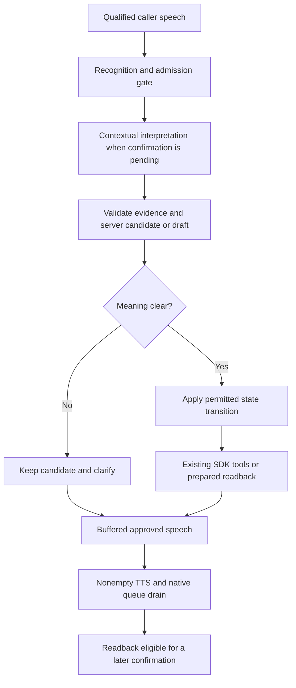

# Assamese AI Voice Agent Platform — Voice & AI Architecture

## Backend-owned collection and action review (23 October 2026)

The clinic adapter follows the state/slot pattern documented by [Dialogflow CX](https://docs.cloud.google.com/dialogflow/cx/docs/concept/page), [Rasa collection flows](https://learning.rasa.com/rasa-pro/flows/) and [Lex confirmation](https://docs.aws.amazon.com/lexv2/latest/dg/intent-confirm.html), implemented inside the existing SDK/runtime rather than by installing another framework. The Conexus service structure remains the implementation reference; typed clinic services, transaction hooks and the current executor remain the only business-operation path.

The existing server-derived goal owns name, age, phone and ready-for-review prompts. SDK interpretation still extracts exact source evidence and semantic corrections, but its free-form reply cannot replace those collection questions with requests for already-filled fields or an unsupported action confirmation. A first age question is natural; repeated/disputed age capture can request digits. Scheduling answers and public read results retain their existing contextual interpretation and factual guards. Assistant text mentioning an already captured name/age cannot move last-question metadata back to that field. Verified context includes the derived dialogue phase. This is a workflow boundary, not a growing set of phrase-specific prohibitions.

Unclear speech alone does not invalidate a captured name or age. Evidence-linked disputes and conflicting replacements still require clarification, and a failed explicit correction cannot silently authorize use of a disputed value. When confirmed phone plus current doctor/slot and complete undisputed intake are ready, the backend can plan the existing `book_appointment` prepare operation. It also plans prepare after validated intake completion/correction when ready. Preparation binds the confirmed caller through existing services and creates the complete action readback; it does not create an appointment. If readiness is reached through a literal public slot read, the existing review/book request and SDK tool path remain available. A ready-state model sentence alone never becomes a pending draft.

A later validated confirmation of a completed readback plans the existing booking/cancellation confirm tool with only the server draft ID. Unclear replies to a heard, unchanged draft receive a short confirm/change/stop question; they preserve the original completed readback but grant no authorization. Interrupted/unheard drafts require the complete readback. A real correction invalidates the old draft and creates a new one from retained fields; its readback must complete before a later confirmation can act. Speech recovery also preserves unchanged values and clears any turn authorization. Natural post-completion speech retains the existing receipt guards.

Safe Winston events identify enforced collection goals and planned reviews using IDs, field enums and revisions, without recording names, ages, phone numbers, transcripts or prompts. No HTTP/tool-input/database-schema, notification, provider or recognition-mode changes are part of this follow-up. Full-range number normalization and genuine Assamese/multilingual audio qualification remain separate work.

## Context-aware scheduling answers (23 October 2026)

Calendar literals reuse the existing multilingual cardinal normalizer after ordinal resolution, including the observed `ছাব্বিছ` spelling for 26. Known offered dates go directly to the existing slot-read tool; unknown speech still uses contextual SDK interpretation and ambiguous/unavailable choices remain unresolved. The interpreter distinguishes an answer or correction from a request to list options again. Exact current evidence cannot authorize substituting a neighboring date. A positive dates read does not prove that another date is unavailable: replies containing bounded negative availability claims use the verified options renderer even when they also mention a real offered date. These are targeted validation checks, not universal semantic verification. Hosted recognition and provider rate-limit behavior remain separate acceptance concerns.

The actual last spoken question distinguishes the doctor's name from the patient's name and preserves explicit date/time or patient-field tasks. Interpretation also runs before availability options exist: an evidence-linked `request_availability` decision routes only enabled public read tools through the existing executor. No date/slot is selected from invented options. An unclear missing name is not an existing disputed identity; first current name evidence may fill it, while changing a retained disputed value still requires an explicit correction. Multilingual age interpretation retains the conversation's reply language; bare digits do not identify the language or authorize a language switch. Interpretation diagnostics include the safe expected-field enum, never the name/age/evidence.

The clinic adapter passes scheduling answers that need semantic interpretation, including long replies and questions with imperfect STT, to its existing tool-free SDK interpreter with an explicit date/time task and returned availability. The LLM proposes a structured date/slot choice with current-utterance evidence; the server accepts only a current-doctor offered record before saving selection and planning the existing availability tool. A spoken acknowledgement alone cannot advance selection. Scheduling answers are excluded from patient-name evidence and failed scheduling interpretation does not switch the intake task to name/age. Ordinary unrelated/status questions retain model generation and existing failure recovery. Literal number validation and contextual interpretation share the existing engine, without speech-provider changes or new endpoints. Genuine speech recognition and semantic accuracy still require live qualification.

## Completed-action conversation (22 October 2026)

After a committed clinic action, current-caller verified context explicitly describes a completed phase, no next intake field and no pending finished draft. Conditional completion guidance leaves pre-booking context budgets unchanged. Natural model follow-ups and goodbye wording are retained; bounded receipt checks replace contradictory status, renewed booking confirmation or incorrect numeric receipt details. Completed-state fallbacks never reuse “not booked yet” intake guidance. A pending new cancellation takes precedence and retains its independent authorization. Caller boundaries still exclude earlier callers' outcomes, and speech never triggers automatic disconnect or mutation replay. These checks are targeted safeguards, not a semantic proof of all model sentences.

## Intake evidence and recognition diagnostics (22 October 2026)

Age interpretation can map a numeral-script-only quote back to its exact original source span; it cannot change words, names, spacing or spelling, or select part of a larger numeral. Unchanged echoes of already trusted fields are KEEP operations, with disputed-state rules retained. Explicit age introductions feed the existing whole-number hint. Evidence rejection logs identify the field without its content. VAD speech events include operational audio ranges for comparison with rejected recognition timestamps; admission thresholds and action authorization are unchanged. Missing live recognition remains an unverified provider/audio issue, separate from the corrected intake evidence boundary.

## Assamese doctor-selection correction (22 October 2026)

Named-doctor planning separates surrounding Assamese request verbs from the supplied name. The existing reviewed-name service recognizes exact `ক`/`ৰ` case suffixes without fuzzy spelling or transliteration. Patient introductions and answers to approved intake questions bypass the bare-doctor-answer shortcut. Failed/inactive doctor reads render verified negative results; alternatives cannot authorize selection. Successful doctor-read replies advance to date selection independently of question punctuation. The SDK/executor, database services, confirmations and mutation contracts remain unchanged.

## Local multilingual comparison (23 October 2026)

At the user's request, the local backend `.env` now selects `DEEPGRAM_MODEL=nova-3` and `DEEPGRAM_LANGUAGE=multi` for a fresh-call comparison. The shipped default remains `as`. The worker previously immediately overrode the configured baseline with the saved reply language; it now retains `multi` for ordinary listening, uses `en-IN` for phone dictation, and uses the trusted conversation language for pending phone/action confirmations. Completed confirmations return to the configured conversation baseline. Recognition mode does not change the agent's saved reply/TTS language. Initialization logs explicitly identify the experiment's Assamese-support limitation. Restart the worker to load the setting; revert with `DEEPGRAM_LANGUAGE=as` and restart.

Deepgram's current [Nova-3 multilingual language list](https://developers.deepgram.com/docs/nova-3-language-prompting) includes Hindi and English but omits Assamese, which remains listed as a [monolingual option](https://developers.deepgram.com/docs/models-languages-overview). Its [numeral formatting list](https://developers.deepgram.com/docs/numerals) also does not establish Assamese numeric conversion support. An accepted API connection is not proof of recognition accuracy. No hosted inference or real-speech benchmark was run for this comparison; Assamese microphone acceptance is required before adoption.

For general numeric understanding, the recommended next work is complete reviewed multilingual number vocabulary/composition coverage through the existing shared normalizer, contextual SDK interpretation for unsupported expressions, original evidence and unit validation, and clarification/readback on ambiguity or disagreement. A general number is interpreted before applying age/calendar/time constraints; availability must not coerce a spoken date to a neighboring available one. This is a proposed follow-up, not an implemented full-range numeral solution. Existing [Indic ITN work](https://open-speech-ekstep.github.io/inverse_text_normalization/) supports Assamese and provides a grammar/reference candidate to benchmark, without committing the live runtime to a new Python service. Hosted-model structured output guarantees shape, not meaning; benchmark extraction separately from STT using both known transcripts and held-out real recordings.

## Local acceptance baseline (22 October 2026)

The local recognition experiment was restored to Nova-3 `as` for fresh Assamese acceptance; English digit collection and trusted-language critical confirmations remain unchanged. Groq GPT-OSS-120B and the existing TTS adapters are retained. A registered worker and successful Assamese voice-catalog lookup establish readiness only, not hosted conversation quality, provider approval or audible latency. Frontend generation timing explicitly excludes listening and playback. Real microphone/provider evaluation remains required for Phase 17 completion.

## Phase 16 staff rescheduling compatibility (2026-10-21)

The clinic backend supports authenticated staff rescheduling, not a new voice tool. Voice bookings use persistent doctor/date token counters. Actual upcoming reads include a version; new voice bookings retain version 1. Cancellation binds the spoken appointment version/date/time in trusted service context and rechecks after locking. A database-backed SDK test verifies that an old confirmation cannot cancel an appointment staff have moved. Tool inputs, playback eligibility and patient knowledge checks remain authoritative. Phase 17 microphone/provider acceptance remains pending. See PHASE_16_BACKEND_ACCEPTANCE.md for migration/rollout requirements.

## Phase 17 confirmed-phone and reasoning-output recovery (2026-10-17)

The 20:17 experiment's logs show valid phone confirmation followed by resolver input rejection and a 384-token `length` reply. The resolver is now a strict empty-input tool over retained server phone state. A newly validated phone confirmation plans that enabled resolver through the existing SDK/executor; it does not ask the model to reproduce the digits. Already bound callers do not advertise the redundant resolver on later ordinary turns. Confirmed phone status and the next missing field are supplied as verified facts, and a bounded inconsistent-phone-question guard prevents re-entry into collection. Clear complete number corrections retain fresh playback/confirmation requirements. This does not authorize a booking.

Agent instructions are rebuilt by the SDK callback before each model call so business behavior can expose post-tool facts. No clinic branch is added to the engine. Providers may expose `getMaxCompletionTokens`; the Groq GPT-OSS implementations use a 1,536-token minimum covering hidden reasoning and final output. The same value reaches context fitting and the wire. Short spoken replies, hard request-byte limits, SDK turns, tool limits and deadlines remain unchanged. Nonempty length-truncated text and length-truncated structured output fail as `incomplete_output` without re-executing tools. Entirely empty text keeps its existing pre-tool recovery budget.

The worker now passes the trusted session reply language for pending phone/action confirmations and digit-mode recognition replay. `setInputMode` can replace a conversation recognizer when only that language changes, then restore the configured baseline when confirmation ends. Under the local experiment this yields `multi → en-IN → as → multi`. This preserves English dictation and the user's normal `multi` experiment while avoiding its unsupported Assamese set specifically during confirmation. It is not unrestricted language detection and does not establish Assamese quality for normal `multi` turns. Existing VAD gates, cancellation and stale-stream suppression remain authoritative.

## Phase 17 local model/language experiment (2026-10-17)

At the user's request, the local development environment selects Groq `openai/gpt-oss-120b` and Deepgram Nova-3 `multi`. This changes provider configuration, not benchmarked deployment defaults. The Groq adapter reports its actual configured model and uses GPT-OSS-specific `reasoning_effort: low` / `include_reasoning: false`; Qwen retains `none` / `hidden`. The later recovery follow-up above adds completion headroom and language-specific critical confirmation. The same provider settings apply to streaming dialogue and non-streaming structured interpretation. No reasoning text is spoken or logged.

Normal recognition uses the configured `multi` baseline; phone digits temporarily use `en-IN` and critical confirmations use the trusted reply language. Reply language remains independently Assamese. Deepgram lists English/Hindi in `multi` but not Assamese, so the normal recognition experiment may reduce Assamese accuracy. Original `as` recognition and Qwen defaults remain available for rollback. See `CLINIC_VOICE_TOOLS.md` for restart, comparison and rollback instructions. No live provider quality claim or Phase 17 completion follows from offline request/SDK tests.

## Phase 17 multilingual age and time expressions (2026-10-17)

**Reason:** the 18:45 call retained the name but rejected `টুৱেণ্টি8` with `age_mismatch`. Validation compared its trailing literal `8` with the whole proposed age, instead of interpreting the complete expression. Short time replies also returned `request_help`; the deterministic clock parser recognized `বজাত` but missed `বজা` and bare phonetic/word-based clock answers.

`clinic/voice/spoken-numbers.ts` now supplies bounded cardinal parsing across English, Hindi, Assamese, familiar phonetic forms and mixed digits/scripts. It reuses the existing telephone normalizer's single-digit vocabulary, without telephone length/multiplier semantics. Age validation checks a recognized **whole** expression, so `twenty8`/`টুৱেণ্টি8` can agree with 28 while a proposed 29 is rejected. Existing exact evidence, integer 0–120 range, contradictory-literal/decimal rejection and unconfirmed-candidate semantics remain. Unknown full-word expressions still depend on the existing model interpretation; the lexicon does not claim universal language coverage.

Age mode receives a server-derived `numberHint` only when the current whole utterance parses to an age in range. It includes the original quote/source turn, is rebuilt rather than accepting supplied hints, and tells the model to quote the complete expression. It cannot authorize any action. There is still one bounded tool-free interpretation call, not an extra translation/model pass. Age/time input language does not change the selected reply language.

The same numeric vocabulary normalizes clock words before the existing calendar planner. Clock context permits bare `nine thirty`, `नौ तीस`, `ন ত্ৰিশ`, phonetic hours, `বজা`, `बजकर`, compact AM/PM and repeated identical hour answers. Only returned concrete slots can be selected. Matching morning/evening slots require clarification; different alternatives or negated clock requests cannot silently select the first time. Unknown short choices use a time-specific SDK task with supplied slot references; they cannot modify patient fields. Ordinary replies stay model-written with verified exceptional recovery. Corrupted recognition such as `অনাইনেম` remains uncertain rather than an invented 09:00.

No STT vendor/language-mode switch, threshold change, schema/migration, endpoint or booking-service replacement was made. This fixes interpretation of usable multilingual transcripts, not a guarantee that the live recognizer accurately captures every language or accent. Hosted microphone acceptance remains separate from deterministic tests.

## Phase 17 source-selected patient names (2026-10-17)

**Reason:** the 18:27 call logs identify two separate failures. Turns 8/9 classified accepted bare-name transcripts as `request_help`, leaving `hasName: false`. Turn 10 completed generation normally but failed `name_mismatch`: the independently generated name differed from its source evidence. High STT confidence did not prevent this downstream extraction failure. Prompt-only changes had not established reliable hosted capture.

The clinic interpreter now has a separate strict **model output** schema: `name: { quote, sourceTurn } | null`. The model selects the exact name excerpt once from the current or retained pending utterance. `materializeIntakeDecision` locates it in that server-owned source and constructs the existing canonical `{ value, evidence, sourceTurn }` candidate. Only outer whitespace and terminal `?`, `？`, `!`, `।` are removed; spelling, internal punctuation, initials, case and Unicode remain unchanged. Invented quotes, unknown source turns, extra name fields and a name attached to help/unclear/other intents are rejected. The existing canonical validator remains authoritative for injected interpreters and all resulting state.

The runtime supplies a server-owned `expectedField`; name mode places a focused name-answer task before shared intake instructions. A bare personal name after the name question is an answer without a required “my name is” prefix; a question mark alone is not a reason to classify it as help. Actual help/unrelated speech remains distinct. After repeated no progress, exceptional clarification asks for slow speech or spelling. There is still one bounded tool-free SDK interpretation call, no automatic extraction retry and no conversion of confidence into a guessed name.

The STT acceptance threshold is unchanged. Scores at or above 80% already pass its confidence check when timing and qualified VAD speech overlap; confidence alone cannot admit silence or grant identity/action authorization. Name/age are candidates until the separate booking readback. Existing cancellation, source-evidence retention, caller switching, action confirmation, locks, idempotency and tenant boundaries remain unchanged. Tests use deterministic SDK providers and mocked Groq HTTP; a new hosted Assamese microphone call is still required.

## Phase 17 Assamese language and phone clarification (2026-10-17)

**Reason:** the 18:16 call began with Bengali model-written text, later mixed languages, repeated bare-name requests and full phone readbacks. The main prompt previously named the reply language only by code (`as`) and encouraged natural code-switching. The intake interpreter also used only the short code for its reply. This was insufficient guidance for two languages sharing a script; the transcript itself contained Bengali before TTS.

`engine/prompts.ts` now supplies a reusable explicit reply-language instruction: Assamese (অসমীয়া), Hindi or English. Assamese is distinguished from Bengali, with native grammar anchors; supplied names and necessary English terms remain permitted. The same language instruction reaches the tool-free clinic intake interpreter. Voice instructions request spoken details rather than typing/writing. The clinic prompt removes duplicated rules to preserve recent context within existing budgets; no budget is increased. This is model guidance, not a deterministic language detector or proof of perfect Assamese output. Live verification remains required.

Intake instructions explicitly interpret a bare personal name after a name question and do not reject it solely for a trailing STT question mark. Exact source evidence, unchanged spelling, current-turn/revision checks and unrelated-request rejection still apply. The supplied later logs establish captured name/age by turn 12 but omit the earlier failed-name turns; their exact rejection cause remains unknown.

Those logs also establish English digit recognition returning to Assamese before confirmation, completed initial phone playback, and contextual `unclear` outcomes on turns 14/15/17 without a provider rejection. The phone clarification path now asks a short localized correct-or-change question after completed playback of an unchanged candidate. It preserves the completed readback reference and leaves the number unconfirmed. Interrupting that short question does not revoke a prior completed readback. An unheard, replaced, rejected or restored candidate still requires its full fresh readback, completed playback and a later unequivocal model-interpreted confirmation. Action-draft confirmation behavior is unchanged. No ambiguous transcript authorizes booking.

## Phase 17 first-transcript and concise-speech follow-up (2026-10-17)

**Reason:** reported calls showed recovery before the first accepted hello, repeated selections, verbose speech and stalled draft preparation. The supplied log excerpts begin after the first hello, so its precise acoustic cause is not established. Code inspection reproduced a race: qualified speech could expire before Deepgram's final, after which the worker's delivered-audio boundary discarded that late final.

The existing `TurnCollector` now permits one additional 1,500 ms final-transcript grace window after its normal listening interval, requests a Deepgram `flush()`/Finalize without closing input, and delivers a late final immediately within that window. Interims cannot extend the grace indefinitely. Existing speech qualification, confidence, phone pauses, cancellation and duplicate suppression remain authoritative. This extra wait applies only when qualified speech has no final, not every ordinary turn.

The worker emits participant-targeted `voice_status: listening_ready` after both the first VAD inference and first audio frame submitted to the configured recognizer. The sandbox shows preparation until this signal. It reports local pipeline readiness, not proof that a remote STT service recognized speech. Accepted agent transcript events also establish readiness for compatibility.

Ordinary clinic guidance uses the configured model with a one-question, at-most-two-sentence/28-word instruction and a bounded complete-sentence selector in `clinic/voice/speech-style.ts`. Critical phone/action readbacks and verified outcomes bypass this shortening. State checks reject obvious repeated requests for retained fields/doctor and unsupported explicit numeric dates. These checks are limited safeguards, not semantic proof. Exact reviewed aliases plus the Assamese possessive suffix can resolve the same doctor; spelling substitutions still require reviewed aliases or explicit caller choice.

Ready intake no longer causes another extraction call for every generic continuation. An explicit booking request with retained complete details can plan only `book_appointment` **prepare** through the existing SDK/executor; caller binding reuses `getOrCreatePatient` after phone confirmation. Actual booking still requires the completed draft playback and later affirmative turn. Intake interpretation failures now log safe categories (`invalid_evidence`, `name_mismatch`, `age_mismatch`, schema/JSON/SDK/provider/timeout), finish reason and token count when available. No patient text or model output is logged. The newer 17:49 call's old `invalid_or_failed` event does not establish the exact validation cause; the earlier 17:27 call separately confirmed HTTP 429.

## Phase 17 order-independent intake and offered-choice interpretation (2026-10-17)

**Reason:** a live call supplied name/age before slot selection, but the previous stage gate left them only in chat. Model acknowledgements and later compaction therefore disagreed with structured patient state. Clinic preparation now captures explicit intake and answers to approved intake questions independently of slot order. The existing tool-free SDK interpreter proposes exact-evidence candidates, explicit name/age disputes, short offered-date/slot selections, a next field and an ordinary model-written reply. Null means keep; disputed values are unavailable to booking until a current explicit correction. Revisions and active-turn cancellation reject stale proposals. A pending action correction invalidates its old authorization before replacement details are captured and a fresh draft is prepared.

Retained candidates, dispute status, last question and the next goal enter compact model context. Ordinary capture and follow-up share one interpretation call; real operations still run through the existing SDK/executor. Clear read requests keep the fast planner. Short unresolved date/time answers may use the interpreter with only returned options; server validation saves the actual reference before speech and cannot create availability. Generic engine/provider modules receive no clinic rules or database access.

The clinic interpreter removes optional whole history messages and oldest pending evidence from its model view above a 3,200-byte / 1,250-estimated-token soft input target; the existing provider budget enforces full-request limits. Candidate values/current utterance are never truncated. Full active state retains two unresolved source utterances, field revisions, question context and non-progress count. Repeated valid-but-empty extraction becomes observable and eventually uses a focused exceptional clarification. Availability fallback speech asks only for missing/disputed details. Ordinary model replies stay natural; exact action/phone readbacks and service outcomes remain protected. Captured facts survive interrupted speech; playback eligibility remains mandatory for action confirmation.

No STT/provider replacement is made. A transcript containing only “twenty” cannot establish 27; negation without a clear replacement must clarify. Offline semantic fixtures validate transitions, not live Assamese understanding. Live frontend acceptance remains required.

## Phase 17 offered choices, context headroom and recovery (2026-10-17)

The second live call exposed a **local** estimated-token rejection after a failed availability tool and a later **HTTP 429**, rather than another HTTP 413. Full tool schemas dominated the request and recent history had been removed. This follow-up narrows advertised/executable tools to the current clinic step, intersected with the server profile. Clear planned reads still use the same SDK/executor. Before identity confirmation only public reads and caller resolution are available; booking becomes available after confirmed phone and offered slots, while its existing patient/intake/draft checks remain authoritative. Pending action turns retain only their action tool. All prerequisites, tenant access, confirmations and request idempotency remain server-enforced.

The clinic retains a three-date offered page and resolves explicit weekday/month/day answers against those returned options, using cached localized labels and deterministic number normalization. The reported mixed-language day question now routes to dates for the selected doctor. Repeated weekdays or conflicting selections clarify; unknown expressions remain available for model reasoning from offered facts. Availability arguments can omit doctorId to use the selected server record. A supplied conflicting ID is rejected before any clinic query; absent selection requires a previously returned active candidate. Existing availability services still determine whether a time is bookable.

Context budgeting now reserves 512 estimated input tokens for a prospective tool result before a model-selected call. The immediately preceding complete exchange is retained when hard byte/token budgets permit, even if it exceeds the soft byte target. Current-run tool pairs remain intact; budgets remain finite. Clinic output allowance is 384 tokens, and ordinary speech asks for one missing field or offers at most three options. Date model pages are three entries with continuation; canonical date results remain complete. Natural weekday/date/time phrasing is accepted by bounded relevance checks; exceptional readbacks/failures remain exact. These checks are not universal semantic verification.

`lastReadFailure` and a caller-scoped completed-outcome summary remain validated facts in prompt context. A failed read preserves the doctor and can be explained naturally, with a contextual verified fallback if generation fails or restarts the menu. The summary exposes actual completed IDs/date/time/token only for the current caller boundary; internal records for previous callers remain for reconciliation. No failed generation or interrupted speech triggers another mutation. Redundant public read-event summaries are skipped in clinic sessions; the generic optional memory hook remains available. Observed low provider token quota pauses background requests via the existing shared cooldown port. Foreground calls retain normal provider admission and honest 429 recovery; estimates cannot guarantee the provider's account throughput.

The worker admits only one unusable-speech recovery prompt until accepted caller input resets it. It continues recognizing speech, publishing safe statuses and attempting the existing qualified digit replay; it does not create fake user turns or cancel listening. No-input reminders retain their separate two-prompt budget. Real Assamese recognition and hosted-provider acceptance remain manual checks. Implementation plan and acceptance script: `PHASE17_CONVERSATION_RELIABILITY.md` and `CLINIC_VOICE_TOOLS.md`.

## Phase 17 local LiveKit job startup fix (2026-10-17)

The installed LiveKit Agents SDK defaults to a 10-second `initializeProcessTimeout`. In local Windows `agent:dev`, the SDK creates a fresh `tsx` job child on demand. A measured cold import of this worker took about 9.3–9.7 seconds before its Silero VAD prewarm; the failed call reached VAD startup just as the SDK's timer expired. The error was therefore in child-process startup, before room connection, STT, clinic tools or model context.

The worker now allows 60 seconds for job-process initialization and keeps one **idle prewarmed child in dev mode**. The SDK's production idle-process count remains its default. This moves the local cold import/prewarm ahead of the first browser call and retains a finite startup failure bound; it does not change VAD thresholds, providers, the conversation engine or booking services. Offline cold import plus mocked-provider prewarm completed in about 9.5 seconds total, and backend checks pass. A fresh actual browser connection remains the live acceptance check; the user's already-running worker must be restarted to load the new options.

## Phase 17 compact model context and ordinary replies (2026-10-17)

The accepted user transcript and complete validated session history still live in the isolated active session snapshot. Before **each** SDK model request, including a request after tool execution, the engine's `callModelInputFilter` and session `ContextBudget` build a smaller model view: current utterance, at most four recent caller/reply groups with complete tool-call/result pairs, relevant validated business facts, and optional older conversational notes. Whole older groups are removed; a tool result is never left without its call. The clinic supplies a safe boundary when the active caller changes, so earlier caller context and summary do not enter the new caller's model view. The full tool result and invocation cache are retained internally for action reconciliation.

The default serialized request target is 8 KiB, its hard wire-body limit is 12 KiB, and its input estimate is 3,500 tokens, reserving room for output and safety. Trusted server profiles may configure smaller limits or a provider context window. Script-aware estimation treats non-ASCII speech text more conservatively than English; it is not a tokenizer or the provider's exact limit. The transport checks the actual serialized body before HTTP. Optional old groups/notes are removed to fit; if mandatory instructions/current request/current-run tool pairs still exceed the limit, the request fails locally with a classified processing error. Privacy-safe diagnostics report request sizes by section and estimated versus reported usage without text or payloads.

Tool definitions may supply a validated `projectOutput`. Execution, caching and active snapshots keep the canonical successful result; the SDK and replay see the recorded compact projection. Clinic read results send five doctors/dates or eight times per page, including actionable IDs, total counts and continuation offsets. Ambiguity is determined from the complete service result first. Projection failure cannot rewrite a committed booking as failed. Tool permissions, trusted context, locks, idempotency and action readbacks are unchanged.

After eight newly **completed** caller turns, idle-time, tool-free SDK summarization may condense older safe conversational notes. It has a bounded source, 384-token maximum and three-second deadline; it is cancelled on new turns, reset and close. The clinic projects only public read-event notes into this summarizer, excluding patient identifiers, raw tool payloads and confirmation authority. The summary is marked untrusted in prompts and cannot authorize tools or change validated facts. Failure keeps existing state and does not delay a foreground reply.

The clinic now retains validated caller-provided name and age candidates independently of booking preparation. A selective, tool-free structured SDK call can both interpret an intake/help/correction turn and write its ordinary follow-up; the server checks exact name/evidence, numeric age agreement and the 0–120 age range. Spoken ages without literal digits remain unconfirmed candidates. Conflicting ages stay unresolved until clarified. Normal doctor/date/time guidance is model-written from a concise goal and verified facts; multilingual relevance checks accept localized dates. Phone and action readbacks, booked tokens and confirmed outcomes remain exact. Empty, clearly conflicting or failed model output uses a verified fact-specific reply where available.

HTTP 413 is classified as a request-size failure. One materially smaller retry applies only to the **failed model request**, shares the turn's empty-output recovery budget, and keeps the lower target for that session; it never restarts an executed tool sequence. HTTP 429 uses a provider-scoped cooldown shared through injected Redis (foreground wait at most one second, background summary skipped). Authentication, network, timeout, protocol and other provider failures have distinct safe categories. If the model cannot answer after accepted STT speech, recovery says response processing failed instead of blaming the caller's pronunciation. Provider TTFT is reported only after an actual provider token. SDK tracing remains disabled.

The offline twelve-slot reconstruction peaked at 9,799 bytes versus its prior 20,928-byte reconstruction (about 53% smaller), and a 200-turn offline test stayed bounded. Neither measures the earlier live rejected payload or proves the hosted model's request ceiling. Fresh frontend microphone/hosted-provider acceptance remains outstanding; Phase 17 remains IN PROGRESS.

## Phase 17 contextual confirmations and bounded recovery (2026-10-16)

This follow-up replaces keyword-only confirmation in the **tool-backed clinic profile**. The separate development clinic demo retains its legacy interpretation. Meaning comes from a short tool-free SDK interpretation step; clinic code validates the proposed state transition and the existing executor remains the only business-action boundary.



The worker reports completed playback after `AudioSource.waitForPlayout()`, bounded by expected audio duration plus two seconds and capped at sixty seconds. This is local audio delivery, not proof the caller understood it. Old turn notifications, interruption, zero frames and errors cannot establish readback eligibility. InterruptionManager remains authoritative for cancellation and frame delivery.

English digit collection keeps a copied, in-memory thirty-second maximum buffer of 16 kHz mono PCM. Qualified but unusable speech can receive one additional recognition pass using the conversation-language settings of the existing Deepgram provider. The temporary recognizer does not replace the live stream, has a three-second deadline, flushes pending audio and uses `endInput()` after SDK startup. No buffer is persisted or logged; accepted turns, mode changes and cleanup discard it. Truncated/missing clips cannot supply a number. New speech/participant cleanup aborts replay and stale results are discarded. Different digit interpretations trigger clarification rather than choosing a number. No-speech hallucinations remain rejected without replay.

TurnCollector now distinguishes accepted input, rejected qualified speech and qualified speech with no final transcript. The latter two can trigger an assistant-only recovery turn after the existing quiet interval. After completed question playback, no-input reminders occur after eight seconds and then fifteen seconds after the first reminder's playback. Only two automatic reminders run; new speech resets the budget. Timers pause during speech, generation and playback and close with subscriptions. Recovery never fabricates user input or executes tools. STT/TTS failures emit a safe browser status; audio errors are not reported as successful speech.

Winston records operational category/duration/turn/session identifiers for interpretation, recognition recovery, playback and cancellation, without words, digits, audio or provider payloads. The exact cause of the previously reported silence remains unproven; the new events make future failures diagnosable. Deterministic SDK/WebSocket checks do not establish hosted Assamese recognition quality.


## Phase 17 doctor conversation follow-up (2026-10-16)

The clinic module now routes clear doctor-list/name/date/time requests to a server-planned first SDK function call. The reusable engine accepts optional `initialToolCall` and `allowedTools` turn options, validates them before accepting the turn, and supplies the call once through the existing Model bridge. The SDK Runner/executor remains authoritative; there is no direct service bypass, second orchestration loop or clinic logic in engine/provider modules. Planned read turns expose only their required read tool; ordinary/action turns retain the configured allowlist. Limits remain four invocations/five SDK turns. Existing calls without directives retain their behavior.

Reviewed English/Assamese doctor names and aliases resolve to existing IDs. The clinic state now records candidates, selected doctor, selected bookable date/slot references, pending clock ambiguity and latest verified read result. Successful selection updates diagnostics immediately and survives interrupted speech; changing doctors clears incompatible selections and uncommitted booking drafts. Dates/times remain ISO date/24-hour time with clinic timezone and English weekdays; localized labels are derived, not duplicate database facts. Supported relative-day expressions use the injected/server clock in clinic timezone. Ambiguous AM/PM requests select only if one returned slot fits, otherwise clarify. Unknown expressions remain unresolved.

Caller context and server-verified facts are separate prompt sections. A business-neutral `respond` hook supplements the existing string policy and returns text plus `model | verified_tool | recovery` provenance. Clinic read renderers supply actual candidates/dates/times on empty, failed or irrelevant generation; usable natural replies are retained. Relevance checks are bounded, not a semantic proof. Verified booking/cancellation acknowledgements retain priority, and cancelled/superseded turns cannot emit stale fallback speech. Active snapshots remain non-resumable after process loss.

The worker transports optional selected-doctor metadata, read outcome/count and reply provenance. Winston captures safe stage/category/status/finish/token/latency data without transcripts, arguments, patient information or provider bodies. External SDK tracing stays disabled. This fixes the observed successful-lookup/recovery loop; it does not establish live Assamese recognition quality. The later phone-confirmation report is addressed by the contextual confirmation/recovery follow-up above; its original silence cause and live acceptance remain unverified.

## 1. Realtime Pipeline

```text
Audio Input
   |
LiveKit
   |
Silero VAD
   |
Speech segment
   |
Deepgram Nova-3 STT
   |
Assamese/Hindi/English text
   |
Agent Engine
   |
Conversation State
   |
LLM
   |
Tool Call? ---- YES ---> Tool Executor ---> PostgreSQL/API
   |                                      |
   |<------------- Tool Result -----------|
   |
Generate final response
   |
IndicF5 TTS
   |
Audio frames
   |
LiveKit
   |
User
```

## 2. Realtime Responsibilities

LiveKit owns:
- media transport
- room/session
- participants
- realtime audio
- interruption primitives
- SIP integration

Agent code owns:
- business reasoning
- configuration
- state
- tool calls
- response policy

## 3. VAD

Initial choice:
- Silero VAD through LiveKit

VAD answers:
- did the user start speaking?
- is the user still speaking?
- has the user stopped speaking?

Initial tuning is only a starting point.

Tune against real Assamese recordings.

Typical symptoms:
- agent interrupts user -> increase end-of-speech silence
- response feels slow -> reduce silence
- first word clipped -> increase prefix padding
- background noise triggers turns -> adjust threshold/noise handling

## 4. STT

Initial:
- Deepgram Nova-3
- Assamese support

Deepgram is the initial STT provider. AI4Bharat IndicConformer remains a fallback option only if the Assamese STT benchmark shows that Deepgram is not sufficient.

Integration:

```text
LiveKit Agent
   |
Deepgram streaming STT
   |
stream/final transcript
```

The STT service must be isolated from the dashboard and ordinary API.

Benchmark:
- Assamese
- Hindi
- English
- code switching
- names
- doctor names
- locations
- dates/times
- noisy rooms
- phone-quality audio
- different accents
- fast speech

Measure:
- word accuracy
- semantic accuracy
- first-token latency
- final transcription latency
- CPU/RAM/GPU
- concurrent sessions

## 5. LLM

Initial:
- Hugging Face Inference Providers
- Qwen3.5-4B

The model must:
- understand Assamese
- understand Hindi/English
- preserve language preference
- avoid inventing appointment availability
- use tools for business facts
- ask for missing information
- confirm important actions

The LLM must NOT:
- query PostgreSQL directly
- invent doctors/rooms/slots
- claim a booking succeeded without tool confirmation
- execute arbitrary code
- change system configuration

## 6. TTS

Initial:
- AI4Bharat IndicF5

Integration:

```text
LLM text
   |
custom TTS node
   |
Python TTS service
   |
IndicF5
   |
audio
   |
LiveKit
```

Benchmark:
- Assamese pronunciation
- naturalness
- latency
- sentence chunking
- names
- numbers
- dates
- code-switched text

## 7. Barge-In

Required behavior:

```text
Agent is speaking
      |
User starts speaking
      |
VAD detects speech
      |
Stop/interrupt agent audio
      |
Capture user turn
      |
STT
      |
Agent continues
```

Never allow the agent to keep talking over the user after a confirmed interruption.

## 8. Agent State

The reusable runtime lives in `backend/src/components/agent/engine/`; LiveKit integration lives in `backend/src/agent/`. This follows the existing backend layout rather than introducing a separate service/package in Phase 14.

The engine separates session lifecycle from conversation state:

```ts
SessionContext    // organizationId, agentId, sessionId
SessionState      // active/closed, monotonic turn IDs, timestamps
ConversationState<T> // messages, toolHistory, language, repetition tracking, validated businessState
AgentConfig       // name/business, instructions, languages, greeting, model settings, recovery messages, enabledTools
```

Active state:
- Redis
- organization/session-scoped snapshots, serialized writes, refreshed 30-minute TTL
- delete on close; storage failure closes the affected session

Permanent outcome:
- PostgreSQL
- permanent call/outcome persistence is deferred to later phases

The engine uses the installed `@openai/agents` `Agent` and `Runner` with an SDK `Model` adapter over the existing `LLMProvider`. Vendor selection and credentials remain outside the core. SDK tracing/export processors are disabled; Winston receives operational IDs, events and timing, without transcripts or provider payloads.

`AgentSession<T>` provides `ready`, `processUserUtterance`, `chat`, immutable state/history/snapshot access, `reset`, `notifyInterruption` and idempotent `close`. Generation is buffered before approved response text and replay chunks are returned. Both entry points use the same prompt/response policy. Provider errors and empty output use localized recovery. Phase 15 adds optional injected tools; the default empty allowlist preserves existing voice sessions and rejects unsolicited calls.

New turns supersede in-flight generation. Cancellation retains the accepted user message and discards late output without recovery speech. Interrupted playback is marked in history and excluded from later model context. Reset preserves monotonic IDs. The existing `InterruptionManager` remains the authority for audio abort signals, native queue clearing and frame delivery.

Business behavior is injected through `BusinessBehavior<T>` with a Zod state schema, an initial state, an update operation, prompt context and optional response guidance. The clinic intake demo is isolated under `business/clinic-demo.ts`; phone normalization remains a reused domain utility. It captures requested details without inventing dates/availability or confirming bookings. The mock provider is business-neutral. A hotel test configuration exercises the same engine without clinic code branches.

The response guidance hook also receives the previous approved reply. The optional `onResponse` hook returns validated business state after the approved reply; this records the question actually asked, including model-generated intake questions. Clinic intake uses that context to interpret short doctor/name answers, accepts spoken title spellings including `ডঃ`, and clarifies unrecognized details without repeating the exact same prompt. Worker diagnostics report only whether each detail is present and whether the reply repeated, without logging the detail values.

Empty or formatting-only model output retries once only when no tool invocation has been attempted, respecting cancellation and preserving a single accepted user/history turn. Recovery policy applies after business guidance and removes internal reasoning text before speech. `fallbackReason` distinguishes empty output, provider failure and repeated-response replacement; empty-output events include provider completion reason/token counts when available. No sensitive provider payload is logged. The sandbox Safe Guard tooltip explains the category.

STT final-transcript callbacks dispatch without blocking the speech-event consumer on LLM generation or TTS playback. A finalized Deepgram segment is not a completed caller turn. `backend/src/agent/turn-collector.ts` groups final segments, preserves repeated words/digits, and waits for a quiet interval: 1,200 ms normally and 3,000 ms when the sandbox adapter is collecting a phone number. VAD speech start cancels the timer and immediately interrupts ongoing generation/playback through `InterruptionManager`; VAD speech end, interim results and later final segments refresh the listening window. The interval starts after the latest such activity, so VAD/STT latency is additional. Pending fragments/timers are discarded on participant departure, room disconnect and shutdown. Existing TTFT/total generation metrics exclude this listening interval.

**Recognition admission follow-up (2026-10-16):** the worker now checks each final segment against qualified Silero speech before assembling the turn sent to the engine. Confidence below 0.30 is rejected regardless of text length; missing/non-finite confidence is not treated as perfect recognition. Word timestamps must overlap a detected speech interval, allowing a 300 ms reader/prefix alignment margin. The speech interval excludes VAD's trailing silence and retains at most 128 intervals. Validation occurs after the listening interval to accommodate asynchronous VAD; rejected text never enters model context as caller speech. Qualified speech with rejected/missing recognition now uses the bounded recovery path above; unqualified silence produces no reply. Deepgram word timing is translated to the track's continuous audio timeline across English-digit/conversation recognizer replacements. Missing/invalid timing fails closed. Winston records `stt_low_confidence_filtered` / `stt_unvoiced_filtered`, confidence, timing and rejection reason without text. VAD remains authoritative for immediate barge-in; recognition is not muted during assistant speech. This gate rejects unsupported transcripts, but does not identify speakers or prove that recognized words are accurate inside an actual speech interval.

Phone drafts and confirmation belong to the isolated clinic demo, not the engine or collector. Valid digit fragments are retained across turns, including a multiplier split from its following digit. Unknown tokens, extra digits and incomplete numbers trigger clarification without guessed digits. Full valid retries replace a draft; callers can explicitly restart it. The completed number is read back and requires an affirmative answer; a negative answer clears it. Full doctor names and explicitly supplied morning/clock information are preserved. This does not validate a doctor's identity, improve recognition accuracy, or book an appointment.

The phone normalizer splits joined word/numeral boundaries (for example `ছেভেন00`) while retaining unknown words as ambiguous. A multiplier applied to an entire numeric run requires clarification. An incomplete transcript does not establish where a digit was lost: prompts allow continuation if the caller has not finished, or a complete digit-by-digit retry if they have. Repeated unclear-number prompts vary their guidance to avoid generic repetition recovery. Guided group collection and typed/DTMF fallback are recommendations for further work, not implemented features.

The clinic sandbox requests English digit dictation. Before speaking that prompt, the worker sets the participant's STT input mode to `english-digits`: Deepgram Nova-3 `language=en-IN`, `numerals=true`, `smartFormat=false`, `punctuate=false`. On entering confirmation it restores the configured conversation recognition settings, including Assamese by default. `attachSTTToAudio` owns one continuous audio reader and replaces only the recognizer; incoming frames queue in the replacement during connection setup. Superseded recognizers cannot emit stale transcripts or close the current audio reader. Close/abort cancels the reader, closes the recognizer and removes the abort listener. The shared prewarmed STT provider is never reconfigured. Winston logs `stt_input_mode_changed` with mode/language and operational identifiers only.

The tool-backed clinic adapter also recognizes an approved phone-number question generated by the model before the resolver is called. Such a question enables digit listening without confirming a phone or granting patient access. Subsequent resolver calls preserve an already prepared partial-digit clarification; they do not replace it with the initial phone prompt. This repairs a live-integration gap while leaving caller resolution and business actions behind validated tools.

The generic engine's validated `TurnOptions.responseLanguage` can preserve the conversational reply language independently of specialized input recognition. The sandbox adapter uses it during phone capture, so English digits do not switch an Assamese conversation's replies to English. The development demo phone confirmation accepts affirmative words, checks negation first and leaves unclear/questioning answers unconfirmed. The tool-backed clinic profile now uses contextual SDK interpretation instead. An unclear answer gets a short yes/no clarification rather than repeated full readback. This confirms only the collected number, never a booking. Stream behavior is tested with deterministic streams and the real Deepgram SDK against a local WebSocket server; microphone recognition accuracy still needs live validation.

Groq's Qwen 3 adapter explicitly requests non-reasoning/hidden output for voice, uses the documented completion-token field, and preserves completion metadata. Generic live text probes validate that adapter; they do not replace live browser/audio testing.

The LiveKit worker validates participant organization metadata and creates one engine session per participant. STT confidence and acoustic echo filters, speech providers and diagnostic DataChannel fields remain compatible. Participant departure, room disconnect and job shutdown close subscriptions and sessions.

Phase 14 limitations: snapshots are active state, not crash-resumable sessions; greetings remain transport-managed; voice quality and cloud inference need their existing live validation procedures. Generic factuality rules are prompt constraints, not a semantic proof of model claims. The clinic demo uses deterministic intake responses; real business actions require the typed tool system in subsequent phases.

## 9. Tool Architecture

Phase 15 implements reusable typed functions in `backend/src/components/agent/tools/`. Only explicitly enabled tools are adapted into SDK function tools. The engine injects server-owned context into the SDK run; it never obtains tenant identity from model arguments. Tool definitions validate both input and successful output and return the standard success/error envelope.

```text
Provider function call -> SDK Runner -> ToolExecutor -> validated handler
                       <- SDK Runner <- ToolResult  <- output validation
Final assistant reply -> shared response policy -> buffered speech
```

The SDK owns the loop (maximum five model turns); the executor serializes handlers with four attempts and a five-second timeout by default. Matching invocation IDs reuse their cached result within the run, conflicting reuse is rejected, and executed sequences are never restarted to recover an empty spoken reply. Cancellation propagates into handlers and discards late results. A timeout stops further handlers in that run. Validated call/result pairs are retained in active session state and replayed next turn; interrupted and superseded pairs are excluded.

Groq and Hugging Face support fragmented streaming function calls, multiple correlated results and equivalent non-streaming responses through `providers/llm/chat-protocol.ts`. SDK 0.8 pre-parses malformed JSON before tool invocation; the adapter routes syntax errors through a reserved, always-invalid argument so our executor returns a safe validation envelope instead of SDK exception text. SDK tracing and model/tool payload logging are disabled. Winston records operational identifiers, tool names, duration and error codes.

The harmless `get_server_time` tool has strict empty input and returns a validated UTC timestamp from an injected clock. Run `npm run smoke:tools` in `backend/` for an offline demonstration using the real SDK with a deterministic provider. The live clinic demo still has an empty allowlist; its listening, recognition and confirmation backlog is unchanged. No database/network/business tool or persisted call record was added. This phase validates mocked vendor protocols; cloud tool-calling behavior still needs later live qualification.

Future business-tool example (not implemented in Phase 15):

```ts
bookAppointment({
  doctorId,
  patientName,
  patientPhone,
  slotId,
})
```

Execution:

```text
LLM
 -> validate tool arguments with Zod
 -> execute Node service
 -> DB transaction
 -> result
 -> LLM
```

Critical booking operations must be transactional and protected against double booking.

### Phase 16 clinic service boundary (internal adoption only)

The clinic implementation now lives in `backend/src/components/clinic/`, adapted from the existing WhatsApp appointment platform and backed by the voice repository's independent PostgreSQL database. It exposes strict, scoped service contracts for doctor/slot lookup, patient creation, booking and cancellation, plus operator scheduling/date-blocking operations. Source provenance and contracts are documented in `CLINIC_SERVICE_ADOPTION.md` and `DATA_MODEL_AND_API_CONTRACT.md`.

No clinic tools or worker integration are enabled in this milestone. The browser conversation continues using the isolated intake demo and cannot prove database booking. Future Phase 17 tools must bind trusted organization context and verified patient scope, then call these services through the Phase 15 executor. The LLM, model providers and reusable engine continue to have no PostgreSQL access.

Services preserve concrete slot capacity (default 30), doctor/day tokens and transaction/advisory/row locks. They derive appointment date/time from the database, validate caller-supplied patient details, and expose successful booking separately from reminder/alert scheduling outcomes. Missing/failed notification delivery configuration never means an appointment failed or a message was sent. Durable business idempotency and patient-ownership verification must be settled before live callers can trigger actions. Existing speech/intake inconsistencies remain in the live voice backlog.

### Phase 17 — current clinic voice tools

`components/clinic/voice/` supplies all eight tools described in `CLINIC_VOICE_TOOLS.md`, plus the clinic SDK configuration/session adapter. The worker no longer assumes every participant is a clinic intake demo: a one-use Redis binding selects clinic, explicit development demo, or generic conversation. Only server-configured enabled tools reach the SDK. Unconfigured default sessions have no actions; explicit unconfigured agents are rejected. Model/provider selection and the existing audio pipeline remain unchanged.

The clinic adapter collects phone fragments with the existing deterministic normalizer and uses the contextual SDK interpreter for phone and action confirmation, as described above. English digit dictation retains the conversational reply language and existing dictation pause. It keeps patient grants and server-owned booking/cancellation drafts outside the engine. A later conservative affirmative turn authorizes the draft; corrections/negation/unclear replies do not. Interruption invalidates a pending readback's confirmation eligibility.

The engine adds optional domain-neutral turn/interruption/reset/close callbacks and an opt-in repeated-response policy. Verified readbacks and action acknowledgements can repeat without generic repetition recovery replacing them. Its SDK loop still permits four tool attempts and five model turns, buffers approved speech, and excludes interrupted/superseded pairs from replay.

Tools call existing clinic services for actual doctors, dates, times, booking, tokens, upcoming appointments and cancellation. Existing-appointment access requires confirmed phone plus token/date knowledge, with matched records filtered before model exposure. A failed/changed slot returns freshly queried alternatives and requires a new choice. Rescheduling is absent because the source has no safe service.

Post-commit interruption/timeout retains a durable booking request identity and cached result; retrying that identity does not create another appointment or schedule another pair of jobs. Aborting generation is not rollback. Success speech is rendered from verified service results, including empty-model-output recovery. Prompt rules plus targeted false-acknowledgement filtering do not constitute a semantic proof of arbitrary model-generated dialogue; real hosted-model/microphone qualification remains pending.

Each browser token has a separate caller room. The sandbox exposes safe tool-name/status/error/outcome summaries alongside existing transcript and latency diagnostics. Patient accounts are unnecessary; staff dashboard access remains authenticated. Notification ports preserve existing rules, while delivery remains unconfigured. No paid calls or real messages are needed by the automated acceptance tests.

## 10. Human Handoff

The agent must be able to call:

```text
transfer_to_human()
```

Before transfer:
- preserve call context
- store conversation state
- store reason
- identify organization
- mark call as transferred

## 11. Failure Handling

If STT fails:
- ask user to repeat
- retry when safe
- escalate after repeated failures

If LLM fails:
- use fallback response
- retry once where safe
- transfer when necessary

If TTS fails:
- retry
- if still failing, terminate/transfer according to policy

If booking tool fails:
- never tell the user it succeeded
- explain that booking could not be confirmed
- offer retry/human transfer

## 12. Provider Abstraction

Do not hard-wire business logic to a specific model vendor.

```text
STTProvider
LLMProvider
TTSProvider
```

Initial implementation:

```text
Deepgram Nova-3
Qwen3.5-4B via Hugging Face Inference Providers
IndicF5
```

The LLM integration must use the provider abstraction. Hugging Face provides an OpenAI-compatible chat-completions endpoint, so the Agent Engine can later switch to a self-hosted vLLM endpoint without changing business tools or conversation logic.

Future providers can be added behind the same interfaces.

## 13. LiveKit Custom Nodes

LiveKit Agents supports custom STT/LLM/TTS pipeline nodes, making it possible to connect self-hosted AI4Bharat services rather than requiring an official provider plugin.

Reference:
https://docs.livekit.io/agents/logic/nodes/

## 14. Development Rule

Do not begin PSTN integration before the browser voice loop works reliably.

Do not begin production scaling before measuring:
- audio quality
- STT latency
- TTS latency
- LLM latency
- total turn latency
- concurrent calls
